# Overview page and pages tour

This page describes every console page of the two target types, IBM Db2 Database and IBM Db2 Instance: the question each page answers, its regions and the metric groups behind them, and how the pages read their data. Read it when a page shows something you want to understand, or nothing at all.

**Where to find it:** open a target from **Targets → All Targets**; its Overview page opens, and every other page is in the navigation down the left of the page and on the target menu.

**In this page:** [5.1 IBM Db2 Database pages](#51-ibm-db2-database-pages) · [5.2 IBM Db2 Instance pages](#52-ibm-db2-instance-pages) · [5.3 Time windows, auto-refresh and live reads](#53-time-windows-auto-refresh-and-live-reads)

## 5.1 IBM Db2 Database pages

An IBM Db2 Database target has seventeen pages. **Overview** is the default page. Every other page is one click away in the navigation down the left of each page, grouped as below, and the same pages are listed, in the same groups and order, on the **IBM Db2 Database** target menu.

| Group | Pages |
|---|---|
| (none) | Overview |
| Workload | Performance, Memory & Sorts, SQL, Sessions, Locks, Waits, Members (partitioned and pureScale databases only) |
| Storage and Logs | Storage, Tables, Indexes, Transaction Log |
| Protection | Backup, High Availability |
| (none) | Configuration, Monitoring Readiness, License Info |

Every page is laid out the same way: the page title, one line that says what question the page answers, a toolbar (a time window, **Auto-refresh**, or the page's one action), a row of KPI tiles, then the regions. The KPI row is always the newest stored collection, whatever the time window says. A tile with no value yet reads **Pending** with the reason under it, and a tile that opens another page does so on a click, or on Enter or Space. A page with three or more regions lists them under **On this page** in the left navigation.

Nothing on a page writes to the database. Three buttons submit a job, each after a Yes/No confirmation: **Kill** on Sessions and on Locks, and **Back Up Database** on Backup ([Jobs](jobs-and-metric-extensions.md)). When the plug-in licence is not Active, or expires within 30 days, every page shows one banner saying so.

Each page below says what question it answers, lists its regions and the metric groups behind them, and says what it shows when there is nothing to show. [Time windows, auto-refresh and live reads](#53-time-windows-auto-refresh-and-live-reads) describes the time windows, auto-refresh and the cost of a live read. The [Metrics reference](metrics-reference.md) describes the metric groups column by column.

#### Overview
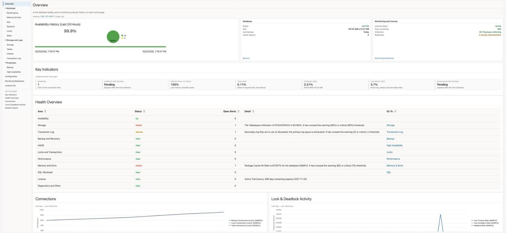

*Is this database healthy, and is monitoring working?* The default page for an IBM Db2 Database target, and the one to open first. Each card and tile links to the page with the detail.

| Name | Description |
|---|---|
| Instance | A line under the page hint naming the IBM Db2 Instance target the database runs on, with its status, when such a target exists ([Instance targets](targets-and-properties.md#instance-targets)). |
| Availability History | Enterprise Manager's own Up/Down record for the last 24 hours. |
| Database | Status (ACTIVE in green, any other state amber), the HADR role and state on an HADR database, size used against capacity, the last backup (**Never** in amber) and the number of invalid objects. Links to **Backup**. |
| Monitoring and License | The licence status and days remaining, **Collection** (*All N groups collecting*, or how many groups are failing, in amber), and **Readiness**: *All checks pass*, *1 check needs attention* or *N checks need attention* (red when a check is not functional, amber otherwise), from the hourly `readiness_summary` ([readiness_summary](metrics-reference.md#readiness-summary); *Collected hourly; none yet* until its first collection). Links to **Monitoring Readiness**. |
| Key Indicators | Seven tiles: **Sessions** (connected, and the share of the connection limit), **Commits per second** (with SQL statements per second), **Buffer pool hit ratio**, **Lock wait** (share of request time), **Storage used**, **Log space used** and **Deadlocks per second**. Each opens its page: Sessions, Performance, Locks, Storage or Transaction Log. |
| Health Overview | One row per area (Availability, Storage, Transaction Log, Backup and Recovery, HADR, Locks and Transactions, Performance, Memory and Sorts, SQL Workload, Licence, Diagnostics and Other) with Enterprise Manager's current verdict, the number of open alerts, the worst alert's message, and a **Go To** link to the page that shows the metric behind it. The verdicts come from Enterprise Manager's current alerts and availability, so a threshold you tune changes the overview too. |
| Connections | Remote, local and total application connections over the last day. |
| Lock & Deadlock Activity | Lock-timeout, lock-escalation and deadlock rates over the last day. |
| Incidents and Problems | Enterprise Manager's incident region for the target. |
| Related Targets | The targets Enterprise Manager associates with this database, with their type and status: the Db2 server and the IBM Db2 Instance it runs on, its HADR standby (or, on a standby, its primary), the monitoring agent, and the agent's host ([Associations](targets-and-properties.md#associations)). |

Source: `DB_Monitoring`, `DetailedResponse`, `Db_Perf`, `Wait_Time`, `Log_Storage`, `HADR_Status`, `DB_Backup`, `Invalid_Objects`, `Appl_Connection`, `License`, `CollectorStatus`, `readiness_summary`, and Enterprise Manager's alerts and associations.

Everything on the page is stored data: the cards and tiles are re-read from the repository every 60 seconds and the two charts every 5 minutes, and opening the page runs no collection on the agent, the readiness probe included. The charts say *Nothing was collected in the last day* until the first collections arrive.

#### Performance
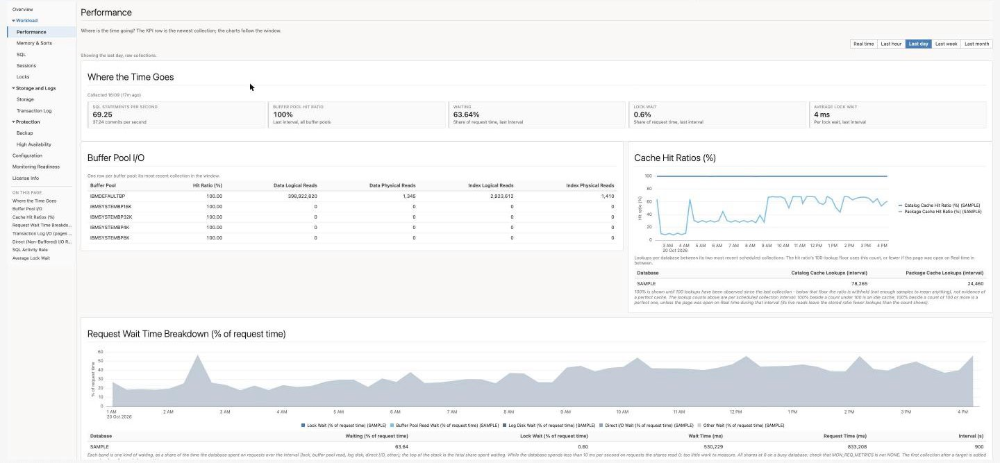

*Where is the time going?* The page a buffer-pool, cache or wait-time alert lands on. The KPI row is the newest collection; the charts and tables follow the **Time window** (Real time, Last hour, Last day by default, Last week, Last month).

| Name | Description |
|---|---|
| Where the Time Goes | **SQL statements per second** (with commits per second), **Buffer pool hit ratio**, **Waiting** and **Lock wait** (shares of request time over the last interval), and **Average lock wait** (ms per lock wait). |
| Buffer Pool I/O | One row per buffer pool: hit ratio, data and index logical and physical reads. On **Real time** the rows are live; on a past window each pool shows its most recent collection in the window. The read counts are totals since the database was activated; the hit ratio is the last interval's ([BufferPool](metrics-reference.md#bufferpool)). |
| Cache Hit Ratios (%) | Catalog and package cache hit ratios, with a table of each database's lookups between its two most recent scheduled collections. A ratio is shown as 100% until 100 lookups have been seen, so the lookup count tells an idle cache from a perfect one. The table always reads stored collections (the past day's on Real time) every 5 minutes, and shows dashes on Last week and Last month, which hold hourly averages. |
| Request Wait Time Breakdown (% of request time) | A stacked chart of where request time went over each interval: lock wait, buffer pool read, log disk, direct I/O and other waits; the table under it gives the totals behind it. On a near-idle database (under 10 ms of request time per second) the shares read 0 ([Wait_Time](metrics-reference.md#wait-time)). |
| Transaction Log I/O (pages per second) | Log pages read and written per second over each collection interval (metadata 4.9; earlier metadata drew the totals since the database was activated). |
| Direct (Non-Buffered) I/O Rate | Average direct read and write rates. |
| SQL Activity Rate | Static, dynamic, commit and rollback statement rates. |
| Average Lock Wait | Average lock-wait time per lock wait. |

Source: `DB_Monitoring`, `Db_Perf`, `Wait_Time`, `BufferPool`, `Cache`, `LogIO`, `NonBufferedIO`.

On **Real time** the charts and the buffer-pool table read live every 60 seconds, which runs those collections on the agent ([Time windows, auto-refresh and live reads](#53-time-windows-auto-refresh-and-live-reads)); a live chart starts empty and fills in while the page is open. Every other window reads stored data. An empty region says *No data*, or that nothing was collected in the window and to try a longer one.

#### Memory & Sorts
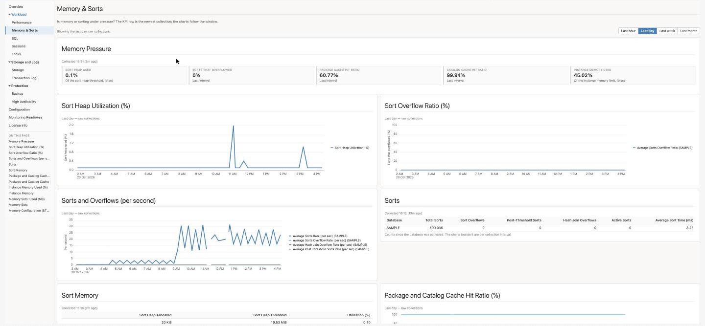

*Is memory or sorting under pressure?* The page the sort-heap, sort-overflow, cache and instance-memory alerts land on. The charts follow the **Time window** (Last hour, Last day by default, Last week, Last month); the tables show the latest stored collection, with its time.

| Name | Description |
|---|---|
| Memory Pressure | **Sort heap used** (of the sort heap threshold), **Sorts that overflowed** (last interval), **Package cache hit ratio**, **Catalog cache hit ratio**, and **Instance memory used** (of the instance memory limit). |
| Sort Heap Utilization (%), Sort Overflow Ratio (%) | Over the window ([General_Info](metrics-reference.md#general-info) and [SortHeap](metrics-reference.md#sortheap)). An interval with fewer than 20 sorts reads 0. |
| Sorts and Overflows (per second) | Sorts, sort overflows, hash-join overflows and post-threshold sorts per second. |
| Sorts | Per database, the totals since activation: sorts, overflows, post-threshold sorts, hash-join overflows, active sorts and the average sort time. |
| Sort Memory | The sort heap allocated against its threshold, and each database's shared and private sort memory high-water marks. |
| Package and Catalog Cache Hit Ratio (%) | Both ratios over the window. An interval with fewer than 100 lookups reads 100%. |
| Package and Catalog Cache | **Cache Lookups and Inserts (per second)** for both caches over the window (metadata 4.9), then per database the lookups in the last collection interval, inserts, overflows and the package cache's most-used size. A rising overflow count means the cache is too small. |
| Instance Memory Used (%), Instance Memory | Instance memory against its limit over the window, then the latest used, limit, utilization, peak since start and whether `INSTANCE_MEMORY` is `AUTOMATIC` ([Memory](metrics-reference.md#memory)). |
| Memory Sets: Used (MB), Memory Sets | One line per Db2 memory set (the five with the highest peak), then each set's scope, used, committed and size, its peak since start and its peak in the window. |
| Memory Configuration (STMM) | `SELF_TUNING_MEM`, `DATABASE_MEMORY`, `INSTANCE_MEMORY` and the parameters STMM tunes, from the daily configuration snapshot ([Configuration inventory](metrics-reference.md#configuration)). |

Source: `General_Info`, `SortHeap`, `Cache`, `MemMgr_Perf`, `Instance_Memory`, `Memory_Sets`, and the configuration snapshot.

Nothing on this page runs a collection: the sort and cache rates are computed from the change since the previous scheduled collection, and a live read would add one. Tables are re-read from the repository every 60 seconds, charts every 5 minutes.

#### SQL
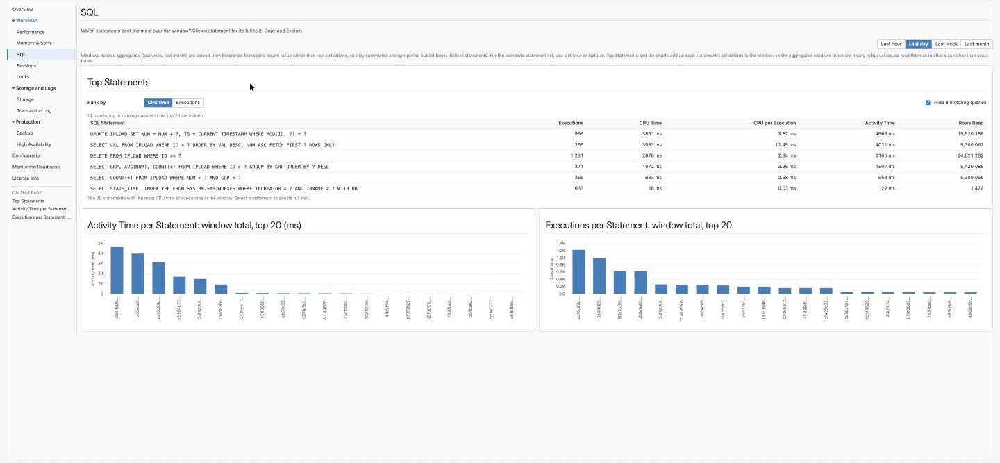

*Which statements cost the most over the window?* Click a statement for its full text, Copy and Explain. One **Time window** for the whole page: Last hour, Last day (the default), Last week or Last month. There is no Real time, because a live read would disturb the per-interval deltas. Last week and Last month are Enterprise Manager's hourly rollup: they list fewer distinct statements, and their totals are relative sizes.

| Name | Description |
|---|---|
| Top Statements | The 20 statements with the most **CPU time** or the most **Executions** in the window (the **Rank by** selector), with the SQL text, executions, CPU time, CPU per execution, activity time and rows read. **Hide monitoring queries** (on by default) hides `MON_GET_*`, catalog and administrative-view queries, and a line says how many it hid. Click a statement, or press Enter on it, to open **Statement Detail**. |
| Activity Time per Statement: window total, top 20 (ms) | The window's top 20 as bars. |
| Executions per Statement: window total, top 20 | The window's top 20 as bars. |

Source: `Query_Analytics` (per statement and interval) and `Statement_Text` (each statement's text, stored at most once a day).

- **Statements are grouped by digest** (from 24.1.2.0.0 / 13.5.3.0.0). Literal values are shown as `?`, and every run of a statement counts toward one row whatever its values: `WHERE ID > 2006` and `WHERE ID > 2007` are one statement, `WHERE ID > ?`. Comments and line breaks are ignored, and an `IN` list counts as one statement whatever its length. A window that starts before the upgrade can show a statement twice: once with the literal text it had before, and once as its digest.
- At most 200 statements new to the target are added in any 24 hours (the busiest first; the first collection after the target is added or upgraded does not count). A new statement past the limit is left out, and its work is not counted, until a place frees up within the day; the agent log says so. [Statement keys](jobs-and-metric-extensions.md#statement-keys) explains why the limit exists.
- Statement text is flattened to one line and cut at 2,000 characters. A statement that last ran before `Statement_Text` existed shows the text the older Top SQL groups stored, if any.

When every statement in the window's top 20 is a monitoring query, the table says so and tells you to clear **Hide monitoring queries**. An empty window says *No statement activity in this window*.

#### Statement Detail
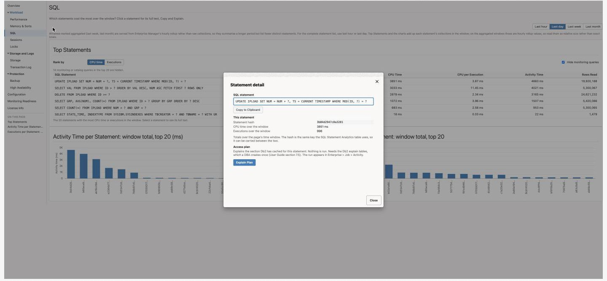

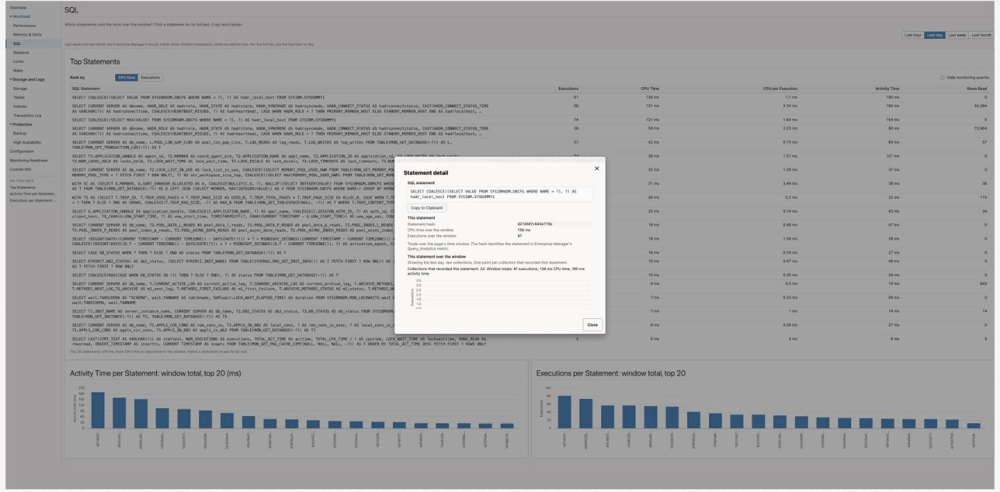

A dialog, not a page. It opens from a statement on **SQL**, from the Running SQL cell on **Sessions**, and from a statement cell in **Recent Deadlocks** or **Lock Contention** on **Locks**.

| Name | Description |
|---|---|
| SQL statement | The full text, with its line breaks. **Copy to Clipboard** copies it and reads *Copied* for a moment. If the browser does not let the console write to the clipboard (for example a console served over plain HTTP), the dialog selects the statement and tells you to press Ctrl+C (Cmd+C on a Mac). |
| This statement | The statement hash, which identifies it in the `Query_Analytics` metric, and two figures from the page that opened it: CPU time and executions over the window (from SQL), or CPU time in the unit of work and how long the statement has been running (from Sessions). The hash is the same key the SQL page's table uses, so a statement can be followed from one to the other. On Last week and Last month the two window figures add up hourly averages, so the dialog calls them a relative size. |
| This statement over the window | Two charts of the stored `Query_Analytics` rows for this statement: **Executions per collection** and **CPU and activity time per collection**, with a summary of the window's totals. From SQL they follow the page's window; from Sessions and Recent Deadlocks they cover the last day. A collection that did not record the statement is a gap: SQL Analytics keeps only the busiest statements of each collection (at most 200), so a statement that is not among them drops out for that collection. On Last week and Last month each point is an hourly average, so no window total is given. A statement in a lock wait, in Lock Contention, has no hash, so the dialog says the hash is not known instead of drawing a chart; a statement SQL Analytics has not recorded, because it was never among the busiest of a collection, says so instead of drawing a chart. |
| Access plan | **Explain Plan** submits the *IBM Db2 - Explain SQL Statement* job and shows each operator with its estimated rows, cost, I/O cost and the table or index it reads. Nothing is run. It needs the Db2 explain tables, which a DBA creates once ([Explain SQL Statement](jobs-and-metric-extensions.md#explain)); the run stays in **Enterprise → Job → Activity**. |

The history charts read stored collections only, never a live collection (nothing runs on the agent). Opened from SQL, the charts are drawn from the rows the page has already read for its window, so the dialog reads nothing more and draws as soon as it opens; if the page is still reading (the window was just changed), the dialog waits for that same read. Opened from Sessions or Recent Deadlocks, the dialog reads the last day's stored rows once: closing it stops waiting for that read, and opening it again while the read is still out waits for the same read rather than starting another. The SQL text, Copy and Explain work while it reads.

#### Sessions
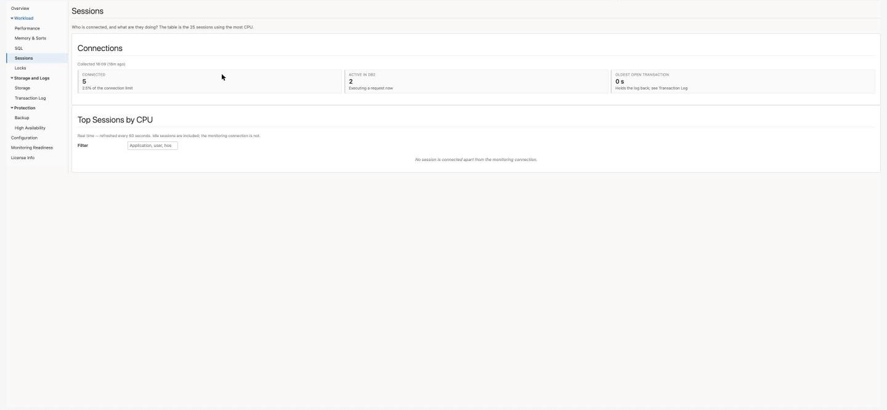
<!-- Screenshot from build 24.1.49: it predates the Auto-refresh control, and the table is empty. Screenshot pending with sessions listed. -->

*Who is connected, and what are they doing?* The 25 sessions using the most CPU in their **current unit of work**, read live at the **Auto-refresh** rate ([Time windows, auto-refresh and live reads](#53-time-windows-auto-refresh-and-live-reads)), and paused, as on Locks, while the browser tab is in the background. Idle sessions are included; the plug-in's own monitoring connection is not.

| Name | Description |
|---|---|
| Connections | **Connected** (with the share of the connection limit), **Active in Db2** (executing a request now) and **Oldest open transaction** (opens Transaction Log). These are stored totals, re-read every 60 seconds. |
| Top Sessions by CPU | Per session: application, handle, user, client host (host name, else IP address), **State**, CPU in the unit of work, how long the transaction has been open, how long the statement has been running, lock wait, locks held, the running SQL, and **Kill**. **Filter** matches the application, user, host, state or handle. Click a column header to sort; numbers start with the largest. |

Source: `Top_Sessions` (live), `DB_Monitoring` and `Oldest_Transactions` (stored).

- **State** is one of **Executing**, **Lock wait**, **Idle in transaction** (its unit of work has written log or holds locks, and the application has gone quiet, so those locks stay held), **Idle**, **Queued** (by WLM), **Disconnecting**, **Being forced off**, **Interrupted** or **Connected**. Lock wait and Idle in transaction are highlighted, because they hold up other work.
- **Running SQL** shows the session's latest statement in two lines. Click it, or press Enter on it, to open it in **Statement Detail**: the full statement, its hash (the key SQL Analytics uses for the same statement), the CPU in the unit of work, how long the statement has been running, and the statement's history over the last day. A statement SQL Analytics has not recorded, because it was never among the busiest of a collection, says so instead of drawing a chart. An idle session reads *No statement running*.
- **Kill** forces the session off with the *Kill IBM Db2 Application* job. A confirmation names the handle, the application and the user; **No** is the default and only **Yes** submits. The page then reports the submission and whether Db2 forced the application off, or shows Db2's message, for example `SQL1230W` when the session has already gone. The job needs the agent on the Db2 server and the target's preferred host credentials ([Jobs](jobs-and-metric-extensions.md)), and every kill stays in **Enterprise → Job → Activity**. The table shows the change on its next refresh (with **Auto-refresh** Off, choose a rate to see it).

An empty table says *No session is connected apart from the monitoring connection*.

#### Locks
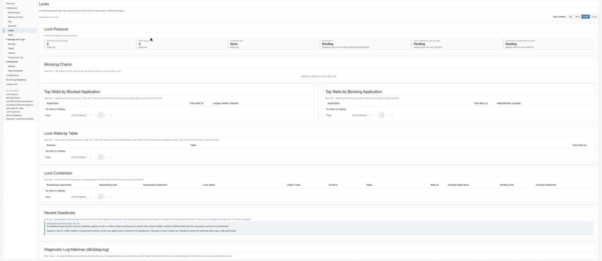

*Is anything blocked right now, and by whom?* Start with the root blocker in **Blocking Chains**. The lock regions are live, read at the **Auto-refresh** rate ([Time windows, auto-refresh and live reads](#53-time-windows-auto-refresh-and-live-reads)): they show locks being waited on now, and rows disappear as waits clear. They are not a history of past contention; for that, use the lock alerts and the *Applications Blocked on Locks* runbook ([Runbooks](alerts-and-templates.md#runbooks)). Before 24.1.2.0.0 this page was called Analysis.

| Name | Description |
|---|---|
| Lock Pressure | **Waiting applications**, **Root blockers** (amber when there is one) and **Longest wait**, right now; **Deadlocks** over the last day (*Pending* with *Deadlock capture is not set up* until a DBA sets it up); **Lock timeouts per second** and **Lock escalations per second** over the last interval. |
| Blocking Chains | Who waits on whom, as trees (metadata 4.4). Each tree starts at its **Root blocker**: the application every row under it waits on, directly or through another, and often a transaction left open. Each waiter is indented under the application it waits on (when several hold the lock, the lowest handle, with the others under **Waits On**), with its handle, user, client host, wait, how many applications wait behind it, the lock and mode, and its statement. Trees with the most total wait come first. A **Wait cycle** badge marks applications waiting on each other in a circle: a deadlock Db2's detector has not broken yet. **Kill** is on a root blocker's row only. |
| Top Waits by Blocked Application | The applications waiting longest, with the longest waiter's handle. No kill here on purpose: forcing off a waiting application leaves the lock holder in place. |
| Top Waits by Blocking Application | The applications holding locks others wait on, with their head blocker's handle. |
| Lock Waits by Table | The tables locks are being waited on right now, with the total wait on each. |
| Lock Contention | Each live lock wait: the requesting application, user and statement; the lock name and object type; the schema and table; the wait; and the holding application, user and statement. A statement cell opens **Statement Detail**; a statement in a lock wait has no hash, so the dialog says so instead of drawing a chart. |
| Recent Deadlocks | The deadlocks of the past day, one row per application involved, newest first: when, how many applications took part, each one's application, handle, user and client host, which one Db2 **Rolled back**, the lock and the statement (metadata 4.4). Click the statement, or press Enter on it, to open **Statement Detail** with the row's statement hash, so the dialog charts the statement over the last day. Stored; a deadlock can take up to 15 minutes to appear. |
| Diagnostic Log Matches (db2diag.log) | The latest db2diag.log records that matched the diagnostic patterns ([Diagnostic log monitoring](metrics-reference.md#diag-log)) in the past 7 days, newest first, up to 50: the time in your browser's time zone, the severity stated in the Db2 message identifier (C critical, E or N error, W warning, I information; *Not stated* without one), and the message. Stored; re-read every 5 minutes. |
| Job Activity, Incidents and Problems | Enterprise Manager's count of this target's job runs over the last 7 days (a kill shows up here), and the target's open incidents, including the lock alerts. |

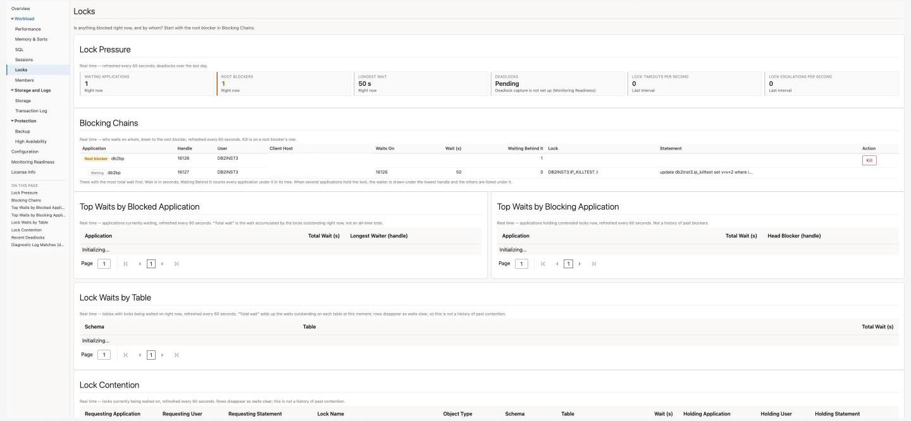

Source: `Blocking_Tree`, `Longest_Lock_Waits`, `Lock_Waits_By_Blocked_App`, `Lock_Waits_By_Blocking_App`, `Lock_Waits_By_Table` (live), `DB_Monitoring`, `Deadlocks` and `Diag_Log_File_Monitoring` (stored).

- **Kill** works as on Sessions: the confirmation names the handle, the application and the user, only **Yes** submits the *Kill IBM Db2 Application* job, and the Blocking Chains show the change on their next refresh (with **Auto-refresh** Off, choose a rate to see it). On a target whose agent is not on the Db2 server, or without preferred host credentials, the result is the job's refusal: *The kill job could not run. Check that preferred host credentials are set for this target.* ([Jobs](jobs-and-metric-extensions.md)).
- **Recent Deadlocks needs deadlock capture**, which is opt-in. Until a DBA sets up the locking event monitor ([Deadlocks](metrics-reference.md#deadlocks)), the region says *Deadlock capture is not set up* with the collector's reason; the Monitoring Readiness page prints the statements. If the last collection failed, the region says so with the error. The plug-in never creates the event monitor. Deadlock counts and the `deadlocks_rate` alert work either way.
- **Diagnostic Log Matches needs a local agent**: the agent monitoring the database must run on the Db2 server (`local` = 1, [Diagnostic log monitoring](metrics-reference.md#diag-log)). Otherwise the region says so. It never asks the agent to collect, because the log scanner remembers how far into db2diag.log it has read and a live read would take those records from the scheduled collection that raises the alert.
- An empty Blocking Chains says *Nothing is waiting on a lock right now*. The numeric columns of the lock tables (Total Wait (s), Wait (s), the handles) sort as numbers.

#### Waits
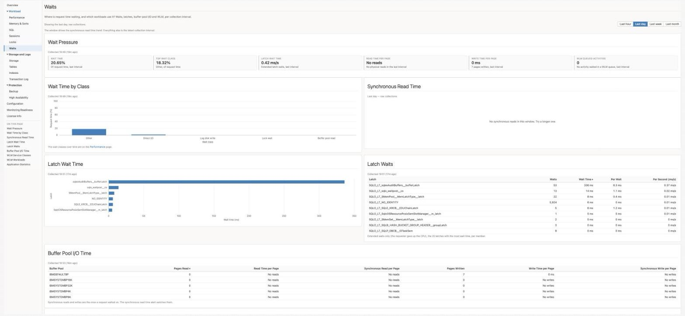

*Where is request time waiting, and which workloads use it?* Waits, latches, buffer-pool I/O and WLM, per collection interval. The **Time window** (Last hour, Last day by default, Last week, Last month) drives only the **Synchronous Read Time** trend; everything else is the latest collection interval.

| Name | Description |
|---|---|
| Wait Pressure | **Wait time** (of request time), **Top wait class**, **Latch wait time** (extended latch waits per second, summed over the 20 latches `Latch_Waits` keeps, for the whole instance; *None* when the last collection found no extended latch wait; the tooltip names the latch with the most), **Read time per page** and **Write time per page** over all buffer pools (with the pages read or written), and **WLM queued activities** (with the time they waited), all for the last interval. Each tile reads *Pending* with *Needs two collections* until two collections exist, because each is a change between them: the first collection after a deploy or a database restart only records a baseline, and the second arrives 15 minutes later. No tile is coloured: none of these groups collects a status word, and the groups' own thresholds alert on their own. |
| Wait Time by Class | Lock wait, buffer pool read, log disk write, direct I/O and other, as a share of request time. The same classes over time are on Performance. |
| Synchronous Read Time | Read time per synchronous read for the five buffer pools with the highest peak, over the window. It is worked out from the collected synchronous read time and count, so a quiet pool still draws: the `avg_sync_read_ms` column reads 0 below about one synchronous read a second, because that is the floor of its alert. A collection in which a pool did no synchronous read is a gap. |
| Latch Wait Time, Latch Waits | The ten latches with the most wait time as bars (the shared `SQLO_LT_` prefix left off the label), then the table of the 20 collected: waits, wait time, per wait and per second. Extended waits only (the requester gave up the CPU). **These are for the whole instance, not this database:** `MON_GET_EXTENDED_LATCH_WAIT` reports the instance, summed here over members, so every database on the instance shows the same latch figures. |
| Buffer Pool I/O Time | Per buffer pool: pages read, read time per page, synchronous read per page, pages written, write time per page, synchronous write per page. Synchronous read per page is the collected time over the collected count, for the same reason as the trend. |
| WLM Service Classes, WLM Workloads | Per service class and per workload: completed, aborted, rejected and queued activities, average queue time, queue time as a share of request time, and CPU share. Db2's default WLM objects are named in words (*Default user workload*). |
| Application Statistics | The 50 applications that used the most CPU in the last interval, without the monitoring connection: connections, CPU (% of one CPU), activity time, lock wait time, lock waits, rows read, commits and failed SQL per second. The top 15 show first; **Show all** lists the rest. |

Source: `Wait_Time`, `Latch_Waits`, `BufferPool_IO_Time`, `WLM_Service_Classes`, `WLM_Workloads`, `Application_Statistics`.

All stored: the page never runs a collection; the tables are re-read from the repository every 60 seconds and the trend every 5 minutes. On a pureScale database these groups are not collected, so the page stays at *Needs two collections*. Every table sorts on a column header. A collection that could not be read says *This collection could not be read from the repository. The page tries again in a minute.*

#### Members
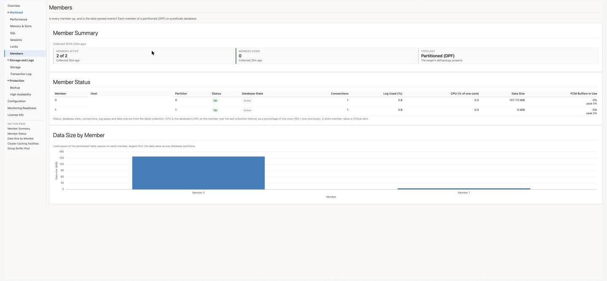
<!-- Host names redacted. No pureScale capture: the Cluster Caching Facilities and Group Buffer Pool regions have no screenshot. -->

*Is every member up, and is the data spread evenly?* For a partitioned (DPF) or pureScale database (metadata 4.6). The left navigation lists **Members** only on a target whose `dbTopology` property is DPF or PURESCALE. The target menu always has it; on a single-member database the page says *Members applies to partitioned (DPF) and pureScale databases; this database has a single member.*

| Name | Description |
|---|---|
| Member Summary | **Members active** (*N of M*), **Members down** and **Topology**. A down member is named in a critical callout. |
| Member Status | Per member: host, partition, **Up** / **Down**, the database's state on the member, its pureScale state (pureScale only), connections, log space used, CPU (% of one core over the last interval), data size and FCM buffers in use. A down member's row is highlighted. |
| Data Size by Member | One bar per member, largest first: the data skew between DPF partitions. Not shown on pureScale, whose table spaces are shared. |
| Cluster Caching Facilities, Group Buffer Pool | pureScale only: each CF's state and its group buffer pool, lock and SCA memory in use against configured, and per member the group buffer pool hit ratio and how often it was full. Implemented, not lab-certified. |

Source: `Member_Status` ([Partitioned (DPF) databases](metrics-reference.md#dpf)), `FCM_Buffers`, and on pureScale `PureScale_Members`, `PureScale_CFs` and `PureScale_GBP` ([pureScale](metrics-reference.md#purescale)). Stored; re-read every 60 seconds.

#### Storage
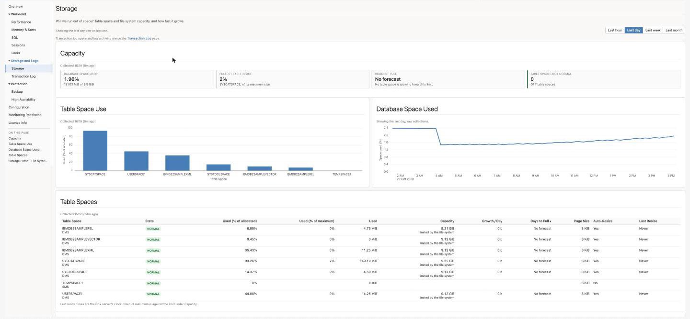

*Will we run out of space?* Table space and file system capacity, and how fast it grows. The **Time window** drives the trend. Transaction log space and log archiving are on the **Transaction Log** page, linked from the line under the hint.

| Name | Description |
|---|---|
| Capacity | **Database space used** (used of capacity), **Fullest table space** (of its maximum size), **Soonest full** (the table space that fills first at its current growth, or *No forecast*; amber under 30 days and red under 7, as Days to Full) and **Table spaces not NORMAL** (amber when any is not). |
| Table Space Use | One bar per table space: used, as a percentage of allocated. |
| Database Space Used | Database space utilization over the window. |
| Table Spaces | Per table space: state, used as a percentage of allocated and of maximum, used, capacity and what limits it (MAXSIZE, the file system, or fixed containers), growth per day, days to full, page size, auto-resize and the last resize (*Last resize failed* in red). Days to full under 30 is shown in amber and under 7 in red, the same values as the shipped Days to Full alert; hover the number for the band. **No forecast** (not growing, or no limit) is never coloured. After an agent plug-in upgrade the forecast needs history again before it projects ([Storage metrics](metrics-reference.md#storage)). |
| Storage Paths - File System Headroom | Each automatic-storage path with its storage group, state, and its file system's used, free and total space. |

Source: `DB_Monitoring`, `Tablespace_Forecast`, `Storage_Paths`. Stored.

#### Tables
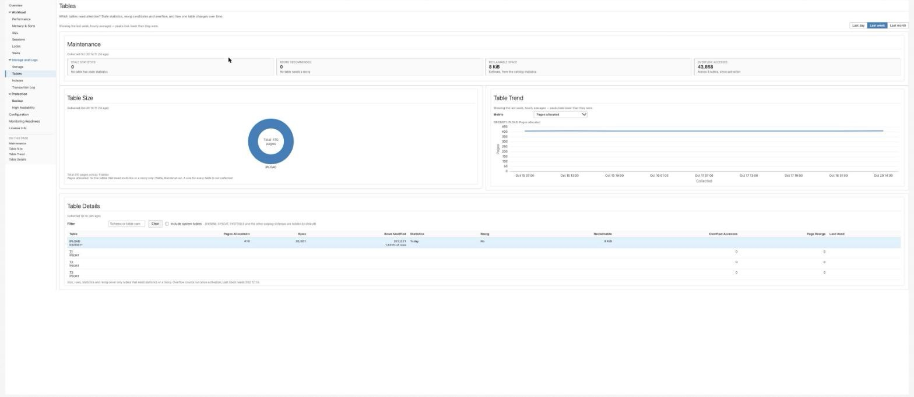

*Which tables need attention?* Stale statistics, reorg candidates and overflow, and how one table changes over time. The **Time window** (Last day, Last week by default, Last month) drives only the trend.

| Name | Description |
|---|---|
| Maintenance | **Stale statistics** (tables changed 10% or more since their statistics; a table analysed today and changed 10% or more since counts as stale) and **Reorg recommended** (overflow rows or sparse pages, by Db2's REORGCHK formulas), both counting the tables `Table_Maintenance` lists; **Reclaimable space** (REORGCHK's estimate from the catalog statistics, summed over them) and **Overflow accesses** (`Table_Overflow` summed, since activation). The caption names when each group was collected (`Table_Maintenance` every 6 hours, `Table_Overflow` every 2). A tile whose group is not collected, or failed, says *Not collected* or *Unavailable* rather than 0. |
| Table Size | The pages allocated (`fpages`) by the five largest tables and the rest as *Other*, as a donut, with the total in the centre. |
| Table Trend | The selected table over the window. **Metric** chooses pages allocated, rows at last statistics, rows modified since statistics, reclaimable space, overflow accesses, page reorganizations, or, on Db2 12.1.5 and later, hours since last access. The largest table is selected when the page opens. |
| Table Details | Every listed table: pages allocated, rows, rows modified (and as a share of rows), the age of its statistics (*Stale* badge), *Recommended* when a reorg is, reclaimable space, overflow accesses, page reorganizations and when it was last used. Largest first, 15 rows a page. **Filter** matches the schema or table name. **Include system tables** (off by default) adds the catalog tables (SYSIBM, SYSCAT, SYSTOOLS and the other Db2 schemas): `Table_Overflow` lists them, and `Table_Properties` lists the SYSTOOLS ones; `Table_Maintenance` leaves them out. The rows are merged from the three groups. Click a table's name to chart it in Table Trend. |

Source: `Table_Maintenance` (tables with stale statistics or a reorg recommendation, worst first, up to 100; the only source of size), `Table_Overflow` (the 100 tables with the most overflow accesses since activation) and `Table_Properties` (when each table was last used, Db2 12.1.5 and later). Stored.

On pureScale the page says only that these groups are not collected there. A table with no history in the window says to try a longer one. The page reads stored collections only and never runs one.

**What the page does not show.** Read these before relying on the counts or the donut:

- **The donut is not every table.** A table's size comes only from `Table_Maintenance`, which lists the tables that need statistics or a reorg, at most 100. A healthy table has no size here, and on a well-kept database the donut can be empty. A size for every table is not collected.
- **The counts stop at 100.** `Table_Maintenance` and `Table_Overflow` each keep at most 100 tables. When `Table_Maintenance` is full, its three counts read "or more" ("60 or more", even "0 or more"): it lists stale tables first, so a full list can leave reorg candidates out. The Overflow count reads "or more" when `Table_Overflow` is full.
- **Overflow follows the system-tables switch.** With **Include system tables** off, the Overflow count leaves the catalog tables out and its sub-line says how many accesses they add, because a Db2 table such as `SYSTOOLS.HMON_ATM_INFO` can hold most of a database's overflow accesses.
- **Last Used** needs Db2 12.1.5 or later; it is blank on earlier releases.

#### Indexes
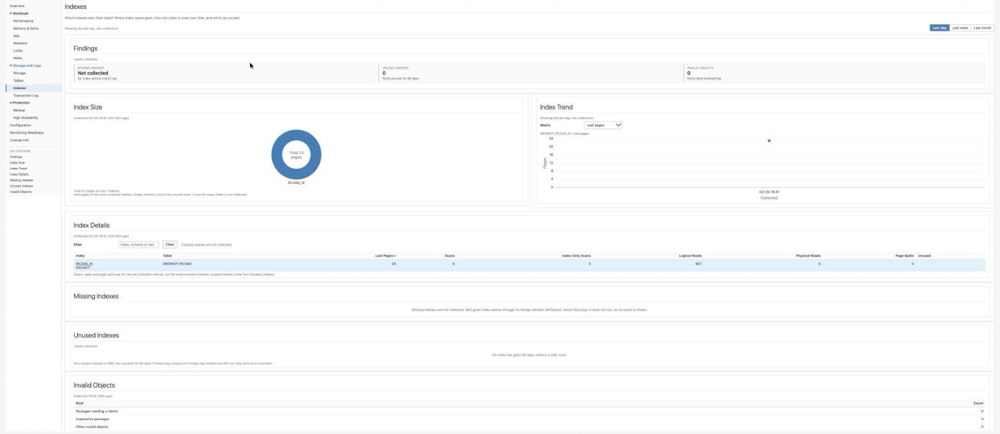

*Which indexes earn their keep?* Where index space goes, how one index is used over time, and which go unused. The **Time window** (Last day by default, Last week, Last month) drives only the trend.

| Name | Description |
|---|---|
| Findings | Three counts, each a link to its region below: **Missing indexes** (always *Not collected*, see below), **Unused indexes** (no DML scan for 90 days or more, from the 24-hour `Unused_Indexes` collection; *100 or more* when the collection is full) and **Invalid objects** (packages and objects Db2 marks invalid: `Invalid_Objects`' total, collected hourly). The caption names when each of the two was collected. |
| Index Size | Leaf pages of the five largest indexes and the rest as *Other*, as a donut. |
| Index Trend | The selected index over the window: leaf pages, index scans, index-only scans, logical reads, physical reads or page splits, each per collection interval. An unused index has leaf pages only. |
| Index Details | Every collected index with its table, from `Index_Activity` and `Unused_Indexes` merged, largest first: leaf pages, scans, index-only scans, logical and physical reads, page splits, and whether it is unused. 15 rows a page; **Filter** matches the index, schema or table name. Catalog indexes are not collected. |
| Missing Indexes | Always says missing indexes are not collected: Db2 gives index advice through its Design Advisor (`db2advis`), which the plug-in does not run. |
| Unused Indexes | The regular, non-unique indexes no DML statement has scanned for 90 days, largest first: key columns, leaf pages, last used and days unused. Primary-key, unique and foreign-key indexes are never listed. |
| Invalid Objects | Packages needing a rebind, inoperative packages and other invalid objects, with a count and examples. The three regions are stacked. |

Source: `Index_Activity` (the most-scanned user indexes, per interval), `Unused_Indexes` (daily, the 100 largest) and `Invalid_Objects`. Stored collections only; the page never runs one. On pureScale the page says only that these groups are not collected there.

**What the page does not show.** Read these before relying on the counts or the donut:

- **The donut is not every index.** Index size covers only the indexes `Index_Activity` listed in its last interval (the 50 scanned most in the last 30 minutes) and the unused ones. A size for every index is not collected.
- **Activity is per interval, not since activation.** `Index_Activity` lists only indexes with activity since its previous collection, and the first collection after a restart only records a baseline. On a quiet database, at night for example, the details can be empty although indexes were used earlier.
- **"Invalid objects" is not invalid indexes.** It counts packages that need a rebind, inoperative packages and other invalid objects (views, routines, triggers). Indexes that need a rebuild are not collected.
- **Missing indexes are not collected.** Db2 gives index advice through its Design Advisor (`db2advis`), which the plug-in does not run, so no count is shown.
- **Unused** leaves out primary-key, unique and foreign-key indexes, which enforce a constraint ([Table maintenance and indexes](metrics-reference.md#table-io)).

#### Transaction Log
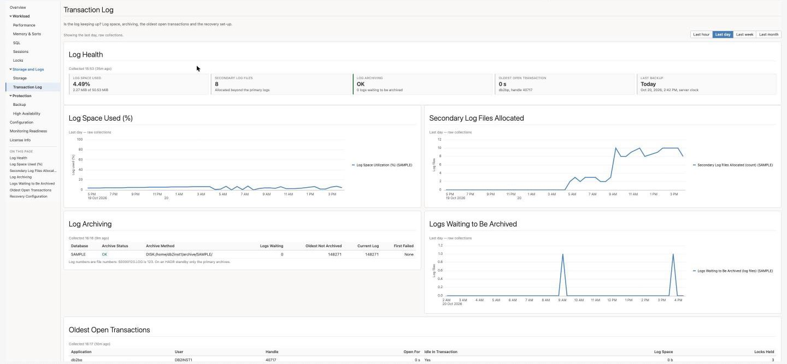

*Is the log keeping up?* Log space, archiving, the oldest open transactions and the recovery set-up. The page a log alert lands on. The charts follow the **Time window**; the tables show the latest stored collection, with its time.

| Name | Description |
|---|---|
| Log Health | **Log space used** (used of total), **Secondary log files** (allocated beyond the primary logs), **Log archiving** (status, and logs waiting to be archived), **Oldest open transaction** (its age, application and handle; opens Sessions) and **Last backup** (server clock). |
| Log Space Used (%), Secondary Log Files Allocated, Logs Waiting to Be Archived | Over the window, so a log that filled overnight and drained again is still visible. A healthy archiver keeps the waiting count at 0 or 1. |
| Log Archiving | Per database: **OK**, **Failed** (in red), **Off (not archiving)**, or **Standby (the primary archives)**; the archive method, logs waiting, the oldest log not yet archived, the current log and the first log that failed ([Storage metrics](metrics-reference.md#storage)). |
| Oldest Open Transactions | The units of work holding the log back, oldest first: application, user, handle, how long open, idle in transaction, log space and locks held. The oldest is badged **Pins the log**. A unit of work counts as open only once it has written log or holds locks, and is at least 5 seconds old; the plug-in's own monitoring connections are left out. To end one, kill its session on Sessions. |
| Recovery Configuration | `LOGARCHMETH1`, `LOGRETAIN`, `LOGPRIMARY`, `LOGSECOND` (-1 is infinite logging), `LOGFILSIZ` (4 KB pages), `TRACKMOD`, `AUTO_DB_BACKUP`, `NUM_DB_BACKUPS` and `REC_HIS_RETENTN`, from the daily configuration snapshot ([Configuration inventory](metrics-reference.md#configuration)). |

Source: `Log_Storage`, `Log_Archive`, `Oldest_Transactions`, `DB_Backup`, and the configuration snapshot. Nothing on this page runs a collection; the tables are re-read from the repository every 60 seconds. An empty Oldest Open Transactions says *No transaction is open (latest collection)*.

#### Backup
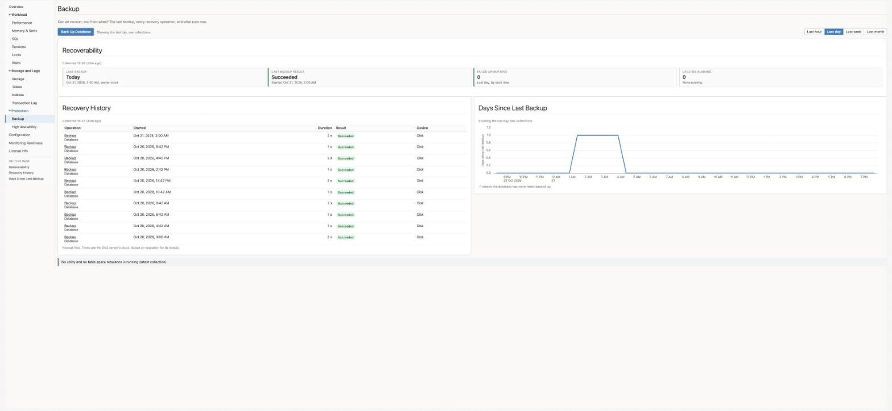

*Can we recover, and from when?* The last backup, every recovery operation, and what runs now. The **Time window** drives the trend.

| Name | Description |
|---|---|
| Recoverability | **Last backup** (*Today*, *N days ago* or *Never*, with the time on the server clock), **Last backup result** (Succeeded or Failed), **Failed operations** in the window, and **Utilities running**. |
| Recovery History | Db2's recovery history, newest first (backup, restore, load, reorg, rollforward and the others Db2 records): operation and object, start, duration, result and device. Select an operation for its end, entry status, SQLCODE, table spaces, location and backup ID. The first 20 show; **Show all** lists the rest. Times are the Db2 server's clock. |
| Days Since Last Backup | Over the window, so a schedule that slipped shows as a rising line (-1 means never backed up). |
| Running Utilities, Table Space Rebalance | Shown only when something is running: utilities in progress (backup, load, reorg, runstats) with who started them and for how long, and rebalance operations after storage changes. Otherwise one line says nothing is running. |

Source: `DB_Backup`, `DB_History`, `Utilities`, `Rebalance_Status`, `Log_Archive`. Stored.

**Back Up Database.** The button at the top left of the page takes an **online** backup of the database to a directory on the database server, now or on an Enterprise Manager schedule. It submits the remote admin job *IBM Db2 - Online Backup (remote)* (`ip_db2_admin_backup`, job type 1.6, [Remote admin jobs](jobs-and-metric-extensions.md#remote-admin-jobs)), so it works for a local or a remote agent.

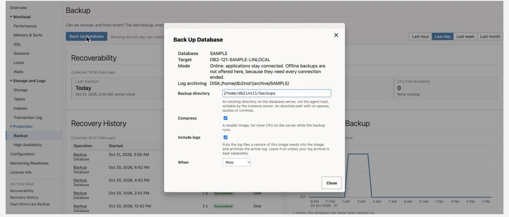

1. **What the dialog shows.** The database, the target, the mode (online), and the log archiving the last collection found. The directory of the last successful disk backup is filled in for you.
2. **What you choose.**
   - **Backup directory**: an absolute path on the **database server**, not the agent host, that exists and that the instance owner can write. No spaces, quotes, commas or semicolons, and no `..`.
   - **Compress** (on by default): `COMPRESS`, a smaller image for more CPU while it runs.
   - **Include logs** (on by default): `INCLUDE LOGS`, which puts the logs a restore of this image needs into the image and archives the active log. Off is `EXCLUDE LOGS`.
   - **When**: **Now**, **Once, later**, or **Daily**, with a **Start** in your browser's local time. A daily backup repeats at that time of day in the Enterprise Manager repository's time zone, for ten years or until you stop it in **Enterprise → Job → Activity**. Scheduling has been verified on Enterprise Manager 24ai, and **Once, later** on Enterprise Manager 13.5. A console that cannot build the schedule says so and submits nothing (use **Now**, or schedule the job from **Enterprise → Job → Library**).
3. **The confirmation** names the database, the target, the directory, the options and when. Nothing is submitted unless you answer **Yes**.
4. **The answer.** A backup run now reports when it finishes: Db2's time stamp for the image and where it is, or Db2's reason for refusing it in plain words (for example: the database uses circular logging, the directory does not exist on the server, the disk filled, or the admin user lacks the authority). The job keeps running if you close the dialog. A scheduled backup reports that Enterprise Manager accepted the schedule; it has not run yet. Every run stays in **Enterprise → Job → Activity**, where it can also be stopped.
5. **When the page shows it.** The page reads stored collections, so a new backup appears after the next ones: **Last backup** within 30 minutes and **Recovery History** within an hour, at the default intervals.

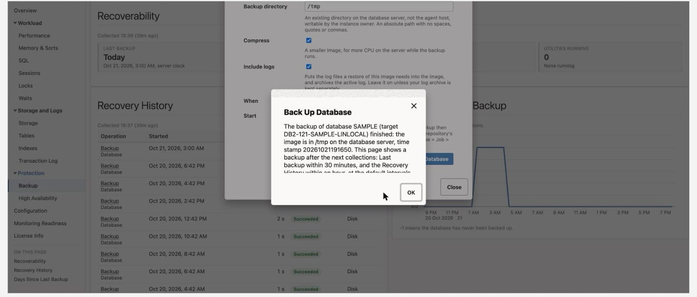

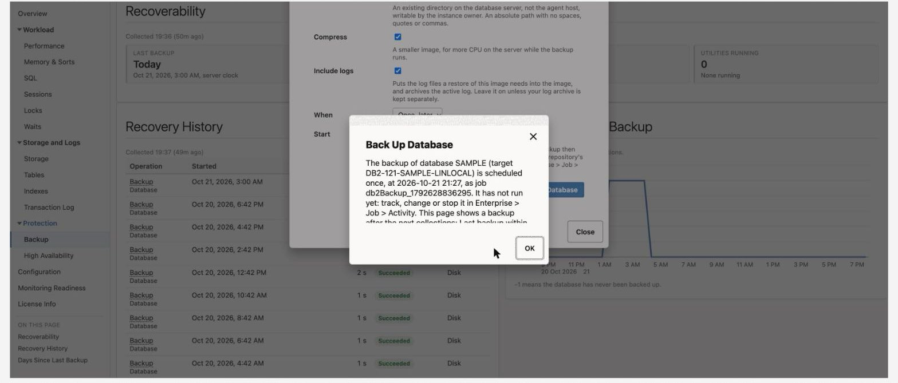

**Images accumulate.** Db2 deletes no backup image by itself: a daily backup adds one image a day to the directory until `AUTO_DEL_REC_OBJ` is on (with `NUM_DB_BACKUPS` and `REC_HIS_RETENTN` saying how many to keep) or your own housekeeping removes old ones. Keep the directory off the file system that holds the active logs and table spaces: a full disk there stops the database.

**Partitioned (DPF) databases are not offered.** Without `ON ALL DBPARTITIONNUMS` the job backs up only the partition its connection runs on, and that image cannot restore the database. On a DPF target the dialog shows a red note and submits nothing; back up every partition on the server with `db2 backup database <db> on all dbpartitionnums ...`. The dialog also refuses when the target's topology could not be read from the repository; try again a minute later. The job refuses a DPF database by itself as well, so one submitted from the Job Library or with `emcli` fails with the same advice and backs up nothing ([Remote admin jobs](jobs-and-metric-extensions.md#remote-admin-jobs)). pureScale databases are backed up across all members and are offered.

**Not on Amazon RDS for Db2.** The job needs SYSADM, SYSCTRL or SYSMAINT, which no RDS user can hold, so it fails there with `SQL1092N` ([Remote admin jobs](jobs-and-metric-extensions.md#remote-admin-jobs)). Use RDS's own backups, or `rdsadmin.backup_database`.

**Online only.** An offline backup needs every connection to the database gone, which is an outage, so the dialog does not offer it. An online backup needs archive logging (`LOGARCHMETH1` not `OFF`). On a database the last collection found using circular logging, the dialog says so and submits nothing; turning on archive logging needs one offline backup, taken on the server.

**Who can use it.** You need **Full** privilege on the target. The target needs the two preferred credentials of the [remote admin jobs](jobs-and-metric-extensions.md#remote-admin-jobs): *IBM DB2 Database Admin Credentials*, a Db2 user with SYSADM, SYSCTRL or SYSMAINT, and *IBM DB2 Plug-in Agent Owner Credentials*. On a TLS target, also its client truststore credential set ([TLS targets](jobs-and-metric-extensions.md#tls-targets)). Without them the dialog says the backup did not run and names the two credential sets. Deploy the plug-in to the agents as well as the OMS: an agent still on an earlier version refuses a job type 1.6 backup and runs nothing.

#### High Availability
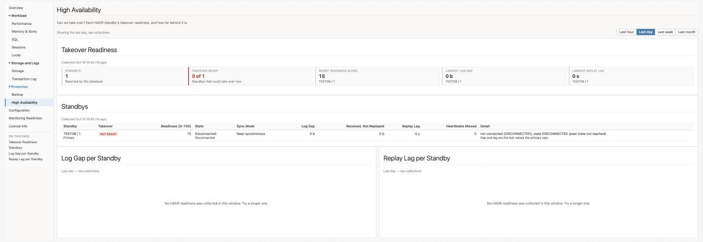

*Can we take over?* Each HADR standby's takeover readiness, and how far behind it is. Meant for an HADR primary or standby ([Monitoring a standby](hadr-monitoring.md#monitoring-a-standby) and [Following the primary](hadr-monitoring.md#client-reroute)). The **Time window** drives the charts.

| Name | Description |
|---|---|
| Takeover Readiness | **Standbys**, **Takeover-ready** (*N of M*, not counting auxiliary standbys), **Worst readiness score**, **Largest log gap** and **Largest replay lag**, each naming its standby. |
| Standbys | Per standby: whether it could take over now (**Ready**, **NOT READY**, or *n/a (auxiliary)*), a readiness score (0-100), state, sync mode, log gap, log received but not replayed, replay lag, missed heartbeats, and the reason in plain words. Gap and lag are the last values the primary saw. |
| Log Gap per Standby, Replay Lag per Standby | Over the window. |
| Incidents and Problems | The target's open incidents, including the HADR alerts. |

Source: `HADR_Readiness`, `HADR_Status`. Stored.

On a database without HADR the page says *HADR is not configured on this database. On an HADR standby, open the primary's High Availability page.* On a partitioned or pureScale database it says HADR is monitored on single-partition databases only.

#### Configuration
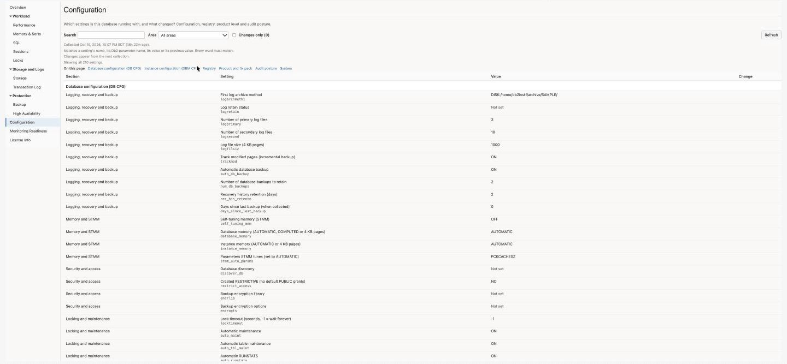

*Which settings is this database running with, and what changed?* The configuration Enterprise Manager last collected for the database ([Configuration inventory](metrics-reference.md#configuration)), on one searchable page, with what changed since the previous collection highlighted.

| Area | What it holds |
|---|---|
| Database configuration (DB CFG) | Logging, recovery and backup: archive method, log files and sizes, incremental-backup tracking, automatic backup, backups and history retained; from metadata 4.5 the days since the last backup when the configuration was collected (**Never backed up** for -1), which changes every day no backup is taken and so is never highlighted as a change. Also security and access (database discovery, `RESTRICT_ACCESS`, backup encryption), locking and maintenance (lock timeout, automatic maintenance, RUNSTATS and REORG), memory and STMM, HADR settings, and one row group per buffer pool and per table space. |
| Instance configuration (DBM CFG) | Capacity (heaps, agents, open files), logging and recovery (transaction manager, sync point manager), connection (service name, discovery), partitioned environment, instance settings (diagnostic level and path, notify level, monitor switches, SYSADM group), and from metadata 4.5 security (authentication, server connection authentication, cataloging without authority, client trust, discovery, TLS port and versions). |
| Registry | Every Db2 registry variable that is set, with the level it is set at (instance, global, environment) and the aggregate that set it, if any. |
| Product and fix pack | The instance's release, service level, build level, fix pack and bit size, and every installed Db2 product with its version and path. |
| Audit posture | Whether audit policies exist, which policy audits the database, and what each audit category records (**Success and failure**, **Success**, **Failure** or **None**); from metadata 4.5 also the authorities and privileges summary (what `PUBLIC` holds, DBADM and SECADM holders, trusted contexts). |
| System | The server name, operating system, CPUs and memory, and the database partitions. |

Each row shows the section, the setting's name with its Db2 parameter name under it (for example `logprimary`), the value, and the change, if any. A setting with no value reads **Not set**. Where the page shows a word for a Db2 code (an audit category's **B** reads **Success and failure**), the code is shown under it.

- **Search** matches a setting's name, its Db2 parameter name, its value and its previous value. Every word must match, so `log archive` finds the archive method.
- **Area** shows one area only; **On this page** jumps to an area.
- **Changes only** hides every setting that did not change. The count beside it is the number of highlighted settings.
- **Refresh** reads the stored snapshot again. It runs no collection.

**Highlighted changes.** A highlighted row changed in the newest collection that differed from the one before it: **Changed**, with the previous value under the badge (for example *was 16365*); **Added**, a value the previous collection did not have; **Removed**, a value the previous collection had and this one does not, such as a registry variable that was unset. The note above the table says when that collection ran. The changes come from Enterprise Manager's own configuration history, the same record behind **Configuration → History**, so the page shows the last time the configuration changed, however long ago. When Enterprise Manager records a whole configuration as new, nearly every row is marked **Added** and the note says there is no previous value to compare with. When the newest collection held no configuration at all, as on an HADR standby that does not accept connections, every row is marked **Removed**. Only changes recorded since the target was added count.

Source: the daily configuration snapshot (`Db2DatabaseConfiguration`). The page reads the repository when it opens and on **Refresh**; times are in your browser's time zone.

#### Monitoring Readiness
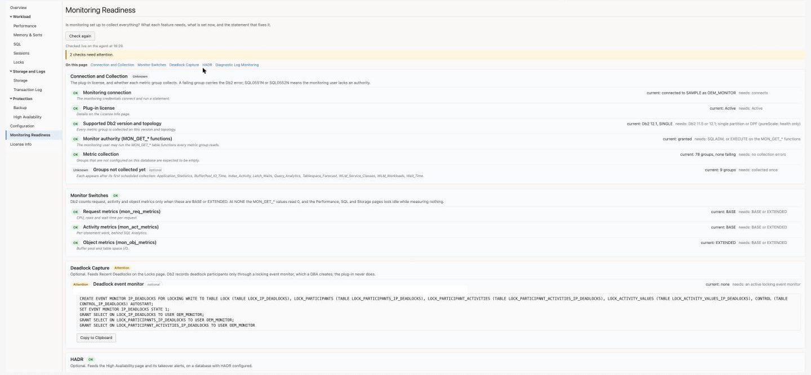
<!-- Screenshot from build 24.1.49; one detail line that still used the page's old name is blanked. -->

*Is monitoring set up to collect everything?* What each feature needs, what is set now, and the statement that fixes it. Open it first when a page is empty or partly filled.

| Name | Description |
|---|---|
| Summary | One line: *All checks pass*, *1 check needs attention*, *N checks need attention*, or that some checks could not be judged yet; then a jump to each panel. |
| Connection and Collection | The monitoring connection, the plug-in licence, the supported Db2 version and topology, the monitor authority (`MON_GET_*`), and **Metric collection**: each metric group that fails with the Db2 error it returned, the groups that are disabled with the reason, and the groups not collected yet. |
| Monitor Switches | `mon_req_metrics`, `mon_act_metrics` and `mon_obj_metrics`. At `NONE` the `MON_GET_*` values read 0 and the pages look idle while measuring nothing. |
| Deadlock Capture | Optional. Whether a locking event monitor is set up and active and `MON_DEADLOCK` lets it record, for **Recent Deadlocks** on Locks. Shown only with the live check. |
| HADR | Optional. Whether HADR is configured, and per standby whether it is connected and ready to take over. |
| Diagnostic Log Monitoring | Optional. Whether the Management Agent runs on the Db2 server (`local` = 1), which db2diag.log monitoring needs. |

Each item has a status word (**OK**, **Attention**, **Not functional** or **Unknown**), what it needs, what is set now, and why. Where a fix is a statement, it is shown under **Statement to run** with **Copy to Clipboard**. The page never runs a statement itself: run it as a user with the authority it needs. An optional item never reads Not functional, and one that could not be judged does not colour its panel.

**Live and stored.** Each time the page opens, and each time you press **Check again**, the agent runs the checks live (`readiness_detail`, metadata 4.6; a few short reads under the monitoring credentials; nothing is stored), and the note says *Checked live on the agent at* the time. While it runs, and when it does not answer, the panels show the latest stored collections (`License`, `CollectorStatus`, `Monitor_Metrics`, `HADR_Readiness`) and the note says why: a target below metadata 4.6 has no live check, and a check that does not answer within 30 seconds is abandoned. **Check again** is disabled while a check runs. The Overview's **Readiness** row counts the same checks once an hour ([readiness_summary](metrics-reference.md#readiness-summary)).

The AI troubleshooting guide covers every check, its causes and its fix in a form you can load into your own AI assistant with the page's results: `https://docs.integrationplumbers.io/db2/ai/troubleshooting.md`.

#### License Info
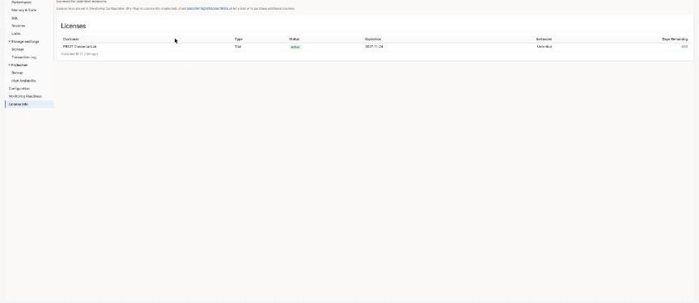

The licence the target's key carries, from the `License` metric (collected every 15 minutes). The line under the title says it in one sentence.

| Name | Description |
|---|---|
| Licenses | Customer, type, status, expiration, licensed instances and days remaining. *Waiting for the first license check* until the first collection, which runs within 15 minutes of deployment. |

License keys are set in Monitoring Configuration, in the *Plug-in Licence Key* credential ([Licensing](targets-and-properties.md#licensing)). For a trial or more instances, email sales@integrationplumbers.io.

## 5.2 IBM Db2 Instance pages

An IBM Db2 Instance target ([Instance targets](targets-and-properties.md#instance-targets)) has six pages, in this order in the left navigation and on the **IBM Db2 Instance** target menu: **Overview**, **Memory**, **Diagnostics**, **Configuration**, **Monitoring Readiness** and **License Info**. They follow the same layout as the database pages, and all read stored data.

#### Overview (instance)
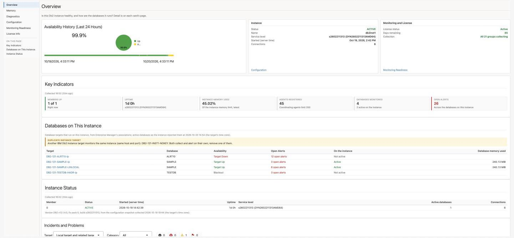

*Is this Db2 instance healthy, and how are the databases it runs?* Detail is on each card's page.

| Name | Description |
|---|---|
| Availability History | Enterprise Manager's Up/Down record for the last 24 hours. |
| Instance | Status, instance name, service level, when it started (server time) and connections. Links to **Configuration**. |
| Monitoring and License | Licence status, days remaining and collection. Links to **Monitoring Readiness**. The instance target has no readiness summary row. |
| Key Indicators | **Members up**, **Uptime** (with the service level), **Instance memory used** (opens Memory), **Agents registered** (with the coordinating agents limit), **Databases monitored** (with how many are active on the instance) and **Open alerts** across its databases. |
| Databases on This Instance | Each IBM Db2 Database target that runs on this instance, from Enterprise Manager's associations: its database, availability, open alerts, whether it is active on the instance, and its database memory. A callout names a second instance target that monitors the same host and port. **Active Databases Without a Target** lists active databases no target monitors. |
| Instance Status | Per member: status, started, uptime, service level, active databases and connections. |
| Incidents and Problems | The target's open incidents. |

Source: `Instance_Status`, `Instance_Memory`, `Agent_Connection`, `License`, `CollectorStatus`, and Enterprise Manager's associations ([Instance targets](targets-and-properties.md#instance-targets)).

#### Memory (instance)
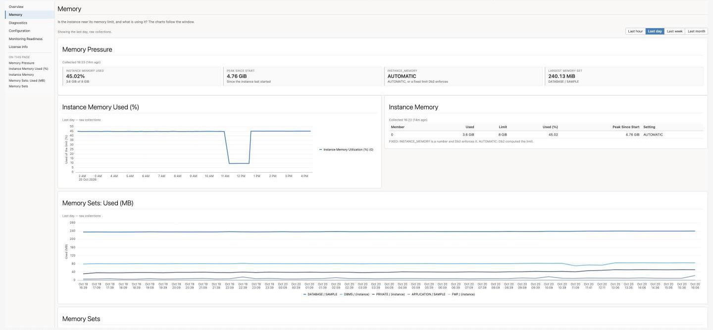

*Is the instance near its memory limit, and what is using it?* The charts follow the **Time window**.

| Name | Description |
|---|---|
| Memory Pressure | **Instance memory used**, **Peak since start**, **INSTANCE_MEMORY** (`AUTOMATIC` or a fixed limit) and **Largest memory set**. |
| Instance Memory Used (%), Instance Memory | Over the window, then per member: used, limit, used (%), peak since start and the setting. |
| Memory Sets: Used (MB), Memory Sets | One line per memory set, then each set with its database, scope, used, committed, size, peak since start and peak in the window. |

Source: `Instance_Memory`, `Memory_Sets`.

#### Diagnostics (instance)
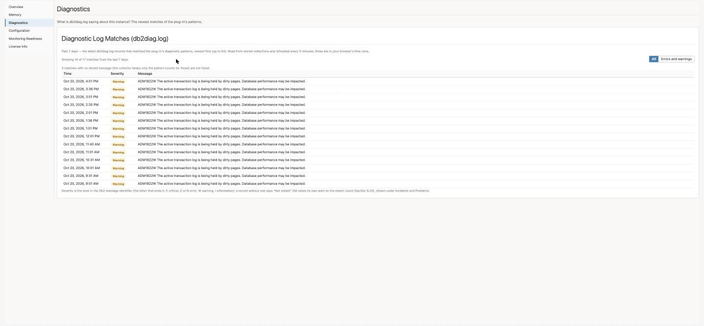

*What is db2diag.log saying about this instance?* The newest matches of the plug-in's patterns.

| Name | Description |
|---|---|
| Diagnostic Log Matches (db2diag.log) | The records that matched in the past 7 days, newest first, up to 50: time, severity and message. **All** or **Errors and warnings** filters by severity, and a line says how many are shown. Matches the collector kept only as a count are counted, not listed. Re-read every 5 minutes. |

Source: `Diag_Log_File_Monitoring` ([Diagnostic log monitoring](metrics-reference.md#diag-log)). It needs the Management Agent on the Db2 server: on a remote agent the page says diagnostic-log monitoring needs a local agent and links to **Monitoring Readiness**. With nothing matched it says *No db2diag.log record matched the diagnostic patterns in the past 7 days.*

#### Configuration (instance)
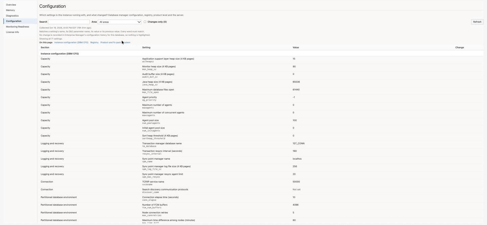

*Which settings is this instance running with, and what changed?* Database manager configuration, registry, product level and the server. It works as the database's Configuration page, on the instance's own daily snapshot (`Db2InstanceConfiguration`). Before the first configuration collection it says none has been collected yet.

#### Monitoring Readiness (instance)
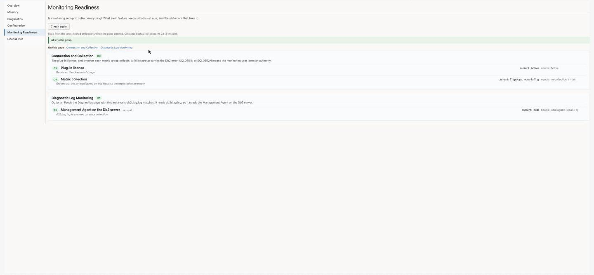

As the database's page, with two panels: **Connection and Collection** and **Diagnostic Log Monitoring**. The instance target has no live check: **Check again** reads the stored collections again.

#### License Info (instance)
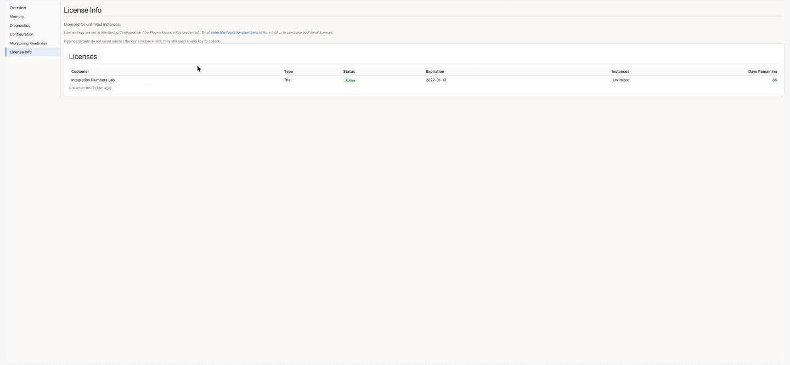

As the database's page. Instance targets do not count against the key's instance limit; they still need a valid key to collect.

## 5.3 Time windows, auto-refresh and live reads

**Stored and live.** Most regions read the **latest stored collection** from the Enterprise Manager repository and say when it ran (*Collected 14:05 (12m ago)*); they are re-read every 60 seconds, and charts every 5 minutes. A **live** read instead asks the agent to run the metric group's collection again, in addition to its schedule. That is what makes a value current, and it is also load on the database, so only these regions read live:

| Page | Live regions | How often |
|---|---|---|
| Sessions | Top Sessions by CPU | The **Auto-refresh** rate |
| Locks | Blocking Chains, Top Waits by Blocked and by Blocking Application, Lock Waits by Table, Lock Contention | The **Auto-refresh** rate |
| Performance | Every chart and Buffer Pool I/O, on **Real time** only | Every 60 seconds |
| Monitoring Readiness | The readiness check | When the page opens, and on **Check again** |

Everything else, on every page, is stored, and opening it runs nothing on the agent.

**Time window.** Pages with history have a **Time window** at the top right; a caption says what the chosen window means.

| Page | Windows | Default |
|---|---|---|
| Performance | Real time, Last hour, Last day, Last week, Last month | Last day |
| Memory & Sorts, Storage, Transaction Log, Backup, High Availability, Waits, instance Memory | Last hour, Last day, Last week, Last month | Last day |
| SQL | Last hour, Last day, Last week, Last month | Last day |
| Tables | Last day, Last week, Last month | Last week |
| Indexes | Last day, Last week, Last month | Last day |

**Real time** has no fixed span: it starts empty and fills in, one point a minute, for as long as the page is open. **Last week** and **Last month** read Enterprise Manager's hourly averages rather than raw collections, because Enterprise Manager keeps raw data for about seven days, so peaks there look lower than they were. The KPI row always shows the newest collection, whatever the window.

**Auto-refresh** (Locks and Sessions). At the top right: **Off**, **30 s**, **1 min** (the default) or **5 min**; the words beside it say the current rate. Every live read runs a collection on the agent: 5 min runs a fifth as many as the default, and Off runs none after the page opens. The stored reads, which run no collection, keep their own pace under Off: on Locks the Lock Pressure rates (once a minute) and the Diagnostic Log Matches (every 5 minutes), on Sessions the Connections tiles (every 60 seconds). With Off the live regions and Recent Deadlocks keep what they last read; choosing a rate reads the live regions at once and Recent Deadlocks within 5 minutes. After a kill with Off, choose a rate to see the change. While the browser tab is in the background the live reads pause, whatever the rate (the lock tables read once more as the tab goes to the background, as they do when you choose Off); when you come back to the tab the page reads at once and carries on at your rate (with Off, it stays off). The choice is shared by the two pages: turn it off on Locks and it is off on Sessions too. It is kept for this browser tab: a new tab or window opens at 1 min, though a tab the browser duplicates keeps the choice. Leaving the page stops it.

**Sorting.** Click a column header to sort; click again to reverse. Numeric columns sort as numbers, so 8 comes before 502.

**Times.** Times are in your browser's time zone, except where a column says *server clock* (Backup) or *server time* (the instance pages).

## Related

- [Metrics reference](metrics-reference.md): every metric group behind these pages, column by column
- [Alerts and thresholds](alerts-and-templates.md): the alerts the Health Overview reads
- [Jobs](jobs-and-metric-extensions.md): Kill, Back Up Database and Explain Plan, and the credentials they need
- [HADR monitoring](hadr-monitoring.md): the High Availability page in depth
- [Troubleshooting](troubleshooting.md): empty pages and failed jobs
