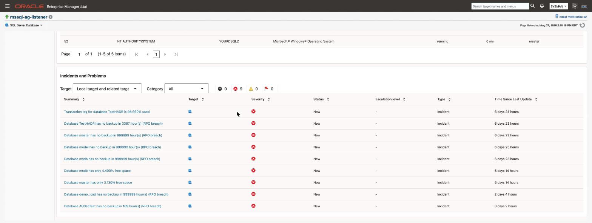

# Alerts and thresholds

The plug-in ships curated WARNING and CRITICAL thresholds. They are enabled the moment a target is created — there is nothing to import and nothing to switch on — and every one of them is editable per target in the Enterprise Manager console.

> **Prerequisites for this page**
> - A target that is collecting. Thresholds are live from the moment the target exists, but they cannot fire on a metric that has never collected.
> - Enterprise Manager access to Metric and Collection Settings, to change any of them.

**In this page:** What ships enabled · The thresholds · Four alerts worth understanding before they fire · Changing a threshold · Applying settings across many targets · Why some thresholds have only a critical value

## What ships enabled {#what-ships}

Twenty thresholds ship with the plug-in, plus the availability condition that drives the target's Up and Down state, spread across space, performance, I/O, backup, high availability, patching, Query Store, licensing and collection health. They are defaults, not recommendations for your estate: they are set where a value is unambiguously worth waking someone for, and they are deliberately conservative so a new target does not flood you on day one.

The plug-in does **not** ship an Enterprise Manager Monitoring Template. A template is a separate artifact that an administrator applies across many targets at once, usually with different values for production, test and development. If you want that, you build it from these defaults — see [Applying settings across many targets](#across-targets) below.

## The thresholds {#thresholds}

| What it watches | Metric column | Warning | Critical | Fires when |
| :--- | :--- | ---: | ---: | :--- |
| Instance availability | Response `Status` | — | 1 | The instance is down |
| Host CPU | Processor `cpu_utilization_pct` | 80 | 90 | CPU utilisation exceeds the percentage |
| Volume free space | VolumeSpace `available_pct` | 10 | 5 | A volume holding SQL Server files falls below the percentage free |
| Database headroom | DbFreespace `headroom_pct` | 15 | 5 | The space a database can still grow into falls below the percentage |
| AG replica link | AgFailoverReadiness `link_healthy` | — | 1 | The replica link is broken |
| AG redo queue | AgFailoverReadiness `redo_queue_kb` | 1048576 | 5242880 | The redo queue exceeds the size in KB |
| AG send queue | AgFailoverReadiness `log_send_queue_kb` | 1048576 | 5242880 | The send queue exceeds the size in KB |
| AG recovery point | AgFailoverReadiness `rpo_seconds` | 300 | 900 | The recovery point exceeds the seconds |
| File read latency | FileIoStats `avg_read_latency_ms` | 50 | 100 | A file's average read latency exceeds the milliseconds for two collections in a row |
| File write latency | FileIoStats `avg_write_latency_ms` | 50 | 100 | A file's average write latency exceeds the milliseconds for two collections in a row |
| Backup age | LastDatabaseBackup `hours_since_last_backup` | 48 | 168 | No backup within the hours |
| Never backed up | LastDatabaseBackup `hours_unbacked` | 48 | 168 | A database older than the hours has no backup on record at all |
| Transaction log | TransactionLog `log_space_used_pct` | 75 | 90 | Log space used exceeds the percentage |
| Licence | License `days_remaining` | 30 | 7 | Fewer days remain on the licence |
| Collection health | CollectorStatus `Status` | — | `COLLECTION_ERROR` | A metric group's collection has failed on two checks in a row |
| Deadlocks | DeadlockRate `deadlocks_last_hour` | 5 | 20 | Deadlocks in the trailing hour exceed the count |
| Blocking | BlockedSessions `blocked_sessions` | 5 | 20 | Blocked requests exceed the count |
| Connection saturation | ConnectionSaturation `connection_saturation_pct` | 80 | 90 | User connections exceed the percentage of the cap |
| TempDB contention | TempdbContention `pagelatch_ex_waiters` | 5 | 20 | Exclusive page-latch waiters exceed the count |
| Security updates | SecurityUpdateStatus `days_behind` | 30 | 90 | The oldest security update the build lacks is at least the days old |
| Plan regression | QueryStoreRegression `cpu_ratio` | 2 | 5 | A query's current plan costs at least the ratio more CPU per execution than its previous plan |

The `License` row watches `days_remaining`, but the metric also carries a `Status` column — `Active`, `License Required`, `Invalid Signature`, `Wrong Product`, `Expired` or `Exceeded Limit` — and raises its own CRITICAL incident whenever that status is anything but `Active`, independently of the days-remaining threshold above. See [Troubleshooting](troubleshooting.md#license) for what each status means and what to do about it.

For metrics measured as a snapshot rather than a rate, use Enterprise Manager's per-threshold **number of occurrences** setting to require a condition to persist before it raises an incident. A single sample of high blocking is often noise; the same value across three consecutive collections is not. The two file latency thresholds and the collection-health one ship with two occurrences already.

## Four alerts worth understanding before they fire {#understanding}

### Database headroom, not free space {#headroom}

The database space alert is evaluated on headroom: the largest size the data files can reach on their volume, minus the space used, as a percentage. A small database that grows by autogrowth sits close to full by design, so an alert on the free share of allocated space fired on master and msdb on nearly every instance while their volumes had gigabytes free. A database with autogrowth off, or capped close to its maximum size, alerts as before; one that can still grow onto free volume space does not. Because other databases on the same volume share that free space, the volume alert above covers a volume holding SQL Server files that is running out. The console's space percentages on Overview, Databases and Capacity show headroom too, so they match the alert. If the monitoring login cannot read volume space, headroom falls back to the allocated size, which is the old measure. The free share of allocated space is still collected as `free_pct` for a threshold of your own.

### A database that has never been backed up says so {#never-backed-up}

`hours_since_last_backup` is empty for a database with no backup on record, and the second backup threshold, on `hours_unbacked`, raises its own alert against the database's age instead, worded so it cannot be mistaken for a late backup: no backup recorded in msdb on this instance. It does not quote an hour count, because for master and model the creation date is the product template's, not your install's. And it says "on this instance" because msdb is instance-local: a database backed up on another availability group replica has no history here, so check where your backups run before changing anything. A database created an hour ago raises nothing on either threshold. If you tune one of the two, tune the other to match.

### Plan regression reads Query Store {#plan-regression}

For each query that ran under more than one plan, the alert compares its current plan with its previous one, both read from Query Store, on the ratio of their average CPU per execution. Both plans need at least ten executions and the current plan at least a millisecond of CPU per execution, so a single odd run or a microsecond query cannot alert; aborted and timed-out executions count, so a plan whose runs time out still raises it. The message names the database, the query, both plan ids, the ratio and the start of the query text. It clears when the query goes back under the threshold, typically after the old plan is forced or the statistics change again. When Query Store forgets the previous plan, after 30 days by default, the row disappears and an incident still open on it has to be closed by hand in Incident Manager. Only databases with Query Store on are read.

### Days behind counts from the oldest missed update {#security-updates}

The security update alert counts from the oldest security release the instance lacks, and the message names that release and its date beside the latest one to install. For a build older than every release in the shipped reference table the count starts at the table's first release, so it is a minimum and the column says "or earlier". A build the table does not know is not judged at all: `days_behind` stays blank, and a `version_judged` column reads 0 so that an API client rendering a blank as 0 does not read it as patched.

## Changing a threshold {#changing}

From the target's menu, choose **Monitoring** then **Metric and Collection Settings**. Every threshold above appears there with its shipped value, and any change applies to that target only.

When a threshold is crossed, the incident appears in Enterprise Manager and on the target's own Overview page:

Collection intervals are set in the same place. They range from one minute for instance availability to 24 hours for server configuration and per-database space, so a metric you have just changed may not reflect it until its next collection.

Review all twenty against your own service levels before relying on them. The file latency defaults in particular are set for ordinary storage; a site on fast storage that expects to sit under 10 ms may want them lower.

## Applying settings across many targets {#across-targets}

Because the plug-in ships defaults rather than a template, estate-wide tuning is done with Enterprise Manager's own template mechanism:

1. Tune one target until its thresholds match your standard.
2. From **Enterprise** → **Monitoring** → **Monitoring Templates**, create a template from that target.
3. Apply the template to the targets or target group you want it on.

This keeps the plug-in's defaults as a sane starting point while letting you hold production and development to different standards.

## Why some thresholds have only a critical value {#critical-only}

Three of them, instance availability, the AG replica link and collection health, have a critical value and no warning. That is deliberate: they are binary conditions. An instance is up or down; a replica link is healthy or broken; a collection either ran or failed. There is no middle state worth a lower severity, and inventing one would only produce an alert nobody can act on differently.

The AG replica link threshold is also deliberately *not* placed on the readiness column. A healthy asynchronous-commit disaster-recovery secondary sits permanently in a synchronising state, so alerting on readiness would raise a standing critical on a perfectly correct topology. Replication lag is covered instead by the redo queue, send queue and recovery-point thresholds above, which measure how far behind the replica actually is.

The collection-health alert is the one new kind of incident on this release: "Collection of the ... metric group is failing", raised when a group still reads `COLLECTION_ERROR` after two five-minute checks and cleared by the group's next successful run. For a group that collects hourly or daily, one failed run raises it and it stays open until that group next succeeds. It is a real collection failure that used to be silent; see [Troubleshooting](troubleshooting.md#collector-status).

## Related

- [Monitoring pages](monitoring-pages.md) - the data the thresholds are evaluated against
- [Monitoring pages](monitoring-pages.md#intervals) - collection intervals, set in the same place as thresholds
- [High availability](high-availability.md#failover-readiness) - why the AG critical sits on the replica link
- [Compliance rules](compliance-rules.md) - configuration findings, which alert differently
- [Troubleshooting](troubleshooting.md#missing-data) - a threshold that never fires
- [Troubleshooting](troubleshooting.md#license) - what each `License` status means
- [Metrics reference](metrics-reference.md) - every column the thresholds are set on
