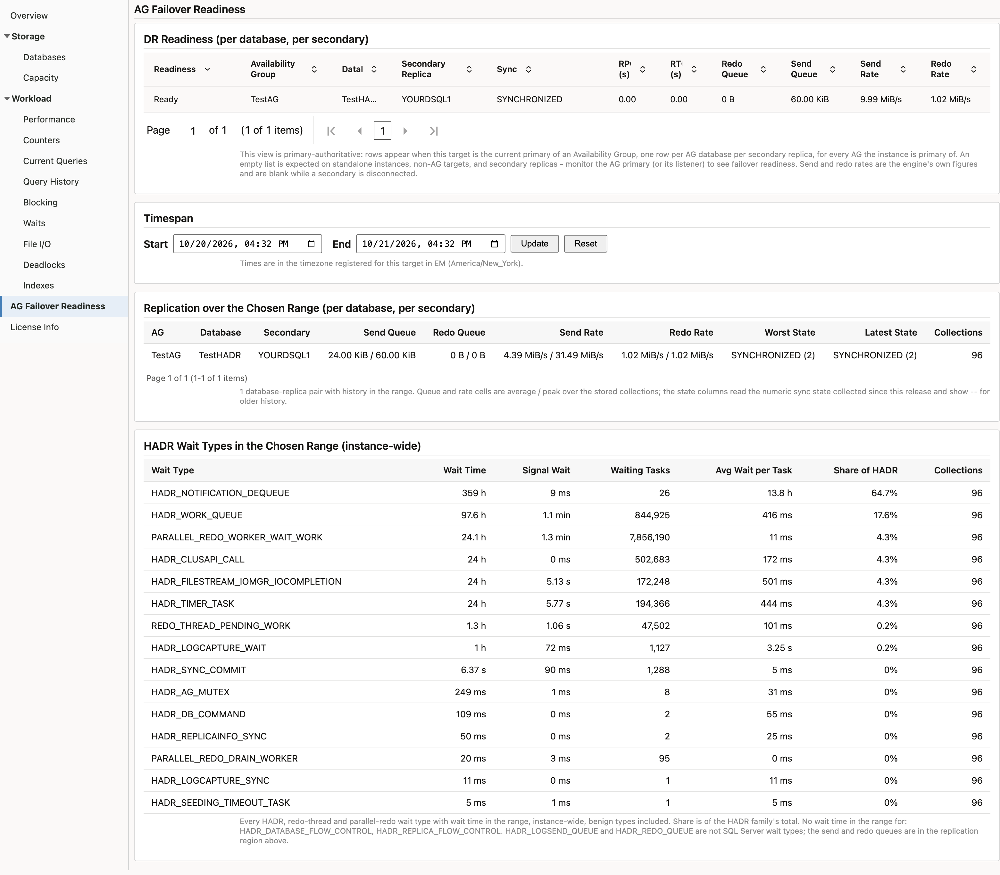

# High availability

The plug-in monitors AlwaysOn availability groups and failover cluster instances, and it behaves predictably on Linux where clustering is managed outside Windows.

> **Prerequisites for this page**
> - A target pointed at an instance participating in an availability group or a failover cluster. See [What to point at](targets-and-properties.md#what-to-point-at), which matters more here than anywhere else in the guide.
> - The monitoring login present on every replica you want reported, not only the primary.

**In this page:** Availability groups · What to monitor · Failover readiness · Failover cluster instances · Linux and the Pacemaker boundary · Database mirroring

## Availability groups {#availability-groups}

Availability groups are monitored through the availability-group metric families and the [AG Failover Readiness](monitoring-pages.md#ag-failover) page. Both work identically on Windows- and Linux-hosted SQL Server.

## What to monitor {#what-to-monitor}

| Target on | You get |
| :--- | :--- |
| The listener | The primary's view, following the primary across a failover |
| A replica | That replica's own view, including when it is a secondary |

Monitoring the listener alone is enough to answer "is the group healthy". Adding the replicas as targets as well tells you which replica is which, and lets you see a secondary's own state — worth doing for a disaster-recovery replica you care about individually.

A standalone instance simply returns no availability-group rows. There is no separate configuration and no error.

## Failover readiness {#failover-readiness}

The point of the readiness surface is to answer a question the built-in dashboards do not: *if I failed over right now, what would it cost me?*

For each database and secondary it reports the synchronisation state, the recovery point in seconds, the redo and send queue sizes, and whether the replica link is healthy — with a readiness verdict that folds those together.

Thresholds ship on the recovery point, both queue sizes and the replica link. See [Alerts and thresholds](alerts-and-thresholds.md).

One deliberate design point: the critical threshold sits on the **replica link**, not on the readiness column. A healthy asynchronous-commit disaster-recovery secondary is permanently in a synchronising state, so alerting on readiness would raise a standing critical on a perfectly correct topology. Lag magnitude is covered by the queue and recovery-point thresholds instead, which measure how far behind the replica actually is.

The live table is primary-authoritative: rows appear when the target is the current primary of a group, and the table is empty on a secondary. Below it, two regions over a start and end you choose show the replication figures averaged and at their peak across the range, and the HADR wait types the instance accrued. The wait region is populated on a secondary too, because waits are instance-wide, and it is where to look when a secondary falls behind. [Monitoring pages](monitoring-pages.md#ag-failover) describes both.

Two readiness columns say when a reading is unknown rather than zero. Commit Position Known is 0 when one replica did not report a last commit time, so the recovery point is empty rather than zero. Queue State Known is 0 when at least one of the two queues was not reported; the unknown one is empty and the other may hold a real measurement, which is the normal shape of a suspended replica. Anything reading these metrics through the API should check the flag before treating a zero as a measurement.

## Failover cluster instances {#fci}

On a Windows Server Failover Cluster, the plug-in reports the node list and which node currently owns the instance, in the Cluster Nodes and FCI Identity metrics. Define the target against the virtual network name and it follows the instance across a failover; a node name does not.

- **Host:** the virtual network name or its fully qualified DNS name. The agent host must resolve it, so where the cluster registers its names in Active Directory DNS, the agent's resolver has to reach that zone.
- **Port:** the FCI's own TCP port. A named FCI instance normally listens on its own port, not 1433. Port 1433 on the virtual IP can be answered by a node's default instance rather than by the FCI, which connects and collects but monitors the wrong instance; FCI Identity reporting "not clustered" on an FCI target is the sign.
- **Instance name:** the FCI's instance name. When a port is also set the driver uses the port and ignores the instance name, so set either the port, or the instance name with no port and the SQL Server Browser service reachable on UDP 1434.

The instance name of an FCI differs from the node's server name, and that is expected; the plug-in does not compare them. After a failover the target needs no change: collection continues against the new active node, and the cluster metrics report the new owner from the next collection. Expect a short Down on the availability metric, a sample or two, while the instance comes online on the other node.

## Linux and the Pacemaker boundary {#pacemaker}

On Linux, SQL Server high availability is normally managed by Pacemaker rather than Windows Server Failover Clustering.

The plug-in detects this and returns an **empty cluster-node table rather than an error**. Windows-specific cluster detail genuinely is not available under Pacemaker, and the plug-in degrades cleanly instead of reporting a failure that would need investigating every time.

Availability groups on Linux are unaffected — they are monitored exactly as on Windows. It is only the Windows-cluster-specific detail that is absent.

If you monitor Linux-hosted SQL Server under Pacemaker, an empty cluster-node table is the expected result, not a fault.

## Database mirroring {#mirroring}

Mirroring metrics are still collected for continuity with older estates, but there is no dedicated page. Microsoft deprecated mirroring in favour of availability groups from SQL Server 2012, and new deployments should not be using it.

## Related

- [Monitoring pages](monitoring-pages.md#ag-failover) - the AG Failover Readiness page, region by region
- [Alerts and thresholds](alerts-and-thresholds.md#thresholds) - the AG thresholds and what each one measures
- [Targets and properties](targets-and-properties.md#what-to-point-at) - listener, virtual network name, or replica
- [Credentials](credentials.md) - the login must exist on every replica, not only the primary
- [Troubleshooting](troubleshooting.md#missing-data) - an AG region that stays empty
