# Monitoring pages

The plug-in adds fourteen console pages to every SQL Server Database target. They are not a dashboard you glance at; each one answers a specific question, and knowing which page answers which question is most of the value. This page describes all fourteen: what each one is for, what it shows, and the things about it that are not obvious from looking at it.

> **Prerequisites for this page**
> - A SQL Server Database target that has reached **Up**. See [Targets and properties](targets-and-properties.md#new-target).
> - Monitoring credentials that resolve, or every page here is empty. See [Credentials](credentials.md).
> - Nothing else. There is no extension to install and no per-page setup.

**Where to find it:** open a SQL Server Database target. The fourteen pages are the left-hand tree on the target's home page, and they are also in the target menu under the target name. The tree is grouped - Storage and Workload - and stays in place as the page scrolls, so on the longer pages you can move between pages without scrolling back to the top.

**In this page:** Overview · Databases · Performance · Counters · Current Queries · Query History · Blocking · Waits · File I/O · Deadlocks · Indexes · Capacity · AG Failover Readiness · License Info · Pages that take a time range · What a blank region means · Collection intervals

Five pages take a start and end time you choose: Query History, Blocking, Waits, File I/O and the lower half of AG Failover Readiness. They share one Timespan panel and the same rules about timezones and retention, described once under [Pages that take a time range](#timespan) rather than five times.

## Overview {#overview}

The page a target opens on, and the one to read first. It answers "is this instance healthy right now", and it is laid out so the answer is in the top row.

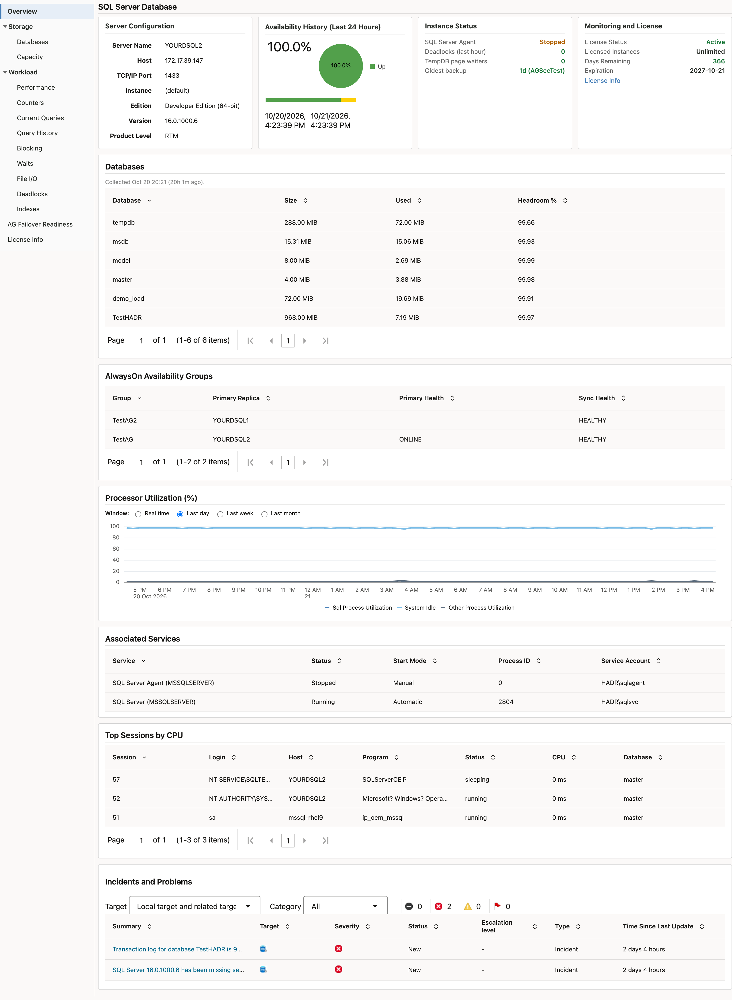

Ten regions, reading top to bottom:

| Region | What it tells you |
| :--- | :--- |
| Server Configuration | Server name, host, port, instance, edition, version and product level |
| Availability History | Percentage up over the last 24 hours, with the status timeline |
| Instance Status | SQL Server Agent state, deadlocks in the last hour, tempdb page waiters, and the oldest backup across all databases |
| Monitoring and License | Licence status, licensed instance count, days remaining, expiry |
| Databases | Size, used, free and headroom per database |
| AlwaysOn Availability Groups | One row per group, with primary replica and health |
| Associated Services | The Windows services behind the instance and their state; empty on a Linux host |
| Processor Utilization | SQL process, system idle and other process CPU, over real time, 24 hours, a week or a month |
| Top Sessions by CPU | Ten sessions with login, host, program and database |
| Incidents and Problems | Every open incident on the target, newest first |

Four things worth knowing:

**Oldest backup shows `Never` in red when a database has no backup at all.** That is a real state, not a collection failure. A database that has genuinely never been backed up is reported as never rather than being folded in with a large day count, because the two need different responses.

**The top-row cards do not all populate at the same rate.** Availability history collects every minute, instance status every five, and licence data hourly, so those three are populated well within the first hour of a new target. Server configuration is on a 24 hour schedule, but the card falls back to a live read of the instance when the repository has nothing yet, so it is not blank either. The Databases card below it is the one that genuinely waits, because per-database space is a 24 hour metric with no fallback. See [What a blank region means](#blank).

**The Monitoring and License card is what an unlicensed target looks like.** If the licence status is anything but `Active`, this card is where you see it — see [Troubleshooting](troubleshooting.md#license) for what each status means and what to do. The [License Info](#license-info) page has the detail.

**Processor Utilization defaults to the 24 hour window.** Switching it to Real Time triggers a live collection against the instance rather than reading stored data, so it is the one control on the page that puts load on SQL Server when you use it. On SQL Server 2017, 2019 and 2022 on Linux the operating system's idle counter is not readable, so the chart says so and plots SQL Server's own process CPU instead of a blank; the CPU threshold does not fire on those instances.

**Top Sessions by CPU is an unordered sample**, ten sessions drawn from the 500 using the most CPU, not the ten highest. Enterprise Manager does not preserve the order a collection returns and this table does not re-sort. The Current Queries tables are ranked in the repository and are not affected.

## Databases {#databases}

Everything about the databases on the instance, and where the backup and restore actions live.

Eleven regions: **Database Size**, **Space Trend**, **Database Summary**, **Database Composition**, **Backup Management**, **Space Usage (Used vs Free)**, **Physical Reads and Writes per Second**, **Physical Bytes Read and Written per Second**, **Database Files**, **Filegroups** and **AlwaysOn Database Replicas**.

A selector at the top of the page drives every region on it. Leave it on all databases for the instance-wide view, or pick one database to narrow the whole page to it at once rather than hunting for that database's row in each region separately. The summary tile shows headroom, the space the data files can still grow into on their volume, which is the figure the free-space alert is evaluated on; see [Alerts and thresholds](alerts-and-thresholds.md#headroom).

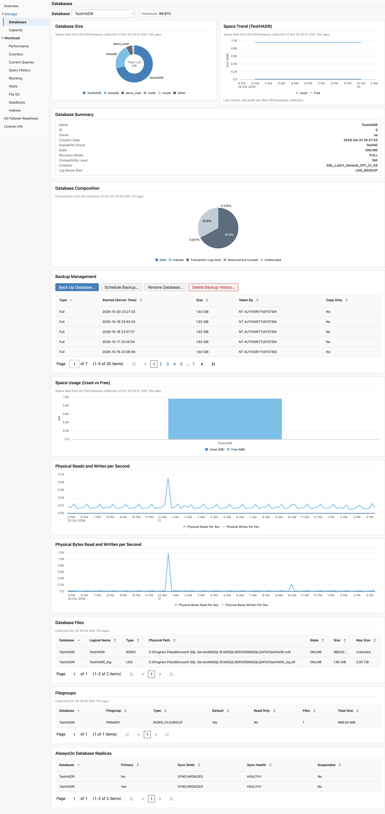

Backup Management lists the backup sets on record for the selected database, and is where **Back Up**, **Schedule Backup**, **Restore** and **Delete Backup History** are submitted. Schedule Backup submits the same backup job on an Enterprise Manager schedule, once or daily, at a start time you pick in your own local time; a daily schedule then repeats at that time of day in the repository's time zone, for ten years or until you stop it. The job appears under Enterprise, Job, Activity, where it can be edited or stopped like any other job, and the dialog says it has been scheduled, not run. All of these are jobs, and jobs have their own credential requirements that are separate from monitoring, so read [Jobs](jobs.md#prerequisites) before you submit one from this page.

Per-database space is a 24 hour metric. It is the single most common reason a new target shows an empty Databases region on its first day.

## Performance {#performance}

The instance-level performance surface. Thirteen regions covering three kinds of thing:

- **Summary tiles.** Performance Summary: the key figures as they stand, including the CPU tile, which says when system CPU is not available on this platform and shows SQL Server's own CPU instead.
- **Charts over time.** Processor Load, Process Memory Utilization, Database I/O in operations and in bytes, Cache Hit Ratios per Interval, Average Wait Times per Interval, Server Network Rates, Server Error Rates, Server Read/Write Rates.
- **Current-state tables.** Top Processes, Database I/O Detail, and Server Statistics, which is cumulative since the instance restarted and says so in its title.

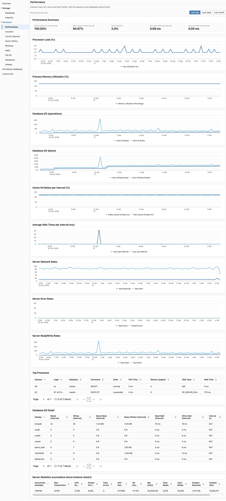

The per-interval charts are the ones to trust for rates. Several SQL Server counters are cumulative since the last service restart, and a raw cumulative value answers almost no useful question. The plug-in differences those counters between collections, and for anything collected per database it differences each database separately before summing, so a database being attached or detached between two samples cannot masquerade as a spike or a lull.

Two of the charts do not offer a Real Time window. Their values are measured over the collection interval, and a real-time poll would change what the scheduled collection records. The raw counter tables that used to sit at the foot of this page are now the [Counters](#counters) page.

## Counters {#counters}

Five tables, one row per counter: **General Statistics**, **SQL Statistics**, **Buffer Manager**, **Memory Manager** and **Plan Cache**, read from `sys.dm_os_performance_counters`.

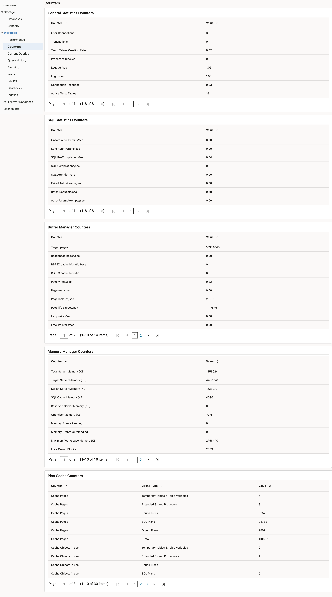

These are reference lists you consult once you already suspect something, not what you scan on arrival, which is why they have a page of their own rather than the foot of Performance. Each table's Value column is a per-second rate for the bulk counters and the raw value for the rest, and the column label says which.

## Current Queries {#queries}

Six regions: **Top Queries by Cumulative CPU**, **Top Queries by Cumulative Executions**, **Top Queries by Cumulative Memory Grant**, **Query Plan Statistics (Plan Cache, Cumulative)**, **Query Store** and **Performance History Comparison**.

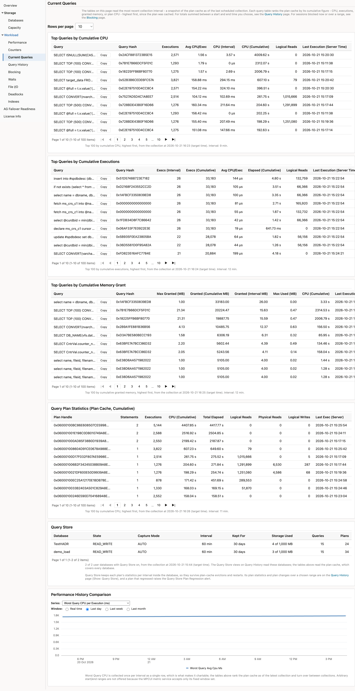

This page answers "what is expensive right now". Every table reads the most recent collection, a snapshot of the plan cache as of the last scheduled collection, and the note at the top of the page says so. For what was expensive between two times, see [Query History](#query-history); for sessions blocked now or over a range, see [Blocking](#blocking). The pages link to each other.

The four query tables are ranked in the repository by their cumulative figure since each plan was cached, CPU, executions, granted memory or plan CPU, highest first, so page 1 is the real top ten. Up to 100 rows are held, ten at a time by default; the **Rows per page** control at the top of the page offers 25 and 50 for every table, and the browser remembers the choice.

Each table's caption states the interval its "(Interval)" columns cover, taken from the collection itself, and flags a late collection, an interval much longer than the group's schedule, which is what an agent or target outage looks like. Rows with no previous sample to difference against, a first collection, a restart or a plan-cache clear, say so instead of showing an interval.

**The "(Interval)" CPU, execution and memory figures are per collection interval, not lifetime totals.** SQL Server's own counters are cumulative since the plan was compiled, which means a query that ran hard last week and has been idle since still carries a large number. The plug-in differences them between collections, so what you see is what that query cost during the interval, and a query that has stopped running falls to zero instead of staying near the top of the list forever.

The query tables read the plan cache, which means they show what SQL Server currently remembers, not a complete history. A query that ran expensively an hour ago and has since been evicted will not appear. Anything evicted between collections is gone; the page does not reconstruct it. Query Store, where it is on, is what survives eviction: the **Query Store** region lists each user database with Query Store on, its capture mode, interval, retention and storage, and those databases are the ones the Query Store views on Query History can read.

Every query cell has a **Copy** button beside the truncated statement. It puts the whole statement on the clipboard as Enterprise Manager stores it, and reads "Copied" for a moment to confirm. Statement text longer than 4000 bytes is cut at 4000, and line breaks and tabs were folded to spaces when the text was collected, so a copied statement may need reformatting before it is run.

## Query History {#query-history}

The page to open after the fact: which queries burned the most CPU between two times you pick, summed over that range and genuinely ranked. Use it when someone asks what was running during an incident.

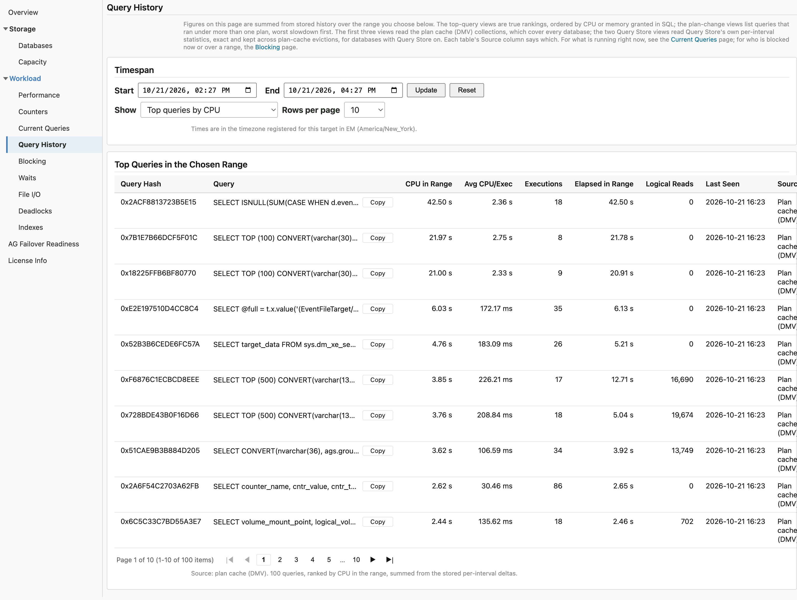

Set **Start** and **End** in the Timespan panel and choose **Update**; **Reset** returns to the last two hours. The range accepts times, not just dates, so a fifteen-minute window around an incident is a reasonable thing to ask for. The rules shared with the other range pages, timezone, retention and the hourly rollup, are under [Pages that take a time range](#timespan).

**Show** chooses what the table holds. Five views:

- **Top queries by CPU**, the default. The top 100 queries in the range by CPU, ten to a page by default. For each: the query hash, the query text, CPU in the range, average CPU per execution, executions, elapsed time, logical reads, and when it was last seen.
- **Top queries by memory granted.** The memory granted across every execution in the range, not the memory held at any one moment, so a query granted 20 MB on each of 100 executions shows 2,000 MB. Beside it, granted per hour and the average grant per execution, which is the one to compare against max server memory when a single large grant is the suspect.
- **Queries whose plan changed.** Every query that ran under more than one execution plan in the range, one row per plan, grouped by query, the query whose plan got slower by the most first. Each plan shows its average CPU and logical reads per execution and how its average CPU compares with the query's earliest plan in the range, then the executions and CPU it actually used inside the range. This is how to tell whether a query degraded because SQL Server chose a different plan. It needs no Query Store.
- **Query Store: top queries** and **Query Store: plan changes.** The same two questions answered from SQL Server's Query Store instead of the plan cache, for databases where Query Store is on. Figures are exact sums over the Query Store intervals collected in the range and survive plan-cache evictions and restarts. Each row is one plan of one query, named by database and Query Store query id, with the plan id, marked "forced" when the plan is forced. In the plan-changes view the plan the plug-in calls current also shows the ratio the plan regression alert fires on. An interval arrives once it closes, every 60 minutes by default, so the most recent hour of a range may not be in yet.

Every table has a **Source** column, plan cache (DMV) or Query Store, and the note under it says the same.

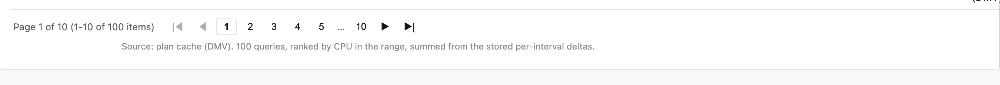

**Show plan**, on each plan row of the three plan views, fetches that plan's XML on demand through the Show Query Plan job and shows it under the table, with a download as a `.sqlplan` file that SQL Server Management Studio opens as a graphical plan. The job reads the plan cache first and then Query Store in any database where it is on, so a plan that has left the cache can still be found. It needs the same job prerequisites as every other console action; see [Jobs](jobs.md#prerequisites). When no plan is found the job's message says why where it can.

**Rows per page** and **Copy** are the same controls as on Current Queries, and the two pages share the rows-per-page choice.

Three things worth knowing before you rely on it.

**The figures are sums of what each collection measured**, not a cumulative plan-cache number. That is what makes a range meaningful: a query that ran hard for ten minutes three hours ago shows those ten minutes, and a quiet range shows nothing rather than carrying a lifetime total forward.

**A query is counted from the second collection it appears in.** The first has nothing to difference against, so it contributes nothing rather than a guess. Collections run every 15 minutes, which means a query that started and finished inside a single interval, and had never been seen before, can be missing from a range that covers it. A query that runs repeatedly is unaffected. The Query Store views do not have this limit, because Query Store keeps the figures itself.

**The plan views see a plan only while its statement is among the 500 using the most CPU at a collection**, so a cheap query's plan change can go unrecorded. Plans of one query running side by side, for example the same query in several databases, are listed as well; their first and last seen times show which is which.

If you need a cut the page does not offer - a different ranking, more rows, or a join to something it does not show - the statement behind the CPU view is not hidden. It is `XMSS_TOP_QUERIES_CPU_RANGE`, in the plug-in's MPCUI descriptor on the OMS:

```
<OMS_HOME>/plugins/ip.em.xmss.oms.plugin_<version>/metadata/mpcui/ip_mssql_database.xml
```

It reads `MGMT$METRIC_DETAILS`, `MGMT$METRIC_HOURLY` and `MGMT$METRIC_CURRENT`, and takes the target GUID, the rollup-half lower bound, the raw/rollup boundary and the end time, with dates as `yyyy-mm-dd hh24:mi:ss`. Anyone with repository read access can run it against any window. One row it returns is a sentinel whose query hash is `__XMSS_NO_ROWS__`; it exists so the result set is never empty, and you should discard it. The Blocking page's statement, `XMSS_BLOCKING_HISTORY_RANGE`, lives in the same file and returns the same sentinel.

## Blocking {#blocking}

Both sides of every block on one row: the blocked session and the session blocking it, the SQL text of each, how long the blocked request has waited, the wait type, the wait resource, and the database. The wait resource is what tells you whether the block is on a table, an index key, a page or a row, and it is shown whole. **Head Blocker** names the session at the top of the chain, which is the one to act on when one blocker has blocked another.

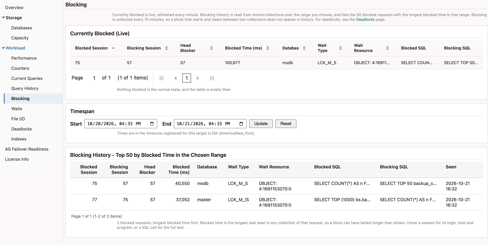

Two regions. **Currently Blocked (Live)**, at the top, is live and refreshes every minute. It is empty when nothing is blocked, which is the normal state, and it is the region to reach for during a live incident. **Blocking History**, below it, lists the 50 blocked requests with the longest blocked time between the Start and End you choose in the Timespan panel; it opens on the last 24 hours. Hover a session id for its login, host and program, or a SQL cell for the full statement. Seen shows the first and last collection that caught the request.

The blocked side's SQL is the statement that was waiting. The blocking side's SQL is the statement it was running at the time or, if it was idle holding an open transaction, the commonest cause of a long block, the last batch it sent, which is usually the one that took the locks.

Three limits worth knowing:

1. Blocking is collected every 15 minutes, so a block that started and cleared between two collections does not appear in history. Blocked time is the longest wait any collection saw, which makes it a lower bound on how long the block really lasted.
2. History reaches back as far as raw metric retention, seven days by default. There is no hourly-rollup half as there is on Query History, because the SQL text, the wait resource and the session details are not kept in the rollup. If your range starts earlier than the stored history, the page says how far back it goes.
3. SQL text is capped at 4000 characters.

## Waits {#waits}

Which wait types the instance spent its time on between a start and end you choose, from the wait statistics the plug-in stores every 15 minutes as per-interval deltas. The figures are the wait accrued in the range, not since the server started.

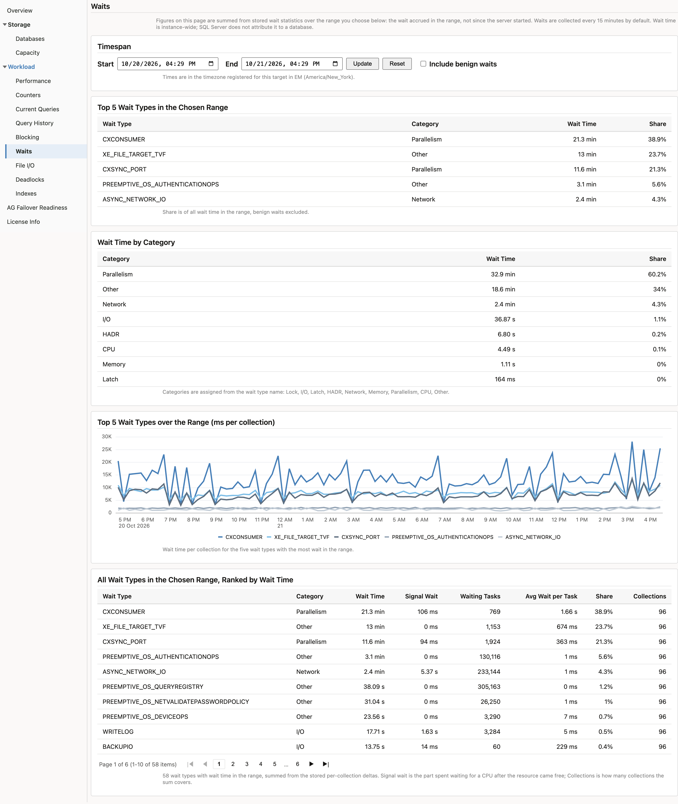

Four regions, all governed by the Timespan panel: **Top 5 Wait Types in the Chosen Range** with their share of all wait time, **Wait Time by Category**, **Top 5 Wait Types over the Range** as a trend per collection, and **All Wait Types in the Chosen Range** ranked by wait time, with signal wait (time spent waiting for a CPU after the resource came free), waiting tasks, average wait per task and share.

Categories are assigned from the wait type name: Lock, I/O, Latch, HADR, Network, Memory, Parallelism, CPU, and Other for everything else.

**Benign waits are excluded by default.** These are the types SQL Server accrues while idle or on its own background schedules, the `SLEEP_*`, `BROKER_*`, `QDS_*` and `XE_*` families and their like, and left in they occupy the top of every list. Tick **Include benign waits** to see them; the shares and the trend are recomputed against the larger total.

Wait time is instance-wide. SQL Server keeps no database dimension on it, so the page carries no database column.

Collection runs every 15 minutes by default. A site that wants finer resolution can set the `WaitTypeHistory` group to 5 minutes for a target under Monitoring, Metric and Collection Settings, with no plug-in change. The page's sums are the same at any interval; the trend gains points. The default is not 5 minutes because the group writes about 150 rows per collection per target, and tripling that across an estate is a repository-volume decision for the site.

## File I/O {#file-io}

Which database files were busy and which were slow between a start and end you choose, from the per-file and per-database I/O statistics the plug-in stores every 15 minutes as per-interval deltas.

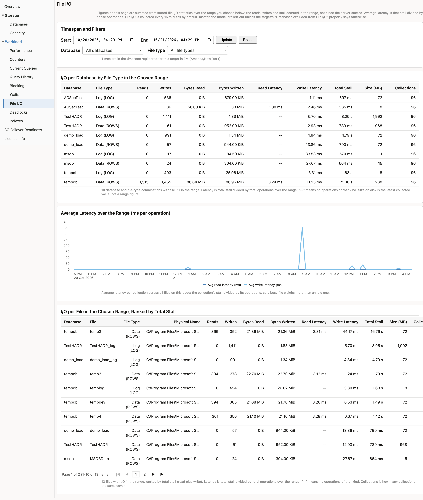

Three regions, all governed by the Timespan panel and its two filters, **Database** and **File type**: **I/O per Database by File Type** (data versus log), an **Average Latency over the Range** trend per collection, and **I/O per File**, ranked by total stall, ten at a time. Each grid shows reads, writes, bytes read and written, average read and write latency, total stall, size on disk and how many collections the sums cover.

Average latency is the stall accrued over the range divided by the operations in the range, in milliseconds, so a busy interval weighs more than an idle one. A file with no operations of that kind in the range shows "--", not zero. The same quotient is stored per interval as Avg Read Latency and Avg Write Latency, which is what the per-file latency thresholds evaluate; see [Alerts and thresholds](alerts-and-thresholds.md#thresholds). Size on disk is the latest collected value, not a range figure.

**master and model are excluded by default**: the two groups leave them out at collection, so they are neither on the page nor in the alert. The target property **Databases excluded from File I/O** changes that: a comma-separated list of database names replaces the default rather than adding to it, and the word `none` keeps every database. tempdb is included by default because its file latency is one of the first things to look at. A change takes effect at the next collection. The Database I/O charts on the Performance page are not affected by the list and stay instance-wide.

As with waits, the `FileIoStats` and `DatabaseIoByType` groups can be set to 5 minutes for a target without a plug-in change; the sums and ratios are the same at any interval.

## Deadlocks {#deadlocks}

Three regions: **Deadlock Rate** over time, **Deadlock Summary (current)**, and **Recent Deadlocks** with the victim, the participating processes and the resources.

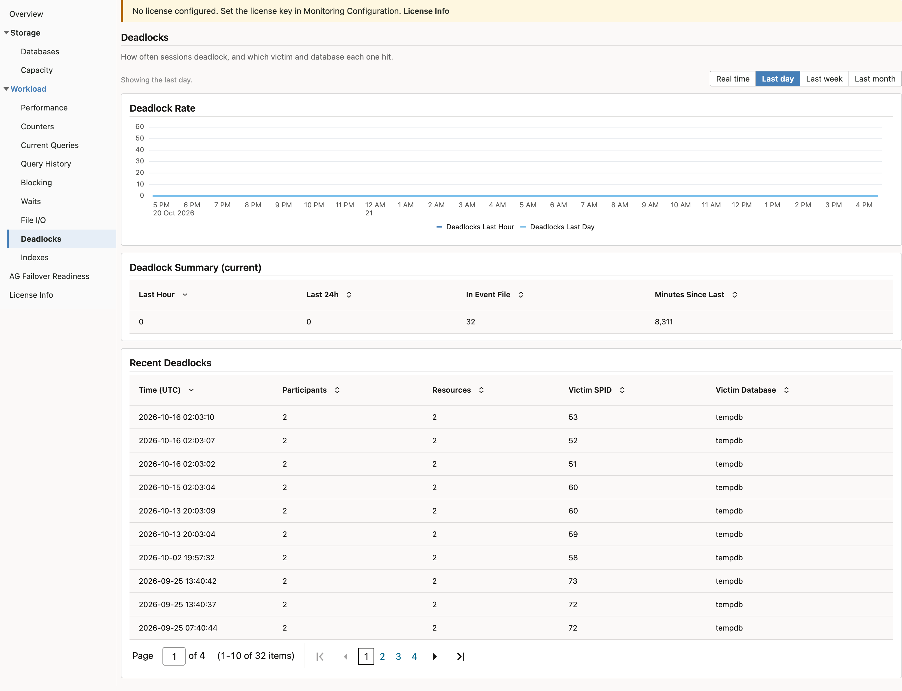

Deadlock detail comes from the `system_health` Extended Events session, which SQL Server runs by default. If someone has disabled that session on the instance, the rate will still be collected but the detail regions will be empty, and that is a configuration state on the instance rather than a plug-in fault.

Victim Database is the name the database had at the time of the deadlock, read from the deadlock graph itself, so a database that has since been dropped or renamed shows its name then, not now.

## Indexes {#indexes}

Where index space goes, how one index is used, and which indexes need attention. Seven regions: **Index Findings** (counts of missing indexes, unused indexes and indexes that need a rebuild), **Index Size**, **Index Activity** for the selected index, **Index Details** (size and fragmentation per index, summed over partitions, beside its reads and updates), **Missing Indexes**, **Unused Indexes** and **Indexes That Need a Rebuild**, plus a **Create Index** action.

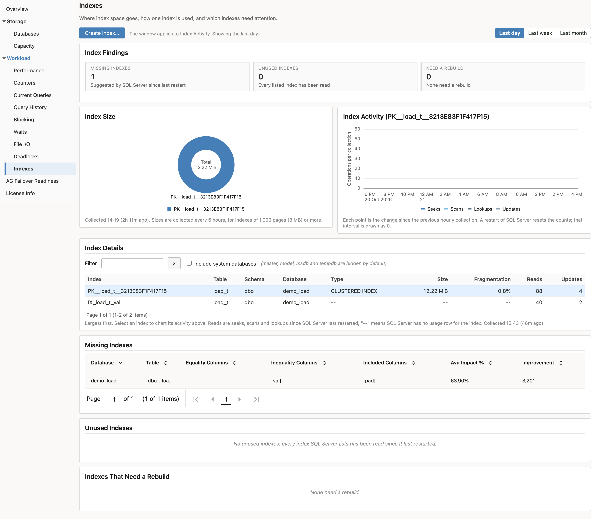

Every region but Missing Indexes reads the last stored collection, so opening the page does not re-run the fragmentation scan against the instance. The caption at the top says when that collection ran.

Fragmentation collection has a floor: indexes smaller than 1000 pages, measured over the whole index, are not reported. That is deliberate. Fragmentation on a small index is not worth acting on, and scanning every small index is the expensive part of the query. If the rebuild and details regions are empty on a real instance, the usual reason is that nothing on it is big enough to qualify, not that collection failed.

Missing Indexes reports what SQL Server's own optimiser recorded as a missing index. Treat those as candidates to evaluate, not instructions. The optimiser records them per query without weighing the cost of maintaining the index against every other workload on the table. Select a row and **Create Index** pre-fills the dialog from it; the dialog has its own Database field and builds the three-part name for you.

## Capacity {#capacity}

Three regions: **Database Capacity (used / free)**, **Volume Free Space** and **File Growth Settings**. This page was named Analysis in the Open Beta.

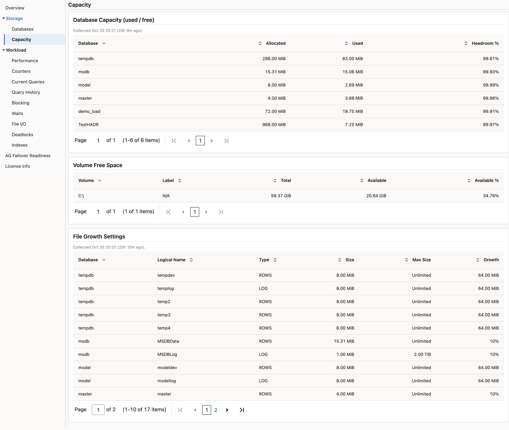

This is the capacity-planning page rather than a performance one. File Growth Settings is the region most worth reading on a new instance, because percentage-based autogrowth on a large data file is a common inherited default and a bad one: each growth event gets larger than the last, and the pauses grow with it.

On a Linux host, Volume Free Space shows a single row with blank volume and label cells and the smallest free space. The volume low-space alert still fires, without naming the volume.

## AG Failover Readiness {#ag-failover}

The live table at the top, **DR Readiness (per database, per secondary)**, answers a question the built-in dashboards do not: if you failed over right now, what would it cost. One row per availability group database per secondary replica, with readiness, sync state, recovery point and recovery time in seconds, the send and redo queues and the send and redo rates, refreshed every minute.


Rows appear when this target is the current primary of an availability group, for every group it is primary of; the table is empty on a standalone instance, a non-AG target or a secondary replica. Monitor the primary, or its listener, to see failover readiness. Send and redo rates are the engine's own figures and are blank while a secondary is disconnected.

Under it, one Timespan panel governs two regions that read the stored collections rather than the live instance:

- **Replication over the Chosen Range (per database, per secondary):** the average and the peak of the log send queue, redo queue, log send rate and redo rate across the collections in the range, the worst sync state seen and the latest one. As with the live table, rows exist only for ranges in which this target was a primary.
- **HADR Wait Types in the Chosen Range (instance-wide):** every HADR, redo-thread and parallel-redo wait type with wait time in the range, summed from the same per-interval deltas the Waits page uses, with its share of the HADR family's total. The Waits page's benign exclusion is not applied here, because two of the types worth watching on a busy secondary are on it. Waits are instance-wide, so this region is populated on a secondary replica too: it is the secondary's own redo and flow-control waits, which is where to look when a secondary falls behind.

The critical threshold sits on the replica link rather than on the readiness verdict, which is a deliberate design decision with a real consequence for what alerts you. [High availability](high-availability.md#failover-readiness) explains why. The readiness group collects every 15 minutes by default and, like waits, can be set to 5 minutes per target.

## License Info {#license-info}

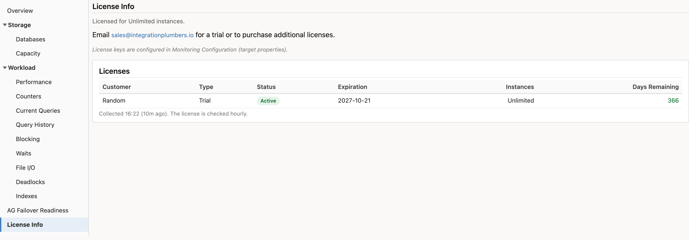

The licence status for this target as of the last check: customer, licence type, status, expiry, licensed instance count and days remaining, with a line saying when the check ran. Keys are entered in the target's monitoring configuration, not here; see [Targets and properties](targets-and-properties.md#properties). What each status means, and what to do about one that is not `Active`, is in [Troubleshooting](troubleshooting.md#license).

## Pages that take a time range {#timespan}

Query History, Blocking, Waits, File I/O and the lower half of AG Failover Readiness share a **Timespan** panel: set **Start** and **End** and choose **Update**; **Reset** returns to the page's default window (the last two hours on Query History, the last 24 hours on the others). The inputs carry minutes, and the query behind them carries seconds, so a range can be as short as you like.

**Times are in the timezone Enterprise Manager has registered for the target**, not your browser's and not necessarily the SQL Server host's own clock. The panel names that timezone under the inputs, and that label is the thing to read; the two can differ, and on a monitored host running UTC they will. The default window is in the same timezone, so the page opens on the target's last two hours, not yours.

**Ranges older than raw metric retention**, `metric_values_retention`, seven days by default, are served from Enterprise Manager's hourly rollup instead. The two halves are split on an hour boundary so nothing is counted twice, but the rollup half is measured in whole hours: it runs from the start of the hour your range begins in to the end of the hour it ends in, so its totals can include a little activity either side of the times you typed. The page says so when that half is in use. Blocking has no rollup half, because the session detail is not kept in the rollup.

**If a range reaches back further than the repository actually kept**, the page says how far the history goes rather than quietly reporting a short total. That is what you will see on a newly deployed plug-in, or on a site that has lowered `metric_values_retention` below the default.

**Nothing is reconstructed.** If the collection behind a page was not running during the range, or the instance was down, the page says no activity was collected in that range.

## What a blank region means {#blank}

A blank region is one of three things, and they are worth telling apart before raising a support request. The **Collector Status** metric, on the target's All Metrics page, says which: one row per metric group with a status word and a reason. See [Troubleshooting](troubleshooting.md#collector-status).

1. **The metric has not collected yet.** Server configuration and per-database space are on a 24 hour schedule, so a target created this morning may not have them until tomorrow. Most other things arrive far sooner: availability every minute, instance status every five, licence and backup age hourly. Collector Status reads `NOT_COLLECTED_YET`.
2. **There is genuinely nothing to report, or the feature is not set up.** An instance with no availability group shows an empty AlwaysOn region. An instance with no index over 1000 pages shows an empty rebuild region. A database without Query Store on contributes nothing to the Query Store views. All correct: Collector Status reads `NO_DATA`, `NOT_CONFIGURED` or `DISABLED`, with the reason.
3. **Collection is failing.** Collector Status reads `COLLECTION_ERROR` with the error, and after two checks in a row a CRITICAL incident names the group. See [Troubleshooting](troubleshooting.md#collector-status).

The first case is the one that catches people out, because a brand new target is exactly when someone is most likely to be looking at the console and least likely to assume the answer is "wait".

## Collection intervals {#intervals}

Intervals range from one minute for instance availability to 24 hours for server configuration and per-database space, with the query, wait, file I/O, blocking and availability-group families on 15 minutes, index fragmentation on 6 hours, and Collector Status and the Windows services on 5 minutes. They are visible and changeable per target under **Monitoring** then **Metric and Collection Settings**, in the same place as the thresholds. See [Alerts and thresholds](alerts-and-thresholds.md#changing).

Shortening a 24 hour collection to get a page populated sooner is possible and occasionally reasonable on a lab instance. It is a poor idea on a production one: those metrics are on a long schedule because the queries behind them are the expensive ones. Shortening the 15 minute range groups to 5 minutes is a different matter, described on the Waits and File I/O pages above; the pages are correct at any interval, and the cost is repository volume.

## Related

- [Getting started](getting-started.md#first-look) - which page to read first on a new target
- [Alerts and thresholds](alerts-and-thresholds.md) - what alerts you on the data these pages show
- [High availability](high-availability.md) - availability groups, failover clusters, and the readiness surface
- [Jobs](jobs.md) - the backup, restore and query plan actions on these pages, and their credential requirements
- [Compliance rules](compliance-rules.md) - the configuration findings that complement the Capacity page
- [AI clients and the MCP Server](mcp-server.md) - the same data read by an assistant rather than a page
- [Troubleshooting](troubleshooting.md) - when a page is empty and it is not one of the expected reasons
