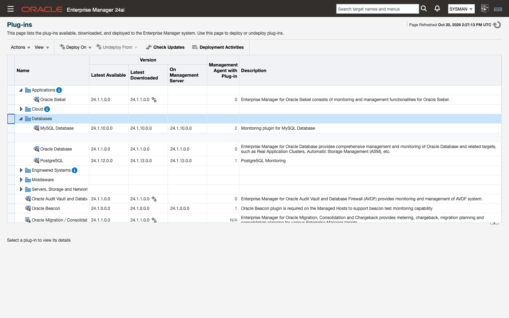
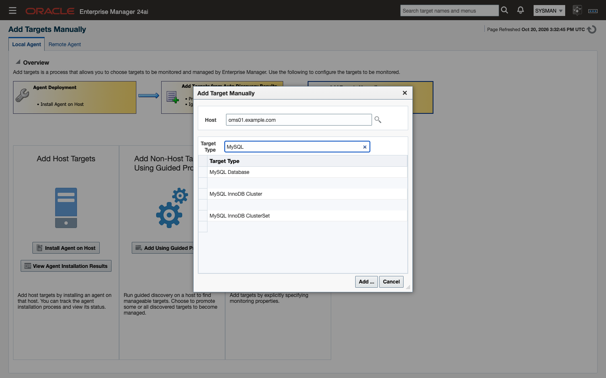
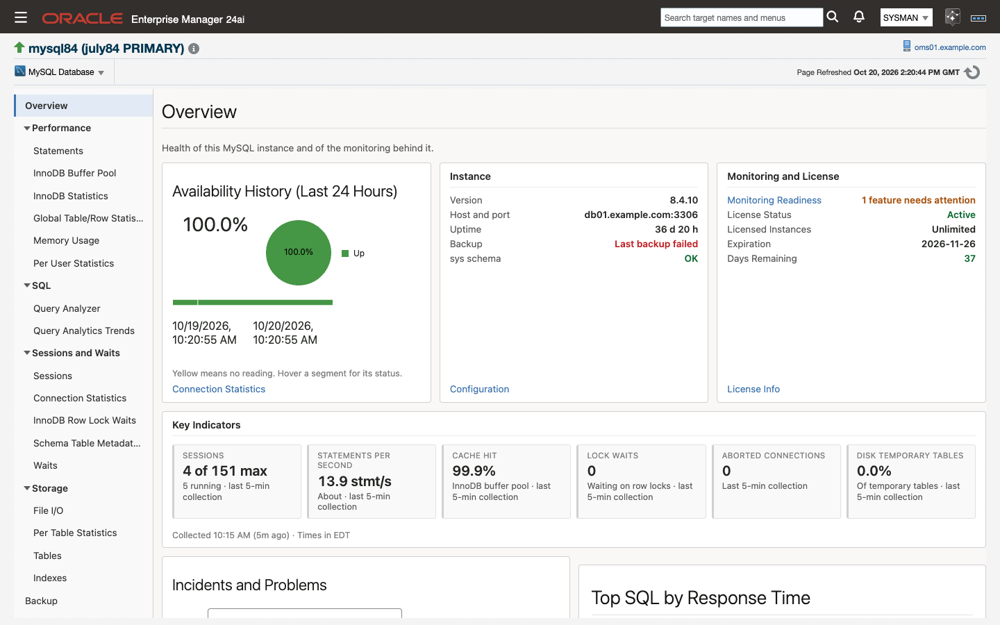

# Getting started

If you have not deployed the MySQL plug-in before, this page is the whole path: six steps that take an Enterprise Manager with no MySQL targets to a console with real data in it. Each step links to the detail rather than repeating it.

> **Prerequisites for this page**
> - Enterprise Manager access that can import an OPAR and deploy plug-ins, for example `sysman`. See [Prerequisites](prerequisites.md#21-enterprise-manager-and-agents).
> - A Linux Management Agent on, or with network reach to, each MySQL server. Windows agents are not supported in this release.
> - The ability to create an account on the MySQL server you want to monitor. See [Prerequisites](prerequisites.md#24-the-monitoring-user) for the exact grants.
> - Your license key for `ip.em.xmys`, from your Integration Plumbers contact.

**Where to find it:** install and deployment under Setup ▸ Extensibility; the target under Setup ▸ Add Target ▸ Add Targets Manually; everything the plug-in shows you afterwards under the target's own menu.

**In this page:** Before you start · Install the plug-in · Add your first target · Check it worked · What to look at first · If something is wrong

One fact shapes the whole page: a MySQL Database target comes **Up** without a license key and then collects nothing but availability. The target looks healthy in All Targets while every metric page stays empty. Enter the key when you create the target.

## 1. Before you start {#before}

Have these to hand:

| What | Notes |
|---|---|
| The OPAR that matches your EM line | `24.1.10.0.0` for Enterprise Manager 24ai, `13.5.10.0.0` for 13.5. They are not interchangeable: EM refuses the other one at import with `Incompatible version` |
| The MySQL server's address and port | Default `3306`. A local agent can use the Unix socket instead; see [Prerequisites](prerequisites.md#26-unix-socket-connections) |
| A monitoring account on that server | `SELECT`, `PROCESS` and `REPLICATION CLIENT`. The exact statements are in [Prerequisites](prerequisites.md#24-the-monitoring-user) |
| Your license key | One per licensed MySQL Database target. Cluster and ClusterSet targets are containers and need no key |
| MySQL Connector/J | One `mysql-connector-j-*.jar` (8.4.0 is the tested version) on each agent host that will monitor MySQL, in the agent's `ip_plugin/xmys/lib` directory, placed before the plug-in is deployed to that agent. The driver is not inside the plug-in. Download, checksum and directory: [Prerequisites](prerequisites.md#29-mysql-connectorj-on-agent-hosts) |

If you plan to monitor an InnoDB ClusterSet, also install MySQL Shell (`mysqlsh`) on the agent host now; see [Prerequisites](prerequisites.md#22-mysql-shell-for-clusterset-targets). Without it, ClusterSet health falls back to a repository rollup that cannot assess DR promotion readiness.

## 2. Install the plug-in {#install}

Import the archive, deploy it to the management server, then to the agent that will do the monitoring. The full procedure is in [Install and upgrade](install-and-upgrade.md).

```bash
emcli login -username=<em administrator>
emcli import_update -file=/tmp/<artifact>.opar -omslocal
emcli deploy_plugin_on_server -plugin=ip.em.xmys
emcli get_plugin_deployment_status -plugin=ip.em.xmys      # wait for Success
emcli deploy_plugin_on_agent -plugin=ip.em.xmys -agent_names="<agent host>:<port>"
```

On EM 24ai the server deployment prompts for the repository SYS password; on 13.5 pass it as `-sys_password`. A release that moves target metadata restarts the OMS during the server deployment; the status command tells you when it is back.

Deploy the agent side in the same maintenance window as the OMS side. Until you do, metrics added by that release show no data on their pages.



**Done when** `emcli get_plugin_deployment_status -plugin=ip.em.xmys` reports Success for the OMS and for each agent, and the Plug-ins page lists the MySQL Database plug-in at the release's version.

## 3. Add your first target {#add-target}

In the console, go to **Setup → Add Target → Add Targets Manually**, click **Add Target Manually**, choose the agent host and the **MySQL Database** type, and fill in the host, port, monitoring credentials and the **License Key**.



With `emcli`:

```bash
emcli add_target -name="<server>" -type=ip_mysql_database -host=<agent host> \
  -properties="ip_mysql_database_host:<mysql host>;ip_mysql_database_port:3306;ip_mysql_database_license:<key>" \
  -credentials="ip_mysql_database_username:<user>;ip_mysql_database_password:<password>"
```

`-host` is the agent host, the machine doing the monitoring, while `ip_mysql_database_host` is the MySQL server. They are often different machines, and swapping them is the most common mistake at this step.

Every property is listed in [Targets and properties](targets-and-properties.md#41-target-properties).

**Done when** the target appears under All Targets and its status reads Up.

## 4. Check it worked {#check}

Within a few minutes the target shows **Up**, its Overview page fills in, and the **License** metric reports `Active`.



Those are three separate signals and they fail independently:

- **Up** means the agent reached MySQL and got a response. If it stays Down, the problem is connectivity or credentials.
- **`License` = `Active`** means the key was accepted. Anything else stops ordinary collection; see [Troubleshooting](troubleshooting.md#license).
- **A populated Overview page** means collections are running and uploading.

A target that is Up with an empty Overview page is almost always the license key.

**Done when** all three signals read as above.

## 5. What to look at first {#first-look}

Open the target's Overview page and work down the left-hand navigation:

1. **Overview**: availability, version and uptime, the license, and the key indicators (sessions, statements per second, cache hit, lock waits) at a glance.
2. **Sessions and Waits → Sessions**: who is connected and what they are running right now, the quickest confirmation that the plug-in sees your real workload.
3. **SQL → Query Analyzer**: the statement digests, ordered by the cost you care about, with the plan for any of them one click away.
4. **Performance → InnoDB Buffer Pool**: hit rate and usage. The buffer pool hit rate is one of the shipped alert thresholds.

Every page is described in [Monitoring pages](monitoring-pages.md), and every metric in the [Metrics reference](metrics-reference.md).

## 6. If something is wrong {#wrong}

Start with [Troubleshooting](troubleshooting.md). It opens with the license-gate symptoms, which account for most of what people hit in the first hour. The target's Monitoring Readiness page checks the privileges, `performance_schema`, the `sys` schema, the backup tables, the license and MySQL Shell, and shows the statement to run for each gap.

If the answer is not there, send it to your Integration Plumbers support contact, with:

- the plug-in version (`emcli list_plugins_on_server`)
- your EM version (24ai or 13.5)
- the MySQL version and edition
- the metric group or console page involved
- any deploy log, agent log or collection-error text

Next: [Prerequisites](prerequisites.md) for the full requirements, or [Troubleshooting](troubleshooting.md) if something already needs fixing.
