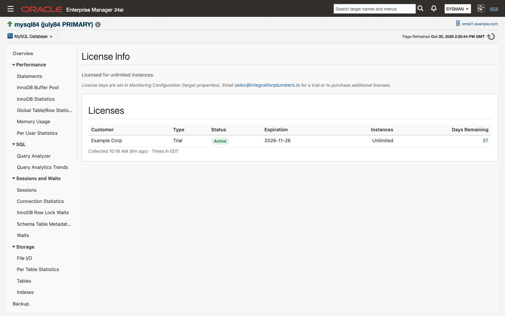
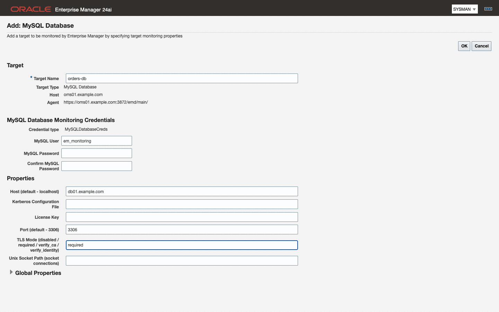
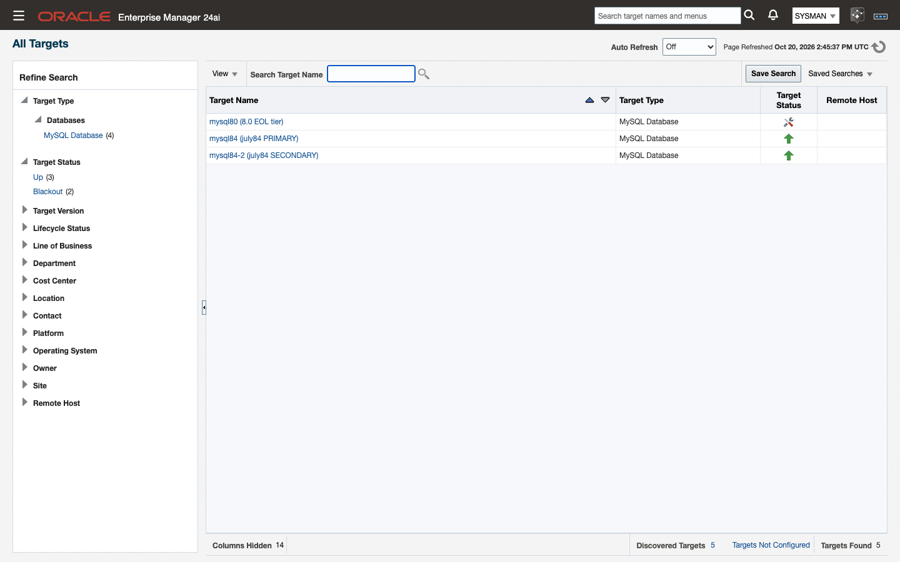

# Adding and modifying targets

This chapter describes adding MySQL database, cluster and ClusterSet targets from the console and with EM CLI, autodiscovery, modifying and removing targets, and associating compliance standards.

> **Prerequisites for this page**
> - The plug-in deployed to the agent that will monitor the target ([3.3](install-and-upgrade.md#33-deploy-to-agents)). Until it is, the MySQL target types are not offered for that agent.
> - The monitoring account and its password ([2.4](prerequisites.md#24-the-monitoring-user)), and a network path from the agent host to the MySQL endpoint ([2.3](prerequisites.md#23-network-and-ports)).
> - A license key for each MySQL Database target ([4.1](#41-target-properties)).

**Where to find it:** Setup ▸ Add Target ▸ Add Targets Manually to add a target; the target's own menu ▸ Target Setup ▸ Monitoring Configuration to change one; Enterprise ▸ Compliance ▸ Library to associate the standards.

**Topics:** 4.1 Target properties · 4.2 Add a target manually · 4.3 Add a target with EM CLI · 4.4 Autodiscovery · 4.5 Modify or remove a target · 4.6 Associate compliance standards · 4.7 Bulk onboarding and migration
## 4.1 Target properties
Every MySQL target is defined by the same small set of monitoring properties, whichever way you add it. The names in bold are the labels on the console page; the names in parentheses are the property keys EM CLI takes ([4.3](#43-add-a-target-with-em-cli)).

**User** and **Password** are credential properties. In the console they appear in the credentials area of the Add Target page, labeled **MySQL User** and **MySQL Password**; with EM CLI they go in `-credentials` rather than in `-properties`.

**MySQL Database (`ip_mysql_database`)**

| Property | Key | Value |
|---|---|---|
| **User** | `ip_mysql_database_username` | the monitoring account from [2.4](prerequisites.md#24-the-monitoring-user), user name only, without the host part |
| **Password** | `ip_mysql_database_password` | that account's password |
| **Host (default - localhost)** | `ip_mysql_database_host` | host name or IP address of the MySQL server as the agent host reaches it. Empty only for a socket connection ([2.6](prerequisites.md#26-unix-socket-connections)). One host: a MySQL Database target is one server, and the Run EXPLAIN job passes these values as comma-separated arguments; endpoint lists are for Cluster and ClusterSet targets |
| **Port (default - 3306)** | `ip_mysql_database_port` | the server's listening port |
| **Unix Socket Path (socket connections)** | `ip_mysql_database_socket` | full path to the server's socket file; local agent only, with Host left empty |
| **TLS Mode (disabled / required / verify_ca / verify_identity)** | `ip_mysql_database_use_secure` | transport security for this target ([2.5](prerequisites.md#25-tls)) |
| **Kerberos Configuration File** | `ip_mysql_database_kerberos_config` | full path to a `krb5.conf` on the agent host, for Kerberos authentication |
| **License Key** | `ip_mysql_database_license` | the signed license key issued for this plug-in, pasted as one line |

**License Key.** The console lets you add the target without a key, but nothing except availability collects until the key is accepted. The `License` metric reports the reason (`License Required` for no key) and raises a CRITICAL incident, and every other metric group on the target reports a collection error, `Collection stopped by license status: …`, until the status is `Active`. Availability keeps reporting, so the target stays Up rather than Down. Cluster and ClusterSet targets are containers, not licensed targets, and are never stopped.

The key is checked entirely on the agent host, every 15 minutes and again as soon as the property changes; nothing is sent to the MySQL server or outside Enterprise Manager. The `Status` column of the `License` metric gives the reason a key is not accepted: `Invalid Signature` (the key was altered), `Wrong Plug-in` (a key issued for a different plug-in; the 24ai and 13.5 editions share one key), or `Expired`.



**MySQL InnoDB Cluster (`ip_mysql_cluster`)**

The same properties, with the `ip_mysql_cluster_` prefix in place of `ip_mysql_database_`, and two labels that read differently.

**(Router) Host** (`ip_mysql_cluster_host`) and **(Router) Port** (`ip_mysql_cluster_port`) take a MySQL Router endpoint, any member of the cluster, or a comma-separated list of them (members, or two Routers), so the target survives losing one. The target reads cluster-wide state through whichever member it lands on.

| Host | Port | Result |
|---|---|---|
| `mysql-a,mysql-b,mysql-c` | `3306` | every host on that port |
| `mysql-a,mysql-b,mysql-c` | `3306,3307,3308` | paired in order |
| `mysql-c` | `1830,1831,1832` | one host, several ports |

Any other combination, or an empty entry, is rejected. So is an entry that is not a plain host name, IP address or `[IPv6]` literal, a port outside 1 to 65535, or more than 16 endpoints: the target shows Down and every collection reports the error, rather than guessing.

The connection tries the list in order and moves on when a member does not answer. The connect timeout is 10 seconds for a single endpoint and 15 seconds shared across a list, never less than 5 seconds per attempt. With every member down the driver makes one extra attempt on the first entry before giving up, so budget N+1 attempts, not N.

**User** and **Password** (`ip_mysql_cluster_username`, `ip_mysql_cluster_password`): the monitoring account must carry the grants in [2.4](prerequisites.md#24-the-monitoring-user) on the cluster. Created on the primary, it replicates to every member. **TLS Mode**, **Unix Socket Path** and **Kerberos Configuration File** behave as they do for a MySQL Database target.

**MySQL InnoDB ClusterSet (`ip_mysql_clusterset`)**

The same properties again with the `ip_mysql_clusterset_` prefix, plus one that only this type has.

**(Router) Host** and **(Router) Port** (`ip_mysql_clusterset_host`, `ip_mysql_clusterset_port`) take the Router endpoint, a member, or a comma-separated list of members, with the same rules as the Cluster target above. Both the JDBC collections and the MySQL Shell session try the list in order; listing every member of every cluster is the configuration that survives losing any one of them.

A MySQL Router port works on both paths with password authentication. The Router forwards the JDBC connections and the MySQL Shell session to the current primary, and the AdminAPI still reports the cluster-wide view, so `health_source` reads `ADMINAPI` behind a Router exactly as it does on a member. List two Routers (`router-1,router-2` with Port `6446`) to survive losing one. With Kerberos, list member endpoints instead, because MySQL Shell cannot log in with Kerberos through a Router ([2.2](prerequisites.md#22-mysql-shell-for-clusterset-targets)).

Availability (the `Response` metric) is Up while any listed endpoint answers. Whether the ClusterSet is healthy is a separate question, answered by the `ClusterSetHealth` metric from the AdminAPI's cluster-wide view and never from the member that happened to answer. A member of a failed cluster answering the connection cannot make the target look healthy, and a failed member cannot make a healthy ClusterSet look Down.

The MySQL Shell session has its own process budget, separate from the JDBC connect timeout: 60 seconds for a single endpoint (30 seconds base plus a fixed 30-second reserve for the AdminAPI's status fan-out to every cluster member), plus the list's per-attempt budget for a list of more than one endpoint (the same 15 seconds shared, with a 5-second floor). A longer list is given proportionally more time to try every member before it is stopped.

**DR Max Tolerated GTID Lag (transactions)** (`ip_mysql_clusterset_dr_max_lag`): how many transactions the replica cluster may be behind the primary cluster and still count as ready for promotion. The `dr_promotion_ready` condition ([7.1](alerts-and-thresholds.md#71-default-thresholds)) evaluates against it.

> **Note:** A ClusterSet target also needs `mysqlsh` on its agent host ([2.2](prerequisites.md#22-mysql-shell-for-clusterset-targets)), and in this release its TLS Mode should be `required` or `disabled` ([2.5](prerequisites.md#25-tls)). With a Kerberos Configuration File set, MySQL Shell authenticates with the agent user's ticket and needs member endpoints rather than a Router port ([2.2](prerequisites.md#22-mysql-shell-for-clusterset-targets)).

## 4.2 Add a target manually
Use this route for a single target, and for any endpoint autodiscovery cannot see ([4.4](#44-autodiscovery)).

<video class="walkthrough" src="images/add-target.mp4" poster="images/add-target-final.png" autoplay loop muted playsinline controls aria-label="Adding a MySQL Database target: Add Target Manually, the agent host, the MySQL Database type, then the credentials and properties form filled in"></video>

1. Make sure the plug-in is deployed to the agent that will monitor the target ([3.3](install-and-upgrade.md#33-deploy-to-agents)). Until it is, the MySQL target types are not offered for that agent.
2. In the console, choose **Setup → Add Target → Add Targets Manually**, then click **Add Target Manually**.
3. In the dialog, choose the **Host** that runs the monitoring agent (this is the agent host, not the MySQL server). The host picker lists every agent host.
4. In **Target Type**, type `MySQL` and select **MySQL Database**.

   

5. Click **Add ...**. The **Add: MySQL Database** form opens with the host and agent already filled in.
6. Enter a **Target Name**. This is the display name used throughout the console and the name EM CLI verbs take. `<host>:<port>` is the convention autodiscovery uses and it stays readable at scale.
7. Fill in the monitoring properties from [4.1](#41-target-properties). At minimum supply **MySQL User** and **MySQL Password** (the credentials area, where the page asks for the password twice), **Host**, **Port** and the **License Key**, plus **TLS Mode** if the server requires an encrypted session. A target added without a key comes Up but collects nothing except availability until a key is accepted ([4.1](#41-target-properties)).
   

8. Click **OK** to create the target. The page has only **OK** and **Cancel**: there is no Test Connection step for these target types, so the first check of the properties is the target's own status.
9. Wait for the target to appear in the console, which takes a couple of minutes, and confirm that it comes **Up**. If it stays Down, the cause is a credential, network or TLS problem. Correct the credentials or properties under **Target Setup → Monitoring Configuration** ([4.5](#45-modify-or-remove-a-target)); you do not need to remove and re-add the target.

Repeat for **MySQL InnoDB Cluster** and **MySQL InnoDB ClusterSet**, choosing that target type in step 4 and filling in the properties listed for it in [4.1](#41-target-properties).

Once the target is Up, its metric groups populate on their own schedules.

**Done when** the target shows Up on All Targets and its Overview page fills with the first collections ([5.1](monitoring-pages.md#51-mysql-database-pages)).

> **Note:** On Enterprise Manager 13.5 the Add Targets Manually page offers **Add Targets Declaratively by Specifying Target Monitoring Properties** instead of a dialog. Select it, choose the target type and the **Monitoring Agent**, and click **Add Manually** to reach the same form as step 6.

> **Note:** On an Enterprise Manager 13.5 site that also has Oracle's own MySQL plug-in deployed, the **Target Type** list shows two entries named **MySQL InnoDB Cluster** and two named **MySQL InnoDB ClusterSet**. Pick the one whose form shows the credential type `MySQLClusterCreds` (cluster) or `MySQLClusterSetCreds` (ClusterSet). Those are the Integration Plumbers types.

> **Note:** Cluster and ClusterSet targets are independent of the MySQL Database targets for the same servers. You can add either without the other, and adding a cluster target does not create database targets for its members.

## 4.3 Add a target with EM CLI
EM CLI creates the same target as the console and is the practical route once you are onboarding more than a handful of servers.

`add_target` takes the display name, the target type, the **agent** host, and the monitoring properties split across two options:

| Console target type | `-type` value | Property prefix |
|---|---|---|
| MySQL Database | `ip_mysql_database` | `ip_mysql_database_` |
| MySQL InnoDB Cluster | `ip_mysql_cluster` | `ip_mysql_cluster_` |
| MySQL InnoDB ClusterSet | `ip_mysql_clusterset` | `ip_mysql_clusterset_` |

| Console field | Key (`<prefix>` from the table above) | Option |
|---|---|---|
| User | `<prefix>username` | `-credentials` |
| Password | `<prefix>password` | `-credentials` |
| Host / (Router) Host | `<prefix>host` | `-properties` |
| Port / (Router) Port | `<prefix>port` | `-properties` |
| Unix Socket Path | `<prefix>socket` | `-properties` |
| TLS Mode | `<prefix>use_secure` | `-properties` |
| Kerberos Configuration File | `<prefix>kerberos_config` | `-properties` |
| License Key (MySQL Database only) | `ip_mysql_database_license` | `-properties` |
| DR Max Tolerated GTID Lag (ClusterSet only) | `ip_mysql_clusterset_dr_max_lag` | `-properties` |

> **Note:** on Cluster and ClusterSet targets, `<prefix>host` and `<prefix>port` accept the comma-separated lists described in [4.1](#41-target-properties). Commas inside a value pass straight through EM CLI; the `;` between properties and the `:` after each name are unchanged.

Both options take `key:value` pairs separated by `;`. Log in first with `emcli login -username=<em user>`.

A MySQL Database target:

```bash
emcli add_target -name="mysql84-prod-01" -type="ip_mysql_database" \
  -host="agent-host.example.com" \
  -properties="ip_mysql_database_host:10.0.0.21;ip_mysql_database_port:3306;ip_mysql_database_use_secure:required;ip_mysql_database_license:<license key>" \
  -credentials="ip_mysql_database_username:em_monitoring;ip_mysql_database_password:<password>"
```

A MySQL InnoDB Cluster target, pointed at a Router endpoint:

```bash
emcli add_target -name="mysql84-prod-cluster" -type="ip_mysql_cluster" \
  -host="agent-host.example.com" \
  -properties="ip_mysql_cluster_host:10.0.0.30;ip_mysql_cluster_port:6446;ip_mysql_cluster_use_secure:required" \
  -credentials="ip_mysql_cluster_username:em_monitoring;ip_mysql_cluster_password:<password>"
```

A MySQL InnoDB ClusterSet target, which adds the DR lag tolerance:

```bash
emcli add_target -name="mysql84-prod-clusterset" -type="ip_mysql_clusterset" \
  -host="agent-host.example.com" \
  -properties="ip_mysql_clusterset_host:10.0.0.30;ip_mysql_clusterset_port:6446;ip_mysql_clusterset_use_secure:required;ip_mysql_clusterset_dr_max_lag:100" \
  -credentials="ip_mysql_clusterset_username:em_monitoring;ip_mysql_clusterset_password:<password>"
```

The same ClusterSet behind two MySQL Routers, so that losing one Router does not take the target Down (the list rules are in [4.1](#41-target-properties); password authentication, because MySQL Shell cannot log in with Kerberos through a Router, 2.2):

```bash
emcli add_target -name="mysql84-prod-clusterset" -type="ip_mysql_clusterset" \
  -host="agent-host.example.com" \
  -properties="ip_mysql_clusterset_host:router-1.example.com,router-2.example.com;ip_mysql_clusterset_port:6446;ip_mysql_clusterset_use_secure:required;ip_mysql_clusterset_dr_max_lag:100" \
  -credentials="ip_mysql_clusterset_username:em_monitoring;ip_mysql_clusterset_password:<password>"
```

A ClusterSet target that authenticates with Kerberos lists its members, names the Kerberos configuration file, and carries the **username only**. Leave the password key out of `-credentials` altogether: `add_target` rejects an empty password value, and the ticket in the agent user's credential cache is the credential ([2.2](prerequisites.md#22-mysql-shell-for-clusterset-targets)):

```bash
emcli add_target -name="mysql84-prod-clusterset-krb" -type="ip_mysql_clusterset" \
  -host="agent-host.example.com" \
  -properties="ip_mysql_clusterset_host:mysql-a.example.com,mysql-b.example.com,mysql-c.example.com,mysql-d.example.com,mysql-e.example.com,mysql-f.example.com;ip_mysql_clusterset_port:3306;ip_mysql_clusterset_use_secure:required;ip_mysql_clusterset_kerberos_config:/etc/krb5.conf;ip_mysql_clusterset_dr_max_lag:100" \
  -credentials="ip_mysql_clusterset_username:em_monitoring"
```

Confirm the target was created:

```bash
emcli get_targets -targets="mysql84-prod-01:ip_mysql_database"
```

**Done when** `get_targets` lists the target and its status reads Up within a few minutes.

> **Note:** `-host` names the **agent** host that will monitor the target. The MySQL endpoint goes in the `<prefix>host` property, and the two are usually different: the same agent host appears in every command when one agent monitors many servers.

> **Note:** If a value has to contain `;` or `:`, override the separators rather than escaping them. Run `emcli help add_target` for the `-separator` and `-subseparator` syntax.

## 4.4 Autodiscovery
Enterprise Manager can propose MySQL Database targets for you on hosts it already monitors.

The plug-in's agent-side discovery detects every listening `mysqld` process on a monitored agent host and proposes one target per instance, named `<host>:<port>`. The name carries no process ID, so it is stable across restarts, and several instances on one host are proposed separately by their listening ports.

Agent-side discovery has to be enabled for the host before anything appears: under **Setup → Add Target → Configure Auto Discovery**, enable the MySQL discovery module on each host you want scanned and set its schedule.

To adopt a proposed target:

1. Choose **Setup → Add Target → Auto Discovery Results**.
2. Select the proposed MySQL Database target and click **Promote**.
3. Supply the monitoring credentials ([2.4](prerequisites.md#24-the-monitoring-user)) and the remaining properties from [4.1](#41-target-properties). **TLS Mode** in particular cannot be discovered; set it explicitly ([2.5](prerequisites.md#25-tls)).
4. Click **Promote** to finish. The target comes Up; it starts collecting once its **License Key** property is set (discovery does not supply one: open the target, *Target Setup → Monitoring Configuration*, and paste the key; see [4.1](#41-target-properties)).

> **Note:** Managed-cloud MySQL (Amazon RDS and Aurora, OCI MySQL HeatWave, Google Cloud SQL, Azure Database for MySQL and their equivalents) has no host process for an agent to see, so it is never autodiscovered. Add those endpoints manually ([4.2](#42-add-a-target-manually) or 4.3), using the service endpoint as Host and its port.

#### Amazon RDS for MySQL

Certified 2026-09-09 on RDS MySQL 8.4.11. The standard monitoring user ([2.4](prerequisites.md#24-the-monitoring-user)) collects every metric group with zero collection errors; nothing RDS-specific is needed beyond a security-group rule that admits the agent host on the endpoint port. What you see that differs from a self-managed server, none of it a defect:

- RDS snapshots are not MySQL Enterprise Backup or XtraBackup runs, so `BackupHistory` has no rows and `BackupStatus` reports both tools absent with no backup age, and the backup thresholds stay silent. Watch RDS backups in AWS.
- The AWS-managed accounts trip the account rules. `rdsadmin@localhost` (ALL PRIVILEGES, `auth_socket`) and the `rds_superuser_role` role (and the master user through that role) violate the security standard's SUPER, GRANT OPTION, PROCESS, `mysql`-schema-write and wildcard-host rules. You cannot change those accounts; treat the violations as the documented baseline for RDS, or exclude the standard's account rules for RDS targets.
- RDS defaults fire configuration rules that a hardened self-managed server would pass: redo/undo and binary-log encryption off, no keyring, `require_secure_transport` off (the 8.4 family default), password validation not installed, `local_infile` on, `sql_mode` not strict. Binary logging itself is off while automated backups are disabled (backup retention 0), which also fires the binary-logging rule. Change what the parameter group and backup settings allow; accept the rest as the managed baseline.
- Replica-side, Enterprise-only and lock-wait groups are empty on a stand-alone RDS instance, as on any server without a replica, the audit-log or firewall components, or lock contention: no rows, no errors. Table statistics appear once user tables see I/O.
- RDS MySQL 8.4 accepts plain and TLS connections by default, and TLS Mode `required` ([4.1](#41-target-properties)) works against the RDS endpoint. Verifying the RDS certificate chain (TLS Mode `verify_ca` or `verify_identity`) needs the truststore credential set and is not yet certified.

#### Amazon Aurora MySQL

Certified 2026-10-24 on Aurora MySQL 8.4.8 (Serverless v2, one writer instance). Add the cluster's writer endpoint as Host; the standard monitoring user ([2.4](prerequisites.md#24-the-monitoring-user)) collects the same metric groups as RDS MySQL 8.4 with zero collection errors. Everything in the RDS list above applies to Aurora as well, with these differences:

- The Aurora MySQL 8.4 parameter-group family sets `require_secure_transport` on, so TLS Mode `required` ([4.1](#41-target-properties)) is the setting to use; a target left on plain TCP fails to connect.
- Aurora turns `performance_schema` on by default only when Performance Insights is enabled. The certified instance set `performance_schema=1` in its instance parameter group before it started (a static parameter: set it before the first start, or reboot after). Without it the statement, wait and file groups report nothing and Monitoring Readiness says so.
- Aurora snapshots and continuous backup are not MySQL Enterprise Backup or XtraBackup runs, so the backup groups are empty as on RDS; watch Aurora backups in AWS.
- `InstanceInfo` reports Aurora's own paths (`/rdsdbbin/oscar-8.4.mysql_aurora.<build>/` as the base directory, `/rdsdbdata/db/` as the data directory); the version reads as the MySQL-compatible version, `8.4.8`.

#### OCI MySQL HeatWave

Certified 2026-10-25 on HeatWave MySQL 8.4.13 (`8.4.13-cloud`, MySQL Enterprise - Cloud), one standalone DB System without a HeatWave cluster attached. The standard monitoring user ([2.4](prerequisites.md#24-the-monitoring-user)), created by the DB System's `admin` account, collects every metric group the Aurora MySQL 8.4 reference collects, plus `AuditLogActivity` because the Enterprise audit log plug-in is active on a DB System, with zero collection errors. Everything in the RDS list above applies here too, with these differences:

- A DB System has a private endpoint only (an address in its subnet, no public IP), so the agent needs a route to it: an agent host inside the VCN or one reached over FastConnect or a VPN, or a public Network Load Balancer in the DB System's subnet forwarding TCP 3306 to the private endpoint, which is how the lab reached it. Put the load balancer's public address in **Host**. The subnet's security list has to admit the agent's address and, for a load balancer, the subnet's own CIDR for health checks and forwarded traffic.
- The DB System accepts plain and TLS connections by default (`require_secure_transport` off, unlike the Aurora 8.4 family), offering TLS 1.2 and 1.3 with a certificate OCI issues to the endpoint. TLS Mode `required` ([4.1](#41-target-properties)) works; the certified target used it and the plug-in connects over TLS 1.3. Verifying that certificate (TLS Mode `verify_ca` or `verify_identity`) is not yet certified, as for RDS.
- `performance_schema` is on by default, with the `sys` schema present, so the statement, wait and file groups collect without any parameter change.
- OCI backups are not MySQL Enterprise Backup or XtraBackup runs, and the `mysql.backup_history` table does not exist on a DB System; the plug-in detects that through `information_schema`, so `BackupStatus` reports both tools absent with no backup age and no collection error, and the backup thresholds stay silent. Watch backups in the OCI console.
- The OCI-managed accounts (`administrator`, locked; `ociadmin` and `ocidbm` at `127.0.0.1`; `ocirpl` at any host; `oracle-cloud-agent` and `rrhhuser` on `auth_socket` at `localhost`) trip the security standard's account rules beside your own accounts: on the certified DB System, SUPER (5 accounts), PROCESS (6), GRANT OPTION (3), wildcard host (4), FILE, SHUTDOWN and `mysql`-schema write. You cannot change those accounts; treat the violations as the managed baseline for HeatWave, or exclude the account rules for DB System targets.
- DB System defaults fire configuration rules a hardened self-managed server would pass: `require_secure_transport` off, redo, undo and binary-log encryption off, no default table encryption, no keyring component, `local_infile` on, password lifetime and reuse unrestricted, the audit log unencrypted, binary logs expiring after one hour (the administration standard's retention rule), `binlog_row_image` at `FULL` and source checksum verification off (two replication rules). Binary logging itself is on with GTIDs, `sql_mode` is strict and `validate_password` is installed at `MEDIUM`, so the rules behind those pass. Change what the DB System configuration allows; accept the rest as the managed baseline.
- Replica-side groups are empty on a standalone DB System: the `group_replication` plug-in is loaded but `OFFLINE`, and there are no replication channels, so the replica groups have no rows and no errors. The source-side groups (`ReplicationSource`, `ReplicationSourceActivity`) do report, since binary logging and GTIDs are on, with a replica count of zero.
- `InstanceInfo` reports the DB System's own paths (`/usr/` as the base directory, `/db/data/` as the data directory, `/db/tmp` as the temp directory); the version reads `8.4.13-cloud`.

#### MariaDB

A MariaDB target can be added the same way and collects most of the database groups, but nine groups stay empty or report collection errors: the four InnoDB status groups, two security groups and three replication-channel groups. MariaDB does not ship the MySQL schemas those groups read (the MySQL InnoDB monitor layout, `performance_schema.global_variables`, `mandatory_roles`, `replication_connection_status`, `mysql.slave_master_info`), so the gaps are properties of MariaDB, not defects the plug-in can work around. The plug-in is for MySQL Server and the managed services built on it; Integration Plumbers does not support or certify it on MariaDB.

MySQL InnoDB Cluster and MySQL InnoDB ClusterSet targets are not autodiscovered either. They are added against an endpoint you choose, so create them manually.

## 4.5 Modify or remove a target
Monitoring properties can be changed at any time; the change applies from the next collection.

To change a target's properties in the console:

1. From the target's home page, choose the target-type menu → **Target Setup → Monitoring Configuration**.
2. Edit the properties ([4.1](#41-target-properties)) and click **OK**.

Editing credentials, host, port or TLS Mode is the normal way to move a target to a new endpoint or to turn encryption on. You do not need to remove and re-add the target for any of them.

To remove a target, choose the target-type menu → **Target Setup → Remove Target** and confirm.



The EM CLI equivalents:

```bash
emcli modify_target -name="mysql84-prod-01" -type="ip_mysql_database" \
  -properties="ip_mysql_database_port:3307" -on_agent
```

```bash
emcli delete_target -name="mysql84-prod-01" -type="ip_mysql_database"
```

`-on_agent` pushes the change to the agent immediately instead of waiting for the next agent resynchronization.

> **Note:** Removing a target removes its collected metric history and its compliance associations with it. A target re-added under the same name starts both over, so prefer editing a target's properties to deleting and recreating it.

## 4.6 Associate compliance standards
Adding a target does not associate compliance standards with it: neither the console wizard nor emcli add_target carries an association, so a new target has no compliance evaluations until you associate the standards.

The plug-in ships five standards for `ip_mysql_database` targets, collected in one framework:

| Standard | Internal name |
|---|---|
| MySQL Administration Standard | `xmys_administration_standard` |
| MySQL Performance Standard | `xmys_performance_standard` |
| MySQL Replication Standard | `xmys_replication_standard` |
| MySQL Schema Standard | `xmys_schema_standard` |
| MySQL Security Standard | `xmys_security_standard` |

All five are authored by `INTEGRATION_PLUMBERS` at version 1. [Chapter 9](compliance-rules.md#compliance-standards) describes the framework and every rule in it.

From the console:

1. Choose **Enterprise → Compliance → Library**.
2. On the **Compliance Frameworks** tab, select **MySQL Framework (Integration Plumbers)**. To associate a single standard instead, switch to the **Compliance Standards** tab and select one of the five.
3. Click **Associate Targets**.
4. Add the MySQL Database targets you want evaluated, then click **OK** and confirm.

With EM CLI, associate one standard at a time:

```bash
emcli associate_cs_targets -name="xmys_security_standard" -version=1 \
      -author=INTEGRATION_PLUMBERS -target_list="mysql84-prod-01"
```

Repeat the command for each of the five internal names you want evaluated on that target.

> **Note:** The two options take different name forms. `-name` takes the standard's *internal* name from the table above; `-target_list` takes the target *display name* alone.

Results appear on the target's compliance pages once a configuration collection has run against the newly associated standards. See [9.2](compliance-rules.md#92-associating-standards-and-reading-results) for reading them.

**Done when** the target's Compliance ▸ Results page lists the five standards with an evaluation date.

## 4.7 Bulk onboarding and migration
For more than a handful of targets (and for moving an estate off the Oracle MySQL plug-in) use the
`mysql-onboard.sh` script ([download](downloads/mysql-onboard.sh), [example inventory](downloads/inventory.example.csv)).
It exports the existing targets to a CSV, creates the replacement GA plug-in targets side by side with
`add_target` / `modify_target -on_agent`, verifies Up and license, associates the standards from [4.6](#46-associate-compliance-standards), and retires
the sources on request. The full sequence, the review flags and the threshold worksheet are in the
[migration chapter](migration-from-omys.md).

The same script moves targets from the Open Beta plug-in (`ip.em.xmyb`) to this release; the migration chapter covers it.
