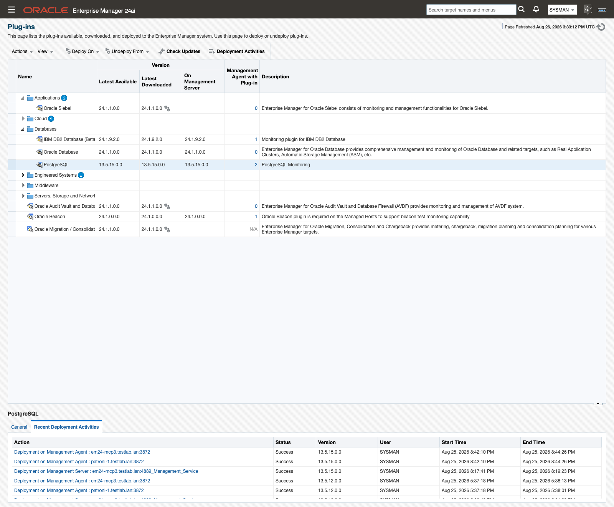

# Install and upgrade

Installing or upgrading the PostgreSQL plug-in follows Oracle Enterprise Manager's standard plug-in lifecycle: import the OPAR onto the OMS, deploy it to the OMS and to each monitoring agent, then license and add your targets. If you're moving an existing 13.5.x deployment forward, the same import-and-deploy sequence upgrades it in place, with no separate migration step.

> **Prerequisites for this page**
> - Your Enterprise Manager, agent, and PostgreSQL versions are supported — see [Supported versions and platforms](prerequisites.md#supported-versions).
> - You have OMS access to import the OPAR and an account (for example `sysman`) with plug-in deployment privileges for `emcli` — see [Enterprise Manager and agents](prerequisites.md#enterprise-manager).

**Where to find it:** Setup → Extensibility → Plug-ins → Databases → PostgreSQL → Actions → Deploy On, or the equivalent `emcli` plug-in commands shown below.

**In this page:** License key · Download · Import the OPAR · Deploy to the OMS · Deploy to agents · Upgrade from an earlier release · After an upgrade · Uninstall

## License key

A valid license key is required to monitor a target with the PostgreSQL plug-in. To purchase a license, contact [sales@integrationplumbers.io](mailto:sales@integrationplumbers.io). To request a trial license, visit the [trial page](https://integrationplumbers.io/postgresql-plugin/trial).

You enter the key per target, in the `Plugin License` target property (see [Database target properties](targets-and-properties.md#database-properties)). To confirm a target's key is recognized, open its **License Info** page.

## Download {#download}

Download details for the release zip are provided during the order process or trial enrollment. The zip holds the plug-in OPAR, the OPAR's SHA-256 checksum, and the four monitoring template files (`.template.xml`) under `xpgs_monitoring_templates_v1/`, with a SHA-256 checksum of the zip beside it. The plug-in ships as two plug-in builds with the same features: **24.1.4.0.0** for Enterprise Manager 24ai and **13.5.18.0.0** for Enterprise Manager 13.5; download the one that matches your Enterprise Manager (the 13.5.18.0.0 build also installs on 24ai, but the 24.1.4.0.0 build does not install on 13.5). If you need access to the download, email [helpdesk@integrationplumbers.io](mailto:helpdesk@integrationplumbers.io) or contact us through [integrationplumbers.io](https://integrationplumbers.io). Verify the checksum of each file before you import it.

## Import the OPAR {#import}

1. Log in to `emcli` and enter the password when prompted:

   ```
   emcli login -username=sysman
   ```

2. Make sure `emcli` is synchronized with the OMS:

   ```
   emcli sync
   ```

3. Import the OPAR file:

   ```
   emcli import_update -file=<PATH_TO_FILE> -omslocal
   ```

## Deploy to the OMS {#deploy-oms}

1. Navigate to Setup → Extensibility → Plug-ins.
2. Expand the Databases folder and click PostgreSQL.
3. From the Actions menu, click Deploy On → Management Servers and follow the on-screen instructions.


*The Plug-ins page after the OPAR is imported. The version shown is the build you imported; the screenshot shows an earlier build, 13.5.15.0.0.*

The equivalent `emcli` command:

```
emcli deploy_plugin_on_server -plugin=ip.em.xpgs
```

To check deployment progress from either the console or `emcli`, run:

```
emcli get_plugin_deployment_status -plugin=ip.em.xpgs
```

## Deploy to agents {#deploy-agents}

1. From the same Plug-ins page, select PostgreSQL.
2. From the Actions menu, click Deploy On → Management Agents.
3. Follow the on-screen instructions to select the agent hosts.

The equivalent `emcli` command:

```
emcli deploy_plugin_on_agent -agent_names="<host>:<port>" -plugin=ip.em.xpgs
```

`get_plugin_deployment_status` (shown above) reports agent deployment progress just as it does for the OMS.

## Upgrade from an earlier release {#upgrade}

Upgrading from 13.5.12, or any other 13.5.x release, to this release uses the same three steps as a first-time install: [import the new OPAR](#import), [deploy it to the OMS](#deploy-oms), then [deploy it to every agent](#deploy-agents). Enterprise Manager treats it as a standard plug-in update — your existing targets, thresholds, and credentials carry forward unchanged. Import the build that matches your Enterprise Manager: 24.1.4.0.0 on 24ai, 13.5.18.0.0 on 13.5.

The agent-local history store used by the advisory pages and the history sections is created automatically the first time each target collects after the upgrade, and an existing store gains the new history types the same way. There is no migration step and nothing to run by hand.

## After an upgrade {#after-upgrade}

For up to 24 hours after the upgrade, the OMS may show an "Error getting meta-data" error until its next metadata refresh completes. See [Error getting meta-data after an upgrade](troubleshooting.md#error-getting-meta-data) if you run into it.

Once the plug-in is deployed, open [**Monitoring Readiness**](monitoring-readiness.md) on each target. It shows exactly which prerequisites a given target is still missing.

Coming from 24.1.3.0.0 / 13.5.17.0.0, expect the following:

- **New Plan Insights warnings.** The **Plan Insights** metric's HIGH-severity condition applies to four insight codes added in this release. A sort spilling 256 MB or more to disk, or a hash join of 8 batches or more, raises a Warning on targets that had none before, and a ticket where your incident rules route to a ticketing connector. See [Plan Insights alerts](plan-analysis.md#plan-insights-alerts).
- **History fills from the upgrade onward.** The lock wait history, buffer cache samples, parameter changes, and server log events start accumulating at the first collection after the upgrade. The wraparound forecast is blank for its first 24 hours, and the size projection appears once a week of history exists.
- **Server-log sections need the grant.** The Vacuum Advisor's server-log sections and the Logs page's event sections stay inactive, and say why, until the monitoring role can read the server log. A target where plan capture already works has a grant that covers them. See [Enabling the log-enhanced features](log-enhanced-features.md).
- **Captured plans may read "unknown".** Where `log_line_prefix` carries no `%d`, captured plans are now listed under every database with their database shown as "unknown", where they were previously hidden. See [Log line prefix](log-enhanced-features.md#log-line-prefix).
- **Templates.** If you applied a shipped monitoring template, import and apply the new version to pick up the wraparound forecast and checkpoint spike thresholds. See [Monitoring templates](alerts-and-templates.md#templates).

## Uninstall

1. Remove every PostgreSQL Database and PostgreSQL Cluster target monitored by the plug-in.
2. Undeploy the plug-in from each agent:

   ```
   emcli undeploy_plugin_from_agent -plugin=ip.em.xpgs -agent_names="<host>:<port>"
   ```

3. Undeploy the plug-in from the OMS:

   ```
   emcli undeploy_plugin_from_server -plugin=ip.em.xpgs
   ```

Uninstalling the plug-in does not delete its collected history. The store file, `%plugin_data%/<target name>_collections.sqlite3` (under `<agent state directory>/ip_plugin/xpgs/data`), remains on the agent host until an administrator deletes it.

## Related

- [Prerequisites](prerequisites.md) — confirm supported versions, network access, and the monitoring role before you deploy.
- [Targets and properties](targets-and-properties.md) — add a target and set its `Plugin License` property.
- [**Monitoring Readiness**](monitoring-readiness.md) — check what a target still needs after install or upgrade.
- [Troubleshooting](troubleshooting.md) — fixes for "Error getting meta-data" and other deployment issues.
