# Monitoring pages

If you came here from the Advisors pages, you already know where plan drift, index and vacuum health, and workload trends live. Everything else lives on the pages below: current connections, table and index growth, currently running and blocked queries, the server log, license status, and the PostgreSQL Cluster target's switchover control.

> **Prerequisites for this page**
> - Query Analyzer's statement list and history read from `pg_stat_statements` — see [Statement statistics (pg_stat_statements)](prerequisites.md#pg-stat-statements).
> - Query Analyzer's Wait Events chart needs the optional `pg_wait_sampling` extension — see [Optional extensions](prerequisites.md#optional-extensions) and [Wait-event sampling](workload-history.md#wait-event-sampling).
> - The history sections (Buffer Cache, Parameter Changes, the lock wait history, and the server log events) read the agent-side history store through an Enterprise Manager job, so they need [Preferred Credentials](prerequisites.md#preferred-credentials) set for the target.
> - The Logs page's event sections need [the server log read grant](prerequisites.md#log-read-grant). Its **Log Statistics** and **PostgreSQL Logs** sections need a **local** Enterprise Manager agent (installed on the same host as the PostgreSQL server) and a configured log file path — see [Logs](#logs), below.
> - The Database page's **Buffer Cache** section needs the optional `pg_buffercache` extension — see [Optional extensions](prerequisites.md#optional-extensions).
> - Cluster switchover and the Cluster Events (Patroni) metric need [Patroni REST API monitoring](targets-and-properties.md#patroni) enabled on the cluster target.

**Where to find it:** PostgreSQL Database target navigation tree (Overview, Configuration, and Realtime at the top level; Database, Tables, Indexes, Queries, and Query Analyzer under each database name; License Info at the bottom). PostgreSQL Cluster target: the cluster's target home page.

**In this page:** Page layout · Database target pages · Realtime pages · Schema inventory metrics · Cluster target

## Page layout {#page-layout}

Every page carries a title, and every section sits on its own panel under one heading style. The navigation tree lists the sections of the page you are on under **On this page**; click one to jump to it. Long tables show 15 rows a page.

The history sections described below read the agent-side history store, not the Enterprise Manager repository. Each one has **From** and **To** fields and a **Refresh** button for the window it shows, and a status line that explains an empty or inactive state instead of raising an error. How far back each one reaches is set on [Retention Policies](history-store-and-retention.md#retention-policies).

## Database target pages

Overview, Configuration, and License Info apply to the whole target. Database, Tables, Indexes, Queries, and Query Analyzer are scoped to one database at a time — pick the database from the tree first.

### Overview

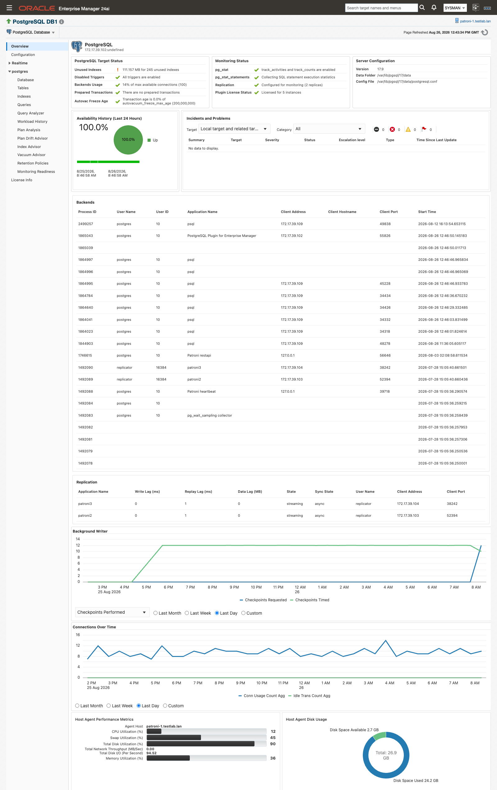

*Overview: target status, incidents, and the Backends, Replication, Background Writer, and Connections Over Time regions.*

**Overview** is the target's landing page. Open it first to see whether a target is healthy at a glance, before drilling into a specific database. It opens on three status panels: **PostgreSQL Target Status** (unused indexes, disabled triggers, backends usage, prepared transactions, autovacuum freeze age), **Monitoring Status** (`pg_stat`, `pg_stat_statements`, replication, and plug-in license status), and **Server Configuration** (PostgreSQL version, data directory, config file path). Below those, availability and open incidents, then a **Backends** table (process ID, user, application, client address/hostname/port, start time) and a **Replication** table (application name, write/replay lag, data lag, state, sync state, client info) for any streaming replicas. **Background Writer** and **Connections Over Time** are trend charts you can switch between Last Day, Last Week, Last Month, or a custom range. The agent host's figures (CPU, memory, swap, and disk utilization, network throughput, and disk I/O) are grouped tiles under the host's name, which links to the host target's home page.

#### Checkpoint History {#checkpoint-history}

**Checkpoint History** shows checkpoint frequency and duration over the retained history, 90 days by default: one point per day for past days and one per collection today, with rates normalized per day so the two compare. Two charts plot **Checkpoints per day** and **Average checkpoint duration (ms)**. The **Background Writer** chart above it is the short-horizon view of the same counters.

Five tiles compare the last 24 hours against the target's own baseline:

| Tile | Shows |
|---|---|
| Checkpoints · last 24h | Checkpoints completed in the last 24 hours |
| Baseline · per day (prior 7d) | The daily average over the seven days before that |
| Spike ratio | The last 24 hours divided by the baseline. The alert threshold is on this value |
| Requested share · 24h | The share of checkpoints that were requested (driven by WAL volume) rather than scheduled |
| Avg duration · 24h | Average checkpoint duration |

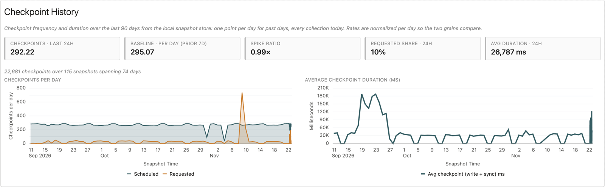

*Checkpoint History: the last 24 hours against the baseline, above the retained history.*

The same figures are columns of the **Background Writer** metric, where the spike ratio ships with a Warning at 2 and a Critical at 3. See [Default thresholds](alerts-and-templates.md#default-thresholds). A high requested share usually means `max_wal_size` is too small for the write load.

#### Database Size History {#database-size-history}

**Database Size History** shows the total size of every database in the cluster over the retained history, 90 days by default, with the growth measured over the last 30 days projected forward on the chart. The projection appears once a week of history has been collected. Tiles give **Cluster size**, **Growth · per day**, **Projected · 30 days**, **Projected · 90 days**, and the depth of **History** behind the figures. Beside the chart, **Databases · last 30 days** lists each database's size, its change, and its change per day, so you can see which database the growth comes from.

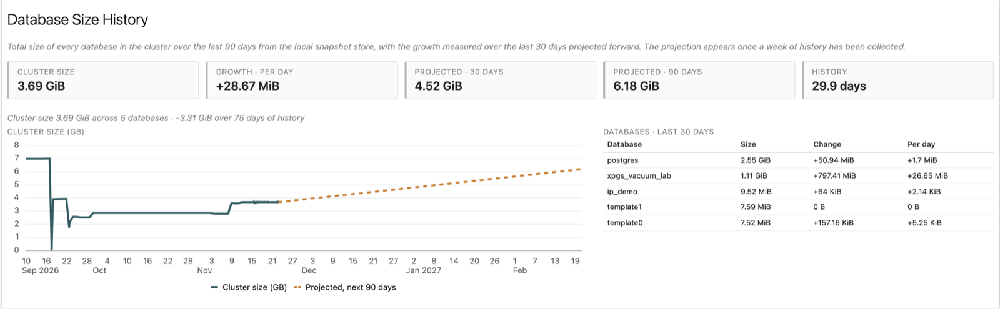

*Database Size History: the dashed line is the projection; the table shows which database the growth comes from.*

The projection is also published as the **Cluster Size Capacity Forecast** metric. Its thresholds ship undefined, because the plug-in cannot see the storage behind the cluster: set them to your own capacity. See [Default thresholds](alerts-and-templates.md#default-thresholds).

### Configuration

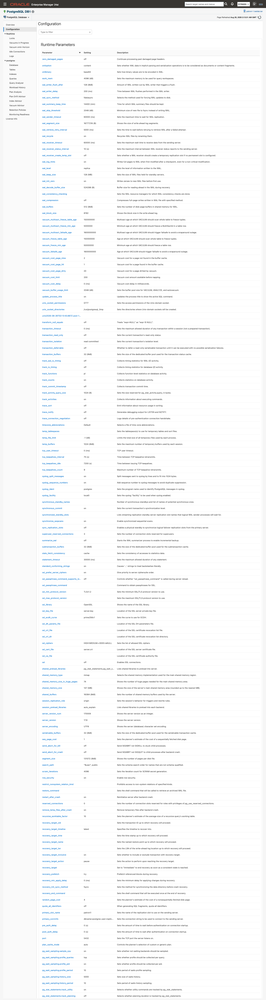

*Configuration: every `postgresql.conf` parameter with its live and boot-time state.*

**Configuration** lists every runtime parameter PostgreSQL reports, one row per parameter:

| Column | Shows |
|---|---|
| Parameter | The setting name |
| Setting | The current value |
| Description | PostgreSQL's short description |
| Unit / Value Type / Category | The unit, data type, and configuration category PostgreSQL reports |
| Source / Context | Where the value came from, and when a change takes effect |
| Boot Value | The value that applies at the next server restart |
| Reset Value | The value `pg_settings.reset_val` reports |

#### Parameter Changes {#parameter-changes}

The table above is the picture now. **Parameter Changes**, below it, is what changed and when. Every 30 minutes the plug-in compares the current values with the last ones it recorded and keeps only the differences, so a change made weeks ago is still listed with its old and new value. The first check records every parameter as the baseline, and changes show from the next check on. Changes are kept for a year by default.

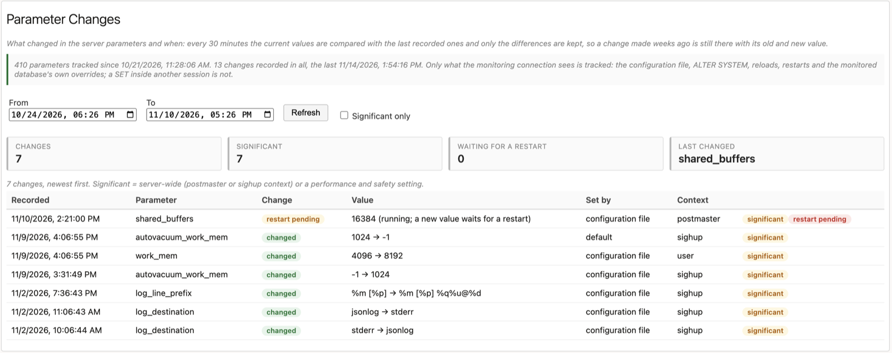

*Parameter Changes: each change with its old and new value, how it was set, and when it takes effect.*

Tiles count the **Changes** in the window, how many were **Significant** (server-wide parameters, and performance and safety settings), how many parameters are **Waiting for a restart**, and name the one **Last changed**. Check **Significant only** to hide the rest. Each row of the table is one change:

| Column | Shows |
|---|---|
| Recorded | When the plug-in first saw the change. A change is seen at the next 30-minute comparison, not at the moment it was made |
| Parameter | The setting name; hover for its category |
| Change | The kind of change: changed, added, removed, restart pending, or restart no longer needed |
| Value | The old and the new value, in the parameter's own unit |
| Set by | How the value was set; hover for the file |
| Context | When a change takes effect: `postmaster` needs a restart, `sighup` a reload, `user` and `superuser` are session or per-database overrides |

Only what the monitoring connection sees is tracked: the configuration file, `ALTER SYSTEM`, reloads, restarts, and the monitored database's own overrides. A `SET` inside another session is not.

The **Parameter Drift** metric publishes the last 24 hours of the same history (parameters changed, significant ones, parameters awaiting a restart, and the last change), so a threshold on it turns an unplanned change into an incident. Its thresholds ship undefined.

### Database

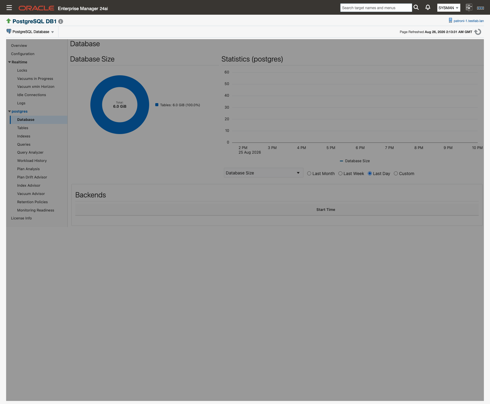

*Database: size and statistics charts for the selected database, plus its live backends.*

**Database** shows the selected database's size and a **Statistics** chart you can plot against Database Size, Transactions, Blocks Read and Hit, Block Read Time and Write Time, Row Access Counts, Deadlocks and Conflicts, or Conflict Details. A **Backends** table below lists the connections currently open to that database.

#### Buffer Cache {#buffer-cache}

**Buffer Cache** shows what is in `shared_buffers`: how much of the cache is in use and dirty over time, which databases hold it, and which relations are cached the most. It is sampled every 15 minutes and needs the `pg_buffercache` extension in the monitored database. The plug-in detects the extension and turns the collection on by itself; where it is not installed, the section stays empty and says so.

| Tile | Shows |
|---|---|
| Cache size | `shared_buffers` at the last sample |
| In use | Buffers holding a page at the last sample. Near 100% is normal once the cache is warm |
| Dirty | Buffers changed in memory and not yet written |
| Average usage count | The average usage count of the buffers in use, from 0 to 5: how recently and how often the pages were used |
| Relations cached | Distinct relations with at least one cached buffer |

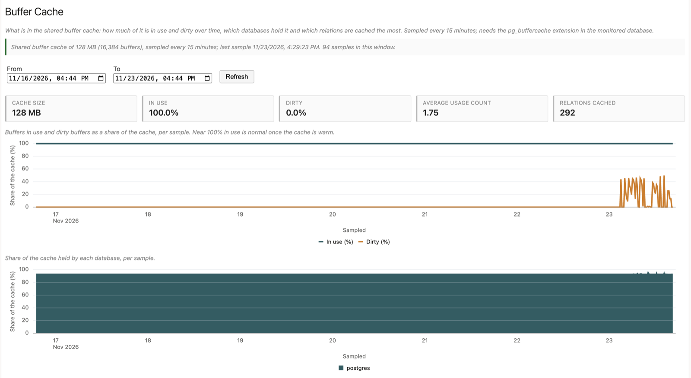

*Buffer Cache: occupancy and dirty share over the window, then each database's share.*

Two charts follow, the in-use and dirty share over the window and each database's share of the cache, and then a **Most cached relations** table with Database, Relation, Kind, Cached, Share, Dirty, and Peak (the most the relation held in the window). The table lists the 20 most-cached relations of the selected database at the last sample. The **Buffer Cache** metric carries the per-sample summary; its thresholds ship undefined.

### Tables

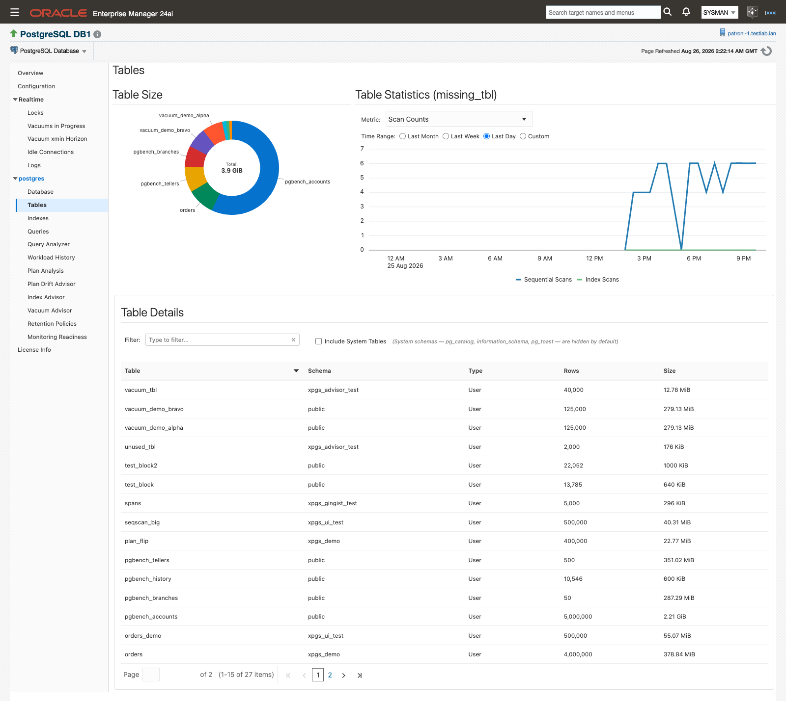

*Tables: size and statistics for every table in the selected database.*

**Tables** breaks table size down per table, with a **Table Statistics** chart selectable across Scan Counts, Rows Fetched by Scan Type, Rows Inserted/Fetched/Updated/Deleted, Live/Dead Rows, Table Maintenance, Heap Blocks, Index Blocks, Toast Blocks, and Toast Index Blocks. The **Table Details** list below shows Table, Schema, Type, Rows, and Size for every table, so you can find and drill into one quickly.

### Indexes

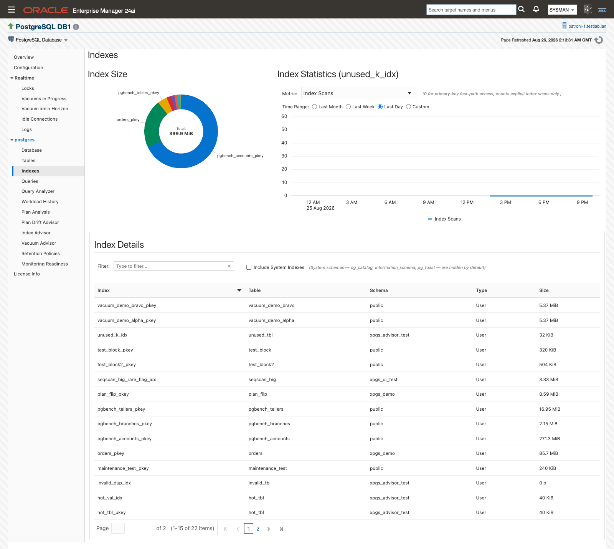

*Indexes: size and statistics for every index in the selected database.*

**Indexes** is the same idea applied to indexes: an **Index Statistics** chart (Index Scans, Index Entries Read, Table Rows Fetched, Disk Blocks) and an **Index Details** list of Index, Table, Schema, Type, and Size. Open it when you're chasing index bloat or confirming whether an index is actually being scanned before deciding to drop it.

### Queries

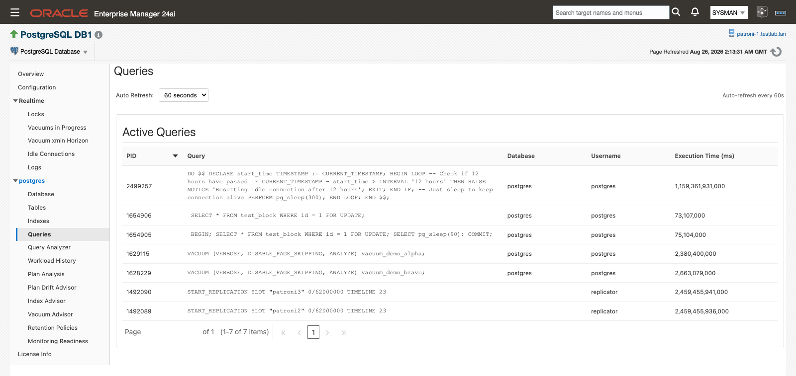

*Queries: what's executing right now, refreshed live.*

**Queries** is a live view of currently executing statements from `pg_stat_activity`, not a history — it works the same way as the Realtime pages, with an **Auto Refresh** selector (No Refresh, 15, 30, or 60 seconds). Each row shows PID, Query, Database, Username, and Execution Time (ms). For statement-level history and aggregated statistics, use Query Analyzer below.

### Query Analyzer

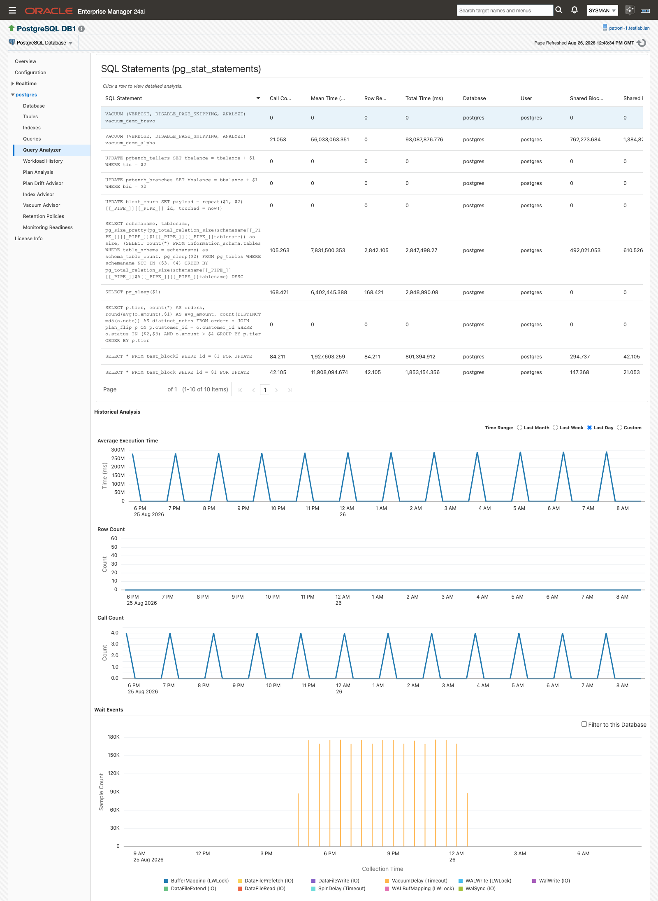

*Query Analyzer: the `pg_stat_statements` view of a database's statements, with per-statement history.*

**Query Analyzer** lists the database's statements from `pg_stat_statements`; selecting one opens its per-statement detail and historical charts, plus the **Wait Events** chart of wait-event counts sampled for that statement over time. See [Wait-event sampling](workload-history.md#wait-event-sampling) for what the extension needs and how the chart reads it.

When a selected statement has plan-drift captures, a "View this query in Plan Drift Advisor →" link appears above the detail panels and takes you straight to that query, preselected, on [Plan Drift Advisor](plan-drift-advisor.md). Testing a proposed query rewrite is no longer done on this page — it happens in the Fix Workbench on **Plan Drift Advisor**, the only place in the plug-in that executes a statement on your behalf, and only on your explicit click. (The Index Advisor's HypoPG simulation also runs an EXPLAIN, but a plan-only `EXPLAIN (FORMAT JSON)` that executes nothing.)

### License Info

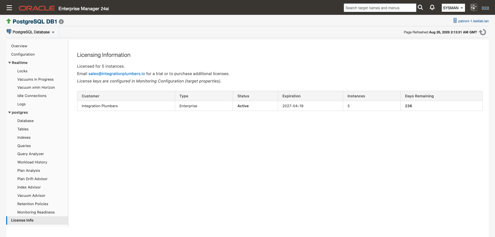

*License Info: the license record recognized for this target.*

**License Info** shows the license the plug-in recognizes for the target:

| Column | Shows |
|---|---|
| Customer | The name the license is issued to |
| Type | The license type |
| Status | Current license status |
| Expiration | Expiration date |
| Instances | Number of instances the license covers |
| Days Remaining | Days left before expiration |

With no license recognized, the table reads "No licenses configured". License keys are entered per target in the `Plugin License` target property, in Monitoring Configuration. See [Database target properties](targets-and-properties.md#database-properties). Email [sales@integrationplumbers.io](mailto:sales@integrationplumbers.io) for a trial or to purchase additional licenses.

## Realtime pages

The pages under **Realtime** query the target live, on demand, each with an **Auto Refresh** selector (No Refresh, 15, 30, or 60 seconds) that controls how often it re-queries while you have the page open. Two of the metrics behind these pages also collect on their own fixed schedule and carry alert thresholds: Vacuum xmin Horizon collects every 30 minutes with Warning and Critical bands (see [Vacuum Advisor](vacuum-advisor.md#xmin-horizon-root-cause)), and Log Stats, behind the Logs page below, collects every 5 minutes once the collection is enabled in Metric and Collection Settings.

Every live feed on a Realtime page follows the Auto Refresh setting, including the collection-throttle banner. **Locks**, **Logs**, **Idle Connections**, and **Vacuums in Progress** also have a **Database** selector at the top of the page. It starts on **All databases**; pick one to narrow the page to that database.

### Locks

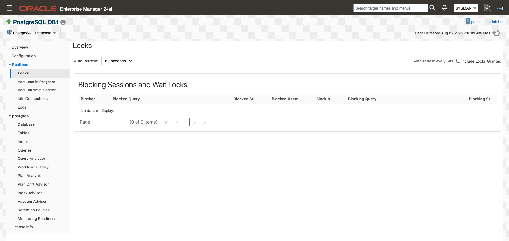

*Locks: blocking sessions and the lock waits behind them.*

**Locks** shows blocking sessions and lock waits, live at the top and as history below.

The live section, **Blocking Sessions and Wait Locks**, shows for each blocked query the session and query holding the lock it is waiting on. The table has one row per blocked/blocking pair: Blocked PID, Blocked Database, Blocked Query, Blocked State, Blocked Username, Blocking PID, Blocking Query, Blocking State, Blocking Username, and Lock Granted. By default it shows only queries that are actually blocked; check **Include Locks Granted** to also show granted locks in the same view. The **Database** selector filters this table by the waiting session's database, and filters the history sections with it.

Three history sections follow. They answer the question the live table cannot: what was blocked last night, by whom, and how often.

**Lock Wait History.** Every 10 minutes the plug-in samples the sessions waiting on a lock in every database. A session seen waiting in consecutive samples counts as one lock wait. Durations are the longest wait observed, so a wait that ends between two samples reads shorter than it was, and a wait shorter than the sampling interval may not be seen at all.

| Tile | Shows |
|---|---|
| Lock waits | Lock waits in the window |
| Longest wait | The longest wait observed |
| Waiting samples | Samples in which a session was waiting |
| Contended objects | Distinct objects the waits were on: tables, or row-level waits on another transaction |
| Blocked by idle transactions | Lock waits whose blocking session was idle inside an open transaction |

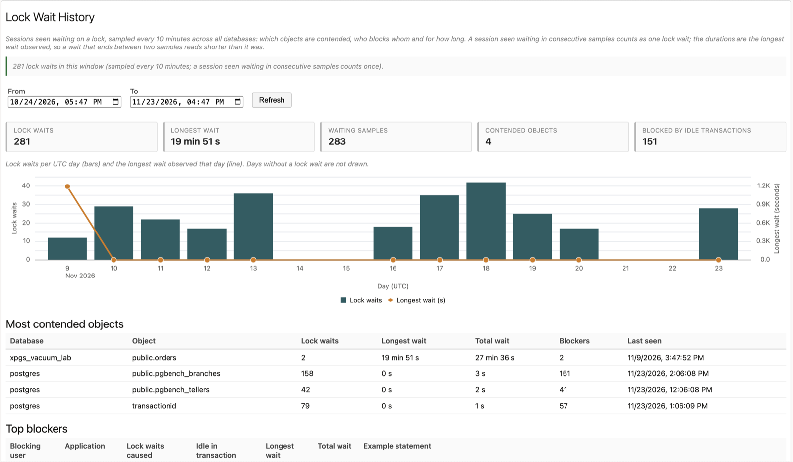

*Lock Wait History: lock waits per day, the longest wait observed, and the objects they were on.*

The chart plots lock waits per UTC day as bars and the longest wait observed that day as a line; days without a lock wait are not drawn. **Most contended objects** lists Database, Object, Lock waits, Longest wait, Total wait, Blockers, and Last seen. **Top blockers** lists Blocking user, Application, Lock waits caused, Idle in transaction, Longest wait, Total wait, and an Example statement.

**Recent Lock Waits.** One row per lock wait, newest first: Started, Database, Object, Waited, Waiting session, Blocker PID, Blocking session, Blocker state, and Blocking statement. Hover a row for both statements. The section lists the newest 200 lock waits; narrow the window for older ones.

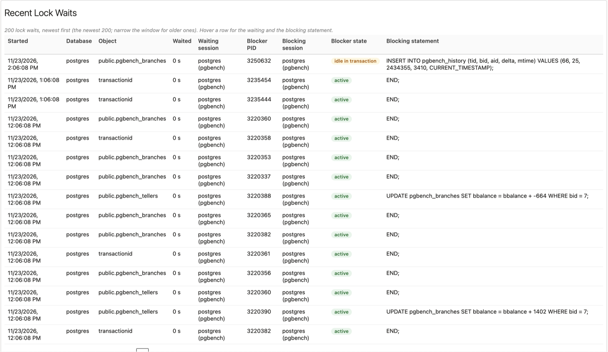

*Recent Lock Waits: the first row's blocker was idle in an open transaction.*

A blocker state of `idle in transaction` points at an application that opened a transaction and left it open, which no amount of query tuning fixes.

**Lock Waits by Query.** The queries that waited on locks according to `pg_wait_sampling`, over the same window: Query id, Database, Lock wait events, and Wait samples. The section appears only when the wait-event history holds lock samples for the window, so it needs the optional `pg_wait_sampling` extension. See [Wait-event sampling](workload-history.md#wait-event-sampling).

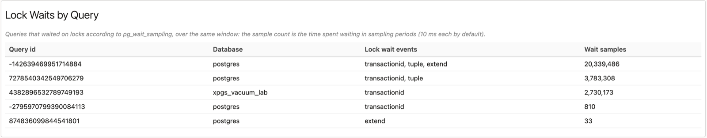

*Lock Waits by Query, below the end of the Recent Lock Waits list.*

The **Lock Contention** metric publishes each sample's summary: sessions waiting, the longest wait in progress and the object it is on, sessions blocking others, and blockers idle in a transaction. Its thresholds ship undefined; a Warning on **Longest Lock Wait in Progress (Seconds)** is the usual one to set.

### Vacuums in Progress and Vacuum xmin Horizon

**Vacuums in Progress** and **Vacuum xmin Horizon** are documented with the rest of vacuum monitoring on [Vacuum Advisor](vacuum-advisor.md), which owns both pages: [Vacuums in Progress](vacuum-advisor.md#vacuums-in-progress) shows running `VACUUM` operations phase by phase, and [Vacuum xmin Horizon](vacuum-advisor.md#xmin-horizon-root-cause) shows what's currently holding back cleanup and the command to release it.

### Idle Connections

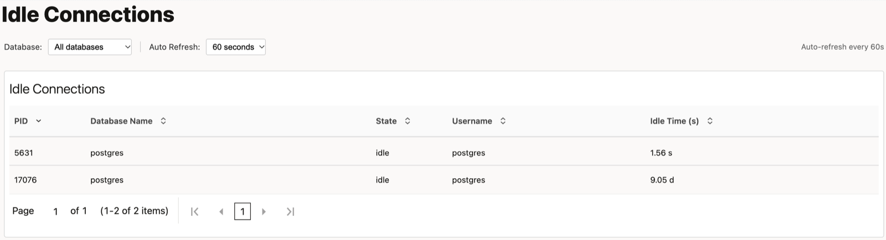

*Idle Connections: sessions sitting idle right now.*

**Idle Connections** lists currently idle PostgreSQL sessions: PID, Database Name, State (for example `idle` or `idle in transaction`), Username, and Idle Time (s). The **Database** selector narrows the list to one database. To terminate idle connections directly rather than just observe them, use the [**Kill Idle PostgreSQL Connections**](jobs-and-metric-extensions.md#kill-idle-postgresql-connections) job.

### Logs

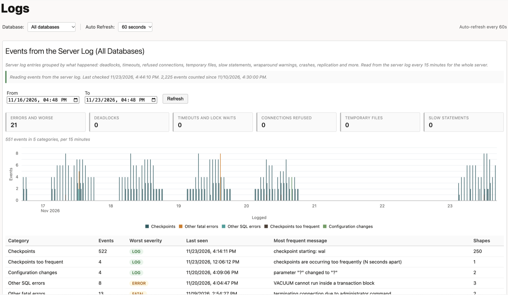

*Logs: the Database selector, then server log events counted by category.*

**Logs** has four sections. The first two read the server log over the monitoring connection and work with a local or a remote agent. The last two read a log file on the agent host.

| Section | Reads | Needs |
|---|---|---|
| **Events from the Server Log (All Databases)** | The server log, over JDBC, every 15 minutes | [The server log read grant](prerequisites.md#log-read-grant) |
| **Recent Events** | The same read | The same grant |
| **Log Statistics (All Databases, last 500 log lines)** | The file named in **Path to postgres log file** | A local agent and the path property |
| **PostgreSQL Logs (All Databases)** | The same file | A local agent and the path property |

#### Events from the Server Log {#server-log-events}

Every entry the plug-in reads from the server log is sorted into one of 26 categories and counted. The section covers the whole server. Six tiles give the window's count of **Errors and worse** (entries logged at ERROR, FATAL, or PANIC), **Deadlocks**, **Timeouts and lock waits**, **Connections refused**, **Temporary files**, and **Slow statements**. A chart plots the counts over the window, and a table lists each category with its Events, Worst severity, Last seen, Most frequent message, and Shapes. A shape is a message with its identifiers, literals, and numbers replaced, so `relation "orders" does not exist` and `relation "events" does not exist` count as one.

| Category | Category | Category |
|---|---|---|
| Deadlocks | Checkpoints | Replication |
| Lock waits logged | Checkpoints too frequent | WAL archiving failures |
| Statement, lock and idle timeouts | Temporary files | Constraint violations |
| Statements cancelled by the client | Slow statements logged | Permission denied |
| Serialization failures | Transaction ID wraparound warnings | Other SQL errors |
| Standby recovery conflicts | Out of memory or disk | Other warnings |
| Connections refused (authentication or configuration) | Server process crashes | Other fatal errors |
| Connection limit reached | Server start, stop and recovery | Panics |
| Connections and disconnections | Configuration changes | |

A category can only fill if the server writes the entries behind it. Slow statements need `log_min_duration_statement`, temporary files need `log_temp_files`, lock waits need `log_lock_waits`, and connections need `log_connections`. See [More event categories](log-enhanced-features.md#more-event-categories). The plug-in reads the `stderr` log and, on PostgreSQL 15 and later, `jsonlog`. A server that writes only `csvlog` is not read.

While the log cannot be read, the section shows a status line that names the missing grant and nothing else; nothing errors.

#### Recent Events {#recent-events}

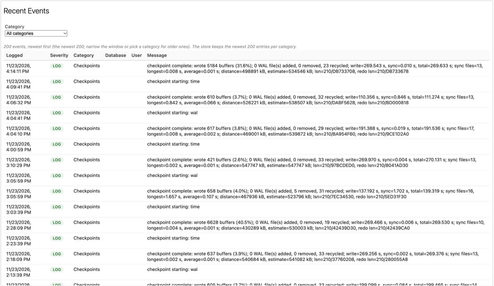

*Recent Events: the entries behind the counts, newest first.*

**Recent Events** lists the logged entries themselves, newest first: Logged, Severity, Category, Database, User, and Message. Hover a message for its DETAIL and STATEMENT lines. Pick a **Category** to see one category only. The store keeps the newest 200 entries per category; the counts in the section above are not limited that way.

The page's **Database** selector scopes this section to one database, which works when the server's `log_line_prefix` carries the database name. See [Log line prefix](log-enhanced-features.md#log-line-prefix). Entries with no database, such as connection failures, checkpoints, and server messages, show only under **All databases**. The counts and categories in the section above always cover the whole server.

The **Server Log Events** metric publishes one row per category with its count for the last 24 hours, its worst severity, when it was last seen, and its most frequent message. The condition on **Log Events in Last 24 Hours** ships undefined, so set a threshold per category in a monitoring template: for example, a Warning at 1 on the Deadlocks row.

#### Log Statistics and PostgreSQL Logs {#log-statistics}

**Log Statistics** reports Total Lines, Warnings, Errors, Fatals, and Panics over the last 500 lines of the configured log file. **PostgreSQL Logs** shows those lines parsed into Timestamp, Severity, PID, Username, Database Name, and Message. Both follow the Auto Refresh setting.

Both sections stay empty, and say why, when the target's **Path to postgres log file** property is blank. The same applies to the scheduled **Log Statistics** collection: with the collection enabled and no path set, the metric reports no data and no error, so an empty metric there means the path is not set. A path that is set but cannot be read still reports an error.

These two sections work only when the Enterprise Manager agent is **local**, installed on the same host as the PostgreSQL server. They do not support remote log collection. The two event sections above have no such limit.

#### Setup

For the event sections, follow [Enabling the log-enhanced features](log-enhanced-features.md). For **Log Statistics** and **PostgreSQL Logs**:

1. **Enable logging in PostgreSQL.** PostgreSQL doesn't log to a file by default:
   - Set `log_directory` and `log_filename`, and set `logging_collector = on` in `postgresql.conf`.
   - Reload or restart PostgreSQL.
   - Confirm the OMA (agent) user can read the log file.
2. **Configure the log file path in the plug-in.** On the target's Monitoring Configuration page (target menu ▸ Target Setup ▸ Monitoring Configuration), enter the full path in **Path to postgres log file**. See [Database target properties](targets-and-properties.md#database-properties). The path must point to a file readable by the agent on the same host; remote paths aren't supported.
3. **Enable the Log Statistics collection** if you want the counts as a scheduled metric. Setting the path does not enable it. Open the target's **Metric and Collection Settings**, find **Log Statistics**, and enable the collection; it then runs every 5 minutes. The shipped monitoring templates do not enable it either. The two page sections need only the path.

*Setting the "Path to postgres log file" target property.*

## Schema inventory metrics {#schema-inventory-metrics}

The plug-in collects four schema-inventory metrics every 30 minutes: **Trigger**, **Prepared Transactions**, **Sequences**, and **User Function**. They're descriptive inventory, not a page in the tree — find them under the target's **All Metrics** tab (target home page → All Metrics → *metric name*).

| Metric | Internal name | Shows |
|---|---|---|
| Trigger | `triggers` | Database Name, Table ID, Trigger Name, Function ID, Enabled State, and Is Internal (whether the trigger is system-generated). Table and function are identified by ID, not name |
| Prepared Transactions | `prepared_transactions` | Transaction ID, global transaction ID, prepared time, owner, and database — useful for finding stuck two-phase-commit transactions |
| Sequences | `sequences` | Database, schema, sequence name, sequence type, and blocks read/hit |
| User Function | `user_functions` | Schema, function name, call count, total time, and self time. Requires `track_functions = 'all'` in `postgresql.conf` |

Enterprise Manager's repository persists only numeric metric columns for historical trending. Because these metrics are mostly text (names, states, identifiers), there is little for it to chart. Use the live view under **All Metrics** to inspect current state.

## Cluster target

### Cluster home

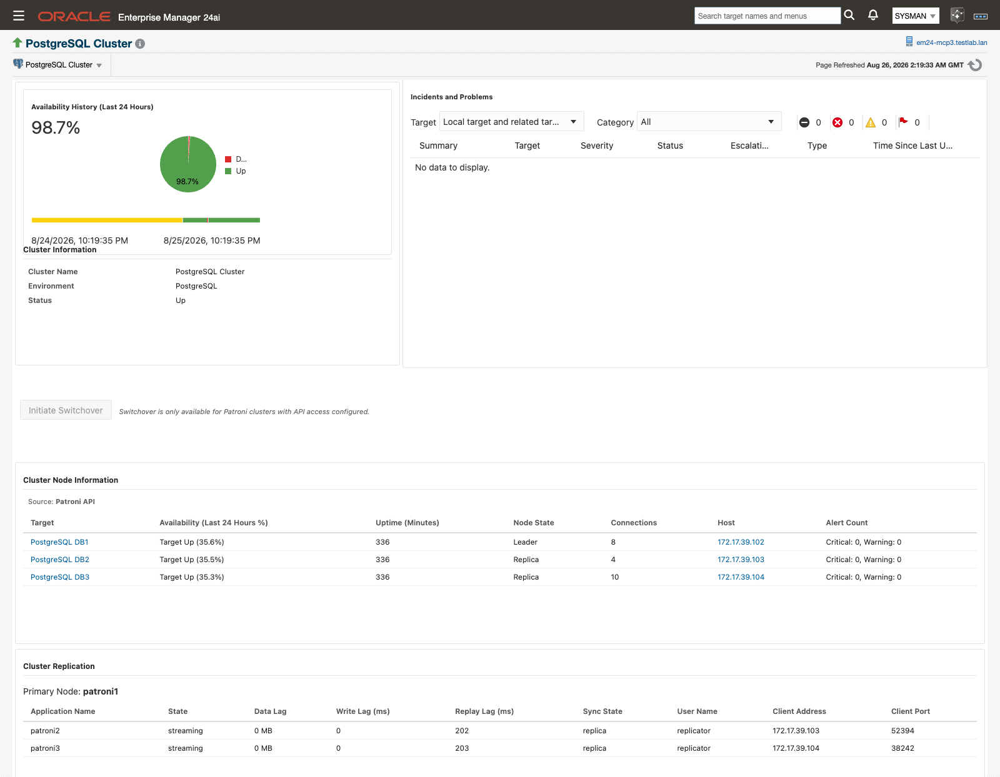

*Cluster home: cluster identity, availability and incidents, node information, and replication.*

The PostgreSQL Cluster target's home page opens on **Cluster Information** (cluster name, environment, status) next to availability and open incidents, then **Cluster Node Information**, listing each member's Target, Availability (Last 24 Hours %), Uptime (Minutes), Node State, Connections, Host, and Alert Count, and **Cluster Replication**, which names the current primary and lists each replica's application name, state, data lag, write/replay lag, sync state, and client info. Open it to check cluster-wide health or run a switchover, rather than drilling into one member's database target. Below those, **Leader Change History** lists every switchover and failover the cluster has seen; see [Leader Change History](#leader-change-history).

The empty state reads "No Patroni cluster data available." Allow up to 24 hours after a Patroni configuration change for the first collection to register; if it persists, verify `patroni_hosts` and `patroni_port` are reachable from the agent host.

### Patroni switchover {#patroni-switchover}

For clusters monitored with the Patroni API mode enabled, the cluster home page carries an **Initiate Switchover** button. For any other cluster, the button is disabled with the message "Switchover is only available for Patroni clusters with API access configured."

1. Click **Initiate Switchover**.
2. In the confirmation dialog, optionally pick a **Target Node** — leave it at "Let Patroni Choose (Recommended)" to let Patroni select the best available standby, or name one explicitly.
3. Click **Confirm Switchover**.

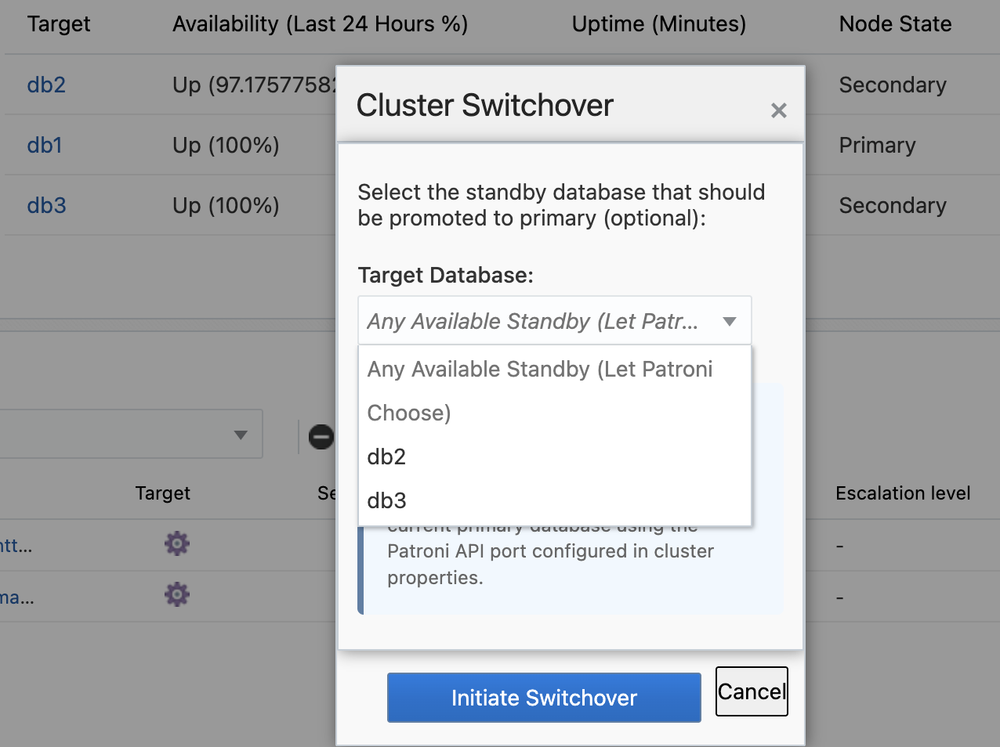

*Confirming a switchover: promotes the selected standby, demotes the current primary.*

Confirming submits an Enterprise Manager job that calls the Patroni REST API to promote the selected (or Patroni-chosen) standby and demote the current primary; the cluster is briefly unavailable during the operation. Track the job like any other from Enterprise Manager's Job Activity.

### Leader Change History {#leader-change-history}

For Patroni-managed clusters with the Patroni API mode enabled, the cluster home page lists every leader change the cluster has seen, newest first. A line above the table names the last one: the new leader, when it took over, how long ago, and the timeline. A summary gives the number of leader changes on record, in the last 7 days, and in the last 30 days.

| Column | Shows |
|---|---|
| Timeline | The timeline the change started |
| When | When the change happened |
| Age | How long ago |
| New Leader | The member that became leader |
| Reason | The reason Patroni recorded |
| LSN | The write-ahead-log position of the switch |

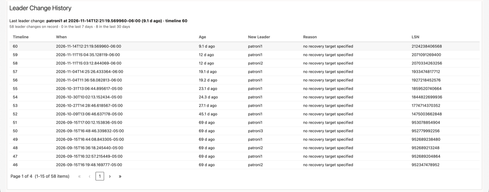

*Leader Change History: the last change, the totals, and one row per timeline.*

With the Patroni API mode off, the section reads "Leader change history requires Patroni API access (use_patroni_api_for_metrics) on this cluster target." With no changes yet, it reads "No leader changes recorded for this cluster yet."

A leader change under 24 hours old raises a Warning on the cluster target, planned switchovers included, and the warning clears as the change ages. It comes from the **Leader Change Alert (Patroni)** metric described below.

### Cluster Events (Patroni) and Leader Change Alert (Patroni) metrics {#cluster-events-patroni-metric}

For Patroni-managed clusters with the Patroni API mode enabled, the plug-in also collects the cluster's timeline-switch history as a standard metric, so "when did the cluster last change leaders?" is answerable from Enterprise Manager without a separate tool.

1. On the cluster target, open **All Metrics** and select **Cluster Events (Patroni)**.
2. Each row is one timeline switch, with columns Timeline, Event Timestamp, New Leader, Reason, LSN, Event Type, and Hours Since Leader Change.
3. Collection runs hourly; standard Enterprise Manager metric-history views show the accumulated record.

The metric exists only on targets with [Patroni REST API monitoring](targets-and-properties.md#patroni) enabled; with it off there's nothing to configure and no errors. If the Patroni REST API is unreachable, collection simply returns no rows for that cycle. How far back the history reaches depends on Patroni's own retained history (`max_timelines_history`; Patroni's default keeps everything). Event Type is currently always `timeline_switch` — Patroni's history doesn't reliably distinguish a planned switchover from an unplanned failover, so the plug-in doesn't guess. This metric carries no alert thresholds; it's a retrospective record.

Alerting is on a second metric, **Leader Change Alert (Patroni)**. It has one row per leader change of the last 7 days, with Timeline, Event Timestamp, New Leader, Reason, and Hours Since Leader Change. Enterprise Manager evaluates it in the repository every 15 minutes from the events already collected, so it adds no load on the cluster. It ships with a Warning while **Hours Since Leader Change** is 24 or less and no Critical threshold. The `ip_xpgs_cluster_production_critical` monitoring template carries the same warning; see [Monitoring templates](alerts-and-templates.md#templates).

## Related

- [Plan Drift Advisor](plan-drift-advisor.md) — Query Analyzer's drift link lands here, and the Fix Workbench is where a rewrite gets tested.
- [Vacuum Advisor](vacuum-advisor.md) — owns Vacuums in Progress and Vacuum xmin Horizon.
- [Workload History](workload-history.md) — wait-event sampling setup and the Wait Events chart, in depth.
- [Targets and properties](targets-and-properties.md) — the `Plugin License` property, Patroni REST API monitoring, and the rest of the target properties referenced on this page.
- [Jobs and metric extensions](jobs-and-metric-extensions.md) — the Kill Idle PostgreSQL Connections job and Switchover PostgreSQL Cluster job.
- [Enabling the log-enhanced features](log-enhanced-features.md) — the grant and the logging settings behind the Logs page's event sections.
- [History store and retention](history-store-and-retention.md#retention-policies) — how long each history section's data is kept.
